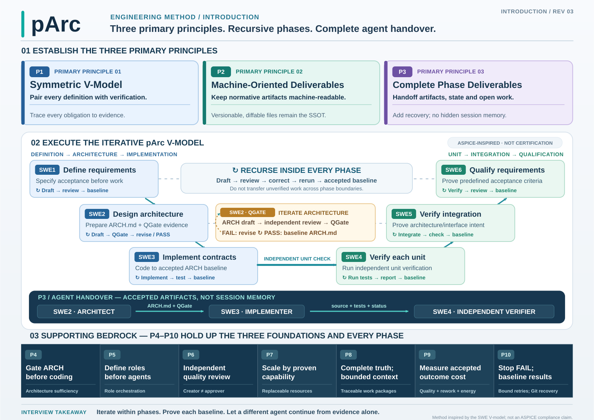

# SPARK 0.0.3 — Public Engineering Charter

**Derived from the current pArc principles.** This is the reviewed, self-contained public charter for the released SPARK source. It contains no private workflow paths, personal configuration, or unpublished development history.

## 1. One-page Charter — three governing principles

**P1 — Symmetric V-Model:** Every requirement and architecture obligation has an independently reviewable verification counterpart. An implementation is not acceptable merely because its tests run; it must satisfy the previously specified acceptance criteria.

**P2 Machine-Oriented Deliverables:** The source of truth (SSOT) is versioned, inspectable and diffable source, Markdown, schemas, tests, Mermaid and explicit evidence. A past chat or private agent memory is **not** an engineering handoff.

**P3 — Complete Phase Deliverables:** Each phase leaves a self-contained baseline and handoff that another qualified agent can resume from public artifacts without hidden context. Establish and verify a **recovery mechanism before execution**.

The three principles have equal priority; the following P4–P10 rules form the supporting foundation.

## 2. Seven supporting principles

| Rule | Contract |
|---|---|
| **P4 — Architecture before code** | An implementation agent must receive a complete and quality-gated Architecture Contract; do not fabricate unreviewed requirements. |
| **P5 — Roles before resources** | Define mission, inputs, outputs, authority, competence and independence before selecting a model/tool runtime. |
| **P6 — Independent critical review** | The author of a normative deliverable must not be its sole final approver; an independent check is required for critical outcomes. |
| **P7 — Capability-based assignment** | Select resources by proven quality, reliability, cost, latency and context fit. |
| **P8 — Complete knowledge, bounded context** | Partition work without losing access and traceability to the full architecture and requirements. |
| **P9 — Optimize accepted outcome cost** | Include coordination, rework, quality, latency, compute and energy—not just token price. |
| **P10 — Halt failures, converge baselines** | A FAIL terminates its current execution and is recorded. Corrective work is a new traceable execution, not a blind retry or weakened test. |

## 3. Symmetric SWE1–SWE6 model

| Definition and implementation | Matching verification | Handoff evidence |
|---|---|---|
| **SWE1** Requirements | **SWE6** Requirement acceptance | Requirements, explicit acceptance, test evidence |
| **SWE2** Architecture | **SWE5** Integration/architecture verification | Baseline `doc/ARCH.md`, independent QGate, decisions |
| **SWE3** Implementation | **SWE4** Unit verification | Code, unit tests, known defects, reproducible execution state |

SWE phases are **iterative within each phase**, including SWE2 draft → independent architecture review → revision → re-review. Handoffs **SWE2 → SWE3 → SWE4** transfer accepted artifacts, not conversational recall. The V-model notation does not claim Automotive SPICE certification.

## 4. SPARK module ownership

| Canonical module name | Responsibility | Manual |
|---|---|---|
| **spark_transport** | Local Model Context Protocol (MCP) file/command tools, token authorization, Secure MCP Tunnel | [spark_transport](doc/TRANSPORT.md) |
| **spark_ui** | Windows ChatGPT Chrome DevTools Protocol (CDP) theme and response observability | [spark_ui](doc/UI.md) |
| **spark_log** | User-approved Conversation Backup and offline Viewer | [spark_log](doc/LOG.md) |
| **spark_cii** | Custom Instruction Injector: renderer request interception, send gate and display mask | [spark_cii](doc/CII.md) |

Architectural authority: [ARCH](doc/ARCH.md). Verification and historical evidence: [ARCH QGate](doc/ARCH_QGate.md). Public release safety: [RELEASE](doc/RELEASE.md). Fresh-install handoff: [COLD_START](doc/COLD_START.md).

## 5. Instructions for any implementation agent

1. **Understand the release.** Read README, this charter, the relevant module manual, ARCH and QGate **before modifying source**. Do not treat past test counts as current acceptance.
2. **Protect user state.** Confirm Git branch, unstaged/staged changes, untracked user files, active processes and ownership. Preserve a verified Git recovery reference before state-changing work; never silently reset another user's changes.
3. **Stay within requested scope.** Treat unresolved non-doc defects as explicit TODO items. Do not fix unrelated runtime problems as a side effect of a documentation task.
4. **Do not claim unobserved behavior.** Local CDP Prefix readback is not evidence of server receipt; a running MCP service is not proof of Plugin tool execution. Record `NOT RUN`, `NOT OBSERVED` and `BLOCKED` exactly.
5. **Separate private data.** Never commit, print or export personal tokens, user chat transcripts, local absolute paths, private workflow documents, downloaded third-party executables or runtime logs.
6. **Verify as a newcomer.** In an ordinary clean checkout run the documented help, version and test commands, validate actual paths, links, images, and security boundaries. Attempt independent review rather than author-only self-approval.
7. **Publish safely.** The Public source is a reviewed, **single parentless root commit**, separate from Private development history. The GitHub Wiki has an independent Git repository. Remote changes require the human release authorization and proven rollback.

## 6. Installation and review entrypoint

A human or a Claude/OpenCode-style agent encountering SPARK for the first time should start with [COLD_START](doc/COLD_START.md), then follow the relevant complete module manual. Installation involving an external Workspace, Tunnel credentials, user messages or active Windows sessions requires the user's actual authorization; the source-only test suite does not simulate those approvals.

The definitive quality evidence and known gaps are maintained in [ARCH QGate](doc/ARCH_QGate.md), not in this charter.
