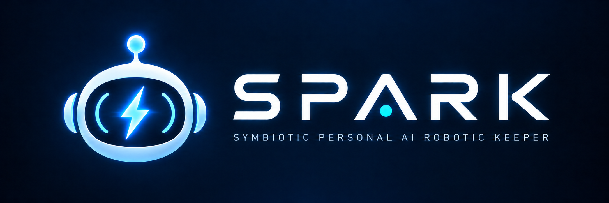

# SPARK — Symbiotic Personal AI Robotic Keeper

**SPARK**는 ChatGPT와 Windows PC의 승인된 작업 환경을 연결하는 오픈소스 프로젝트입니다. Model Context Protocol(MCP)을 통한 파일·명령 도구, Windows ChatGPT 앱의 사용자 인터페이스 개선, 대화 Backup·Viewer, Custom Instruction Injector(CII)를 네 개의 독립 모듈로 제공합니다.

**현재 Private 소스 기준선: 0.0.3.** Windows ChatGPT 앱의 Projects 목록에서 `10.` 상위·`10.00.` 하위 번호를 바탕으로 접기/펼치기와 폴더·대화 들여쓰기를 제공합니다. Pinned 대화에는 실제 프로젝트 ID가 확인될 때 `프로젝트명/대화명`을 화면에만 표시합니다. 번호 사이 공백이 있는 `99. 00.`은 하위 번호로 해석하지 않습니다. ChatGPT 서버의 프로젝트 계층이나 프로젝트 이름은 변경하지 않습니다.

## 1. 시스템 개요

~~~mermaid
flowchart LR
    subgraph ChatGPT["ChatGPT"]
        Conversation["ChatGPT 대화 / Plugin"]
        Desktop["Windows ChatGPT 앱"]
    end
    subgraph SPARK["SPARK · Windows PC"]
        MCP["spark_transport MCP 도구 · 권한 정책"]
        UI["spark_ui 테마 · 상태 관측"]
        LOG["spark_log Backup · Viewer"]
        CII["spark_cii Instruction Injection"]
        Local["승인된 파일·명령 작업"]
    end
    Tunnel["Secure MCP Tunnel"]

    Conversation <-->|"MCP"| Tunnel <-->|"암호화된 연결"| MCP
    MCP -->|"승인된 작업"| Local
    UI <-->|"CDP"| Desktop
    CII <-->|"CDP"| Desktop
    LOG <-->|"대화 데이터"| Desktop
~~~

| 모듈 | 핵심 역할 | 상세 문서 |
|---|---|---|
| **spark_transport** | Secure MCP Tunnel을 통해 승인된 로컬 파일 및 명령 도구 제공 | [설치·연결·운영](doc/TRANSPORT.md) |
| **spark_ui** | Chrome DevTools Protocol(CDP) 기반 Windows ChatGPT 화면 테마 및 모델·응답 상태 관측 | [설정·사용](doc/UI.md) |
| **spark_log** | ChatGPT 대화 Backup과 저장된 대화의 독립 Viewer | [Backup·Viewer](doc/LOG.md) |
| **spark_cii** | 송신 시 사용자 메시지에 관리형 Instruction Prefix 결합, 화면 표시 분리 | [설정·운영](doc/CII.md) |

## 2. 시작하기

SPARK는 **Windows 11**, **Git**, **Node.js 20 이상**을 기준으로 구성합니다. ChatGPT 연결에는 해당 기능을 사용할 수 있는 Workspace 권한과 Secure MCP Tunnel 설정이 필요합니다.

설치는 [spark_transport 설치 가이드](doc/TRANSPORT.md)부터 진행하십시오. 이 가이드는 새로운 Windows 환경을 기준으로 준비, 소스 설치, 개인 설정 생성, 인증, 로컬 실행, ChatGPT Plugin 연결 및 동작 확인을 순서대로 안내합니다.

| 목적 | 문서 |
|---|---|
| 처음 설치하거나 다른 PC·에이전트에게 환경 구축을 맡길 때 | [독립 설치·에이전트 인계](doc/COLD_START.md) → [spark_transport 전체 설치 매뉴얼](doc/TRANSPORT.md) |
| Windows ChatGPT 앱의 표시와 상태 관측을 설정할 때 | [spark_ui 사용 가이드](doc/UI.md) |
| 대화를 Backup하거나 Viewer로 열 때 | [spark_log 사용 가이드](doc/LOG.md) |
| Custom Instruction Prefix를 설정할 때 | [spark_cii 사용 가이드](doc/CII.md) |
| 설계·소스 구조·모듈 간 인터페이스를 검토할 때 | [아키텍처](doc/ARCH.md) |

## 3. 구조와 확장

소스는 네 모듈 아래에 분리되어 있으며 공통 실행 진입점은 **out/SPARK.ps1**입니다.

| 경로 | 용도 |
|---|---|
| [mod/spark_transport/](mod/spark_transport/) | MCP 서버, 인증, Secure MCP Tunnel 및 도구 구현 |
| [mod/spark_ui/](mod/spark_ui/) | Windows ChatGPT UI 제어·관측 |
| [mod/spark_log/](mod/spark_log/) | 대화 Backup·Viewer |
| [mod/spark_cii/](mod/spark_cii/) | CII 주입·마스킹·감사 |
| [out/SPARK.ps1](out/SPARK.ps1) | 공통 Windows 실행·상태·설정 진입점 |
| [doc/ARCH.md](doc/ARCH.md) | 모듈 계약과 세부 아키텍처 |

설계 결정, 검증 기준과 릴리스 정책은 각각 [ARCH](doc/ARCH.md), [ARCH QGate](doc/ARCH_QGate.md), [RELEASE](doc/RELEASE.md)에서 관리합니다. 최신 작업 상태나 시험 횟수는 소개 문서가 아닌 QGate에서 확인할 수 있습니다.

## 4. 문서와 기여

- [SPARK Wiki](https://github.com/SPARK-SymbioticPersonalAIRoboticKeeper/SPARK/wiki) — 개념부터 설치·운영까지 연결하는 읽기용 안내
- [GitHub Issues](https://github.com/SPARK-SymbioticPersonalAIRoboticKeeper/SPARK/issues) — 결함 제보와 개선 제안
- [GitHub Actions](https://github.com/SPARK-SymbioticPersonalAIRoboticKeeper/SPARK/actions) — Windows·Linux 소스 회귀 검사

**첫 방문이라면 [설치 가이드](doc/TRANSPORT.md)를 읽으십시오.** 이미 설치한 사용자라면 해당 모듈의 사용 가이드로 이동하시면 됩니다.
