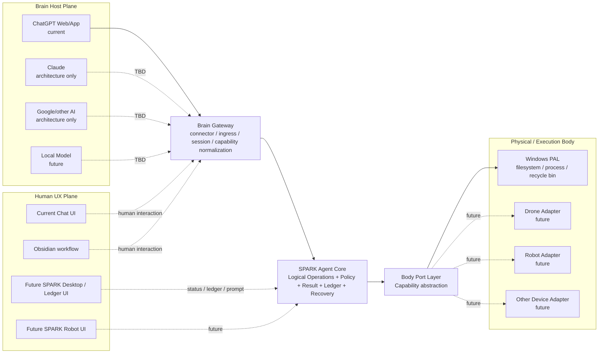
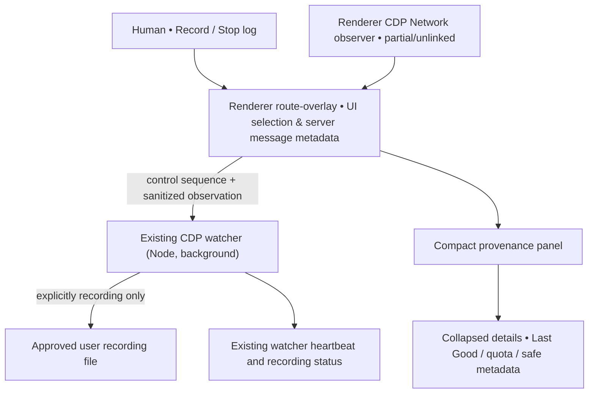
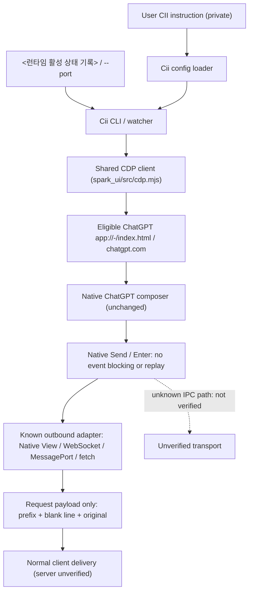
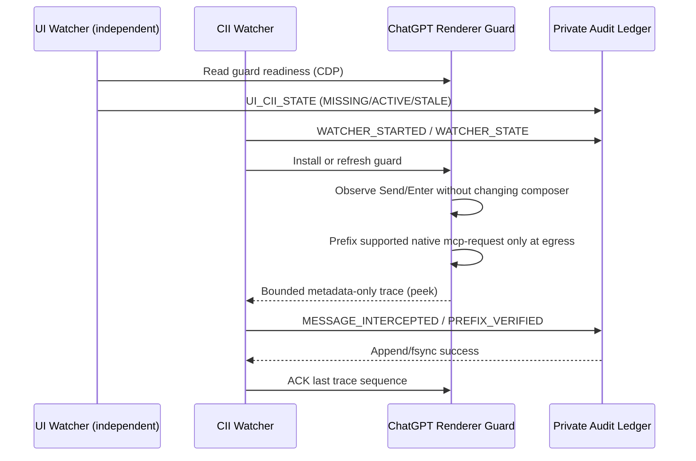
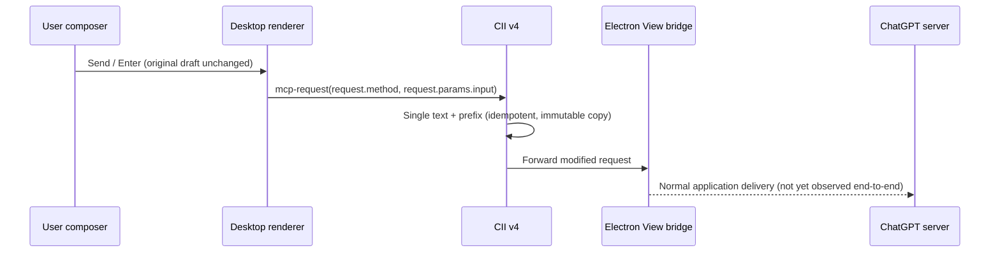
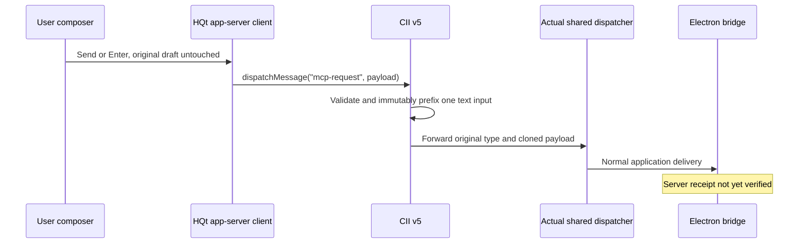
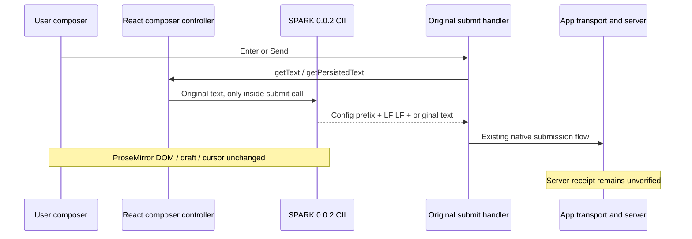
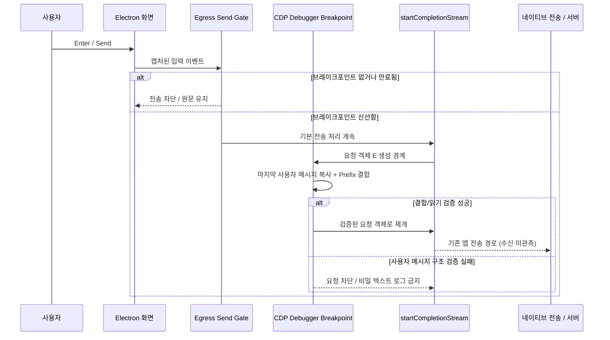
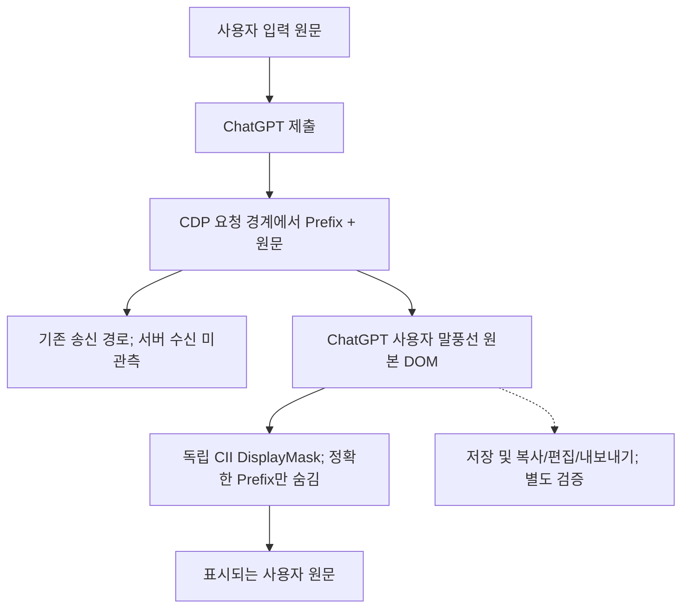
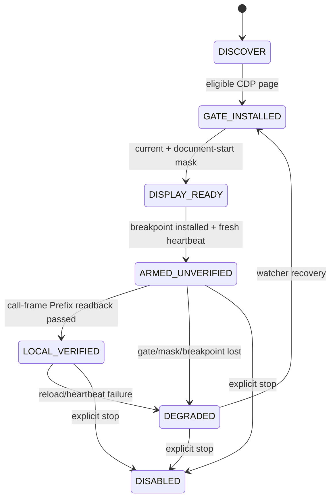

# ARCH — SPARK (Symbiotic Personal AI Robotic Keeper)

**Version:** 0.0.3
**Status:** SPARK 0.0.3 source baseline; product-level E2E acceptance and 6.5 documentation release gates are tracked independently in [ARCH QGate](ARCH_QGate.md).
**Scope:** current four-module implementation contracts with earlier design/experiment records explicitly identified as historical.

## 0. Start here — current SPARK 0.0.3 architecture

이 문서는 구현·보안·테스트 계약의 상세 자료입니다. **처음 SPARK를 설치하거나 사용하려면 이 대형 설계 문서가 아니라 아래 모듈의 실행 매뉴얼에서 시작**하십시오. 이 문서의 이전 버전 설계·실험·검증 이력은 기록 목적으로 보존하며, 현재 인터페이스는 소스와 최신 품질 게이트를 기준으로 검증합니다.

| 모듈 | 현재 운영 책임 | 최초 진입 문서 | 구현 위치 |
|---|---|---|---|
| **spark_transport** | 인증된 Model Context Protocol(MCP) 요청, 10개 파일·명령 도구, 허용 Root 권한, Secure MCP Tunnel | [설치·MCP 연결](TRANSPORT.md) | [mod/spark_transport](../mod/spark_transport/) |
| **spark_ui** | Chrome DevTools Protocol(CDP) 기반 Windows ChatGPT 앱 Theme, 모델/Effort/송신 경로의 관측 | [사용·진단](UI.md) | [mod/spark_ui](../mod/spark_ui/) |
| **spark_log** | 대화 원본 Backup과 JSONL Offline Viewer | [Backup·Viewer](LOG.md) | [mod/spark_log](../mod/spark_log/) |
| **spark_cii** | Custom Instruction Injector(CII), CDP 송신 요청 결합, 인식 가능한 Send 차단, 사용자 말풍선 시각적 마스킹 | [설정·운영](CII.md) | [mod/spark_cii](../mod/spark_cii/) |

~~~mermaid
flowchart LR
  Chat["ChatGPT 대화 / Plugin"] <-->|"MCP"| Tunnel["Secure MCP Tunnel"]
  Tunnel <-->|"인증"| Server["spark_transport"]
  Server --> Policy["허용 Root·Bearer"]
  Policy --> Work["승인된 Windows 파일·명령"]
  Desktop["Windows ChatGPT 앱"] <-->|"CDP"| Theme["spark_ui"]
  Desktop <-->|"CDP"| Injector["spark_cii"]
  Desktop <-->|"대화 원본"| Backup["spark_log"]
~~~

### 0.1. 운영·개발자가 따라야 할 읽기 순서

| 독자 / 상황 | 읽는 순서 | 완료 기준 |
|---|---|---|
| 첫 설치 사용자 또는 새 에이전트 | [README](../README.md) → [spark_transport](TRANSPORT.md) → 사용하려는 모듈 매뉴얼 | 명령의 예상 결과·실패 대응을 설명할 수 있음 |
| 개발자 | [README](../README.md) → [본 ARCH](ARCH.md) → 모듈 README → 테스트 | 시스템 경계, 실제 소스, 검증 계약 파악 |
| 릴리스 검토 | [ARCH QGate](ARCH_QGate.md) → [RELEASE](RELEASE.md) → 현재 CI | PASS, NOT VERIFIED, NOT RUN을 분리 |
| spark_cii 결합 로직 변경 검토 | 본 문서 [§29](#29-custom-instruction-injector-cii--spark-002-baseline-architecture) → [spark_cii](CII.md) | 요청 객체·CDP·표시 마스킹·실제 서버 수신의 구별 |

### 0.2. 구현과 검증의 경계

- **Local PASS는 서버 PASS가 아닙니다.** spark_transport의 로컬 MCP 건강 상태는 ChatGPT Plugin 인증·실제 도구 실행을 대신하지 않습니다. spark_cii의 CDP 호출 프레임 Prefix 읽기 검증은 Electron IPC·TLS·원격 서비스 수신 증거와 다릅니다.
- **화면과 저장된 원문은 다릅니다.** spark_ui의 Route Monitor는 관측 가능한 출처만 표시하며, spark_cii의 Display Mask는 사용자 말풍선의 시각적 표시만 숨깁니다. spark_log의 Backup은 별도 원본 보존 경로입니다.
- **데이터 소유권을 분리합니다.** 사용자 인증과 비공개 설정은 로컬 사설 저장소에 보관하며, 소스·공개 문서·GitHub Wiki에는 절대 기록하지 않습니다. 임시 Runtime 로그는 영구 대화 Backup이 아닙니다.
- **기준선과 미완료 기능을 구분합니다.** 0.0.3 소스 기준선은 존재하지만 모든 ChatGPT 호출·설치 환경·사용자 인터페이스에서의 제품 인수를 의미하지 않습니다. 미해결 메시지 Delivery Timeout은 개발 TODO에 별도 등록되어 있으며 6.5 문서 작업에서 수정하지 않습니다.
- **범위 외의 기능은 구현하지 않습니다.** 다중 사용자 배포, Computer-use, OUI+Clipboard, Telegram/Obsidian Remote Relay/Worker는 별도 요구사항입니다.

### 0.3. 상세 설계 찾아보기

| 필요한 설계 | 본문 위치 |
|---|---|
| 구성·Gateway·Agent Core | §1–§8 |
| 경로 권한·인증·원복 | §9–§13 |
| 실행·UI·Windows Tray | §23–§27 |
| 과거 spark_cii 구현·결정 이력 | §28 (역사 기록, 현행 운영 계약이 아님) |
| **현재 spark_cii 요청 경계/보안/실패 경로** | **§29** |
| 과거 벤치마크·아키텍처 참조 | §20–§22 |

### 0.3.1. 0.0.3 UI source baseline (2026-10-28)

`mod/spark_ui/src/project-collapse.mjs`는 기존 ChatGPT Projects DOM에만 작동하는 표시 기능입니다. 이름의 `N.`을 상위, `N.NN.`을 하위로 해석하고, 정확한 `99.00.`과 공백을 넣은 `99. 00.`을 구분합니다. 원본 React 프로젝트 데이터·순서·서버 동기화에는 개입하지 않으며, watcher가 렌더러 재생성 이후 표시를 다시 적용합니다. 그룹 접기 상태는 렌더러 메모리에만 유지하며 앱 재시작 시 초기화됩니다. 폴더 아이콘과 소속 대화 제목, Show more의 시작 열을 맞춥니다. 별도 테스트·실기기 관측은 [ARCH QGate](ARCH_QGate.md)의 0.0.3 항목을 따릅니다. 아래 0.0.2 변경 시도와 기록은 **역사적 증거**이며 본 0.0.3 계약을 덮어쓰지 않습니다.

### 0.3.2. Local-only reference boundary (2026-10-28)

`ref/`는 제품 소스·Public 스냅샷이 아니라 **로컬에만 남는 참고자료**입니다. Private/Public Git 모두 추적된 `ref/` 파일이 없어야 하며, 두 저장소의 `.gitignore`가 `/ref/`를 제외해야 합니다. `git rm --cached -r ref`는 이미 존재하는 로컬 파일 자체를 삭제하지 않고 Git 인덱스에서만 추적 해제합니다. 향후 Public 스냅샷 생성기는 추적된 `ref/`를 만나면 실패하고, 로컬에서 검토된 공개용 입력 자료에 대해서만 고정 SHA-256 검증 후 독립 스냅샷에 복사합니다. 일반 Git Clone에는 로컬 입력 자료가 없으므로 Public 배포에는 별도의 로컬 검토 자료 준비가 필요하며, 누락 시 안전하게 중단합니다.

이 규칙은 이후 Private/Public의 **현재 브랜치 내용**에 적용됩니다. 기존 공개 이력, 태그, Pull Request, 복제본 및 GitHub 캐시에서 과거 자료가 완전히 소거된다는 뜻은 아닙니다. 이력 재작성·GitHub 지원 요청은 별도 위험 검토가 필요합니다. 다음 §0.4 이후의 `ref/` 경로 설명은 당시의 역사 기록으로, 현재 Git 추적 허용 정책이 아닙니다.

## 0.4. Prior 0.0.2 architecture consolidation (historical context)

이하 0.0.0/0.0.1 구현 기록 및 실측값은 **역사적 증거**입니다. 0.0.2의 현재 인터페이스·경로·실행 계약은 다음 문서가 우선합니다. 모순이 있을 경우 과거 성공 기록을 현재 동작의 근거로 사용하지 않습니다.

| Section | Owner | 운영 문서 |
|---|---|---|
| 1. **spark_transport** / MCP / Secure MCP Tunnel | `mod/spark_transport` | `doc/TRANSPORT.md` |
| 2. **spark_ui** / Theme / metadata / 송신 계층 관측 | `mod/spark_ui` | `doc/UI.md` |
| 3. **spark_log** / Backup / Viewer | `mod/spark_log` | `doc/LOG.md` |
| 4. **spark_cii** / 요청 경계 Prefix 결합 | `mod/spark_cii` | `doc/CII.md` |

영속 설정은 `<사용자 설정 영역>`, 인증정보는 `<사용자 인증 영역>`에만 보관합니다. ChatLog·녹화·UI 기준선·운영 감사 이력은 소스와 분리한 Windows 사용자 데이터 폴더 `<Windows 사용자 앱 데이터 영역>`에 보관합니다. **PAL이 생성하는 독자적인 복구 스냅샷 기능은 제거했습니다.** `log/`는 언제든 지울 수 있는 임시 PID·상태·진단 로그만 허용합니다. 현재 실행 중인 Transport/Watcher가 구 경로를 이미 열어 두었을 수 있으므로, 파일 해시 이전과 실제 프로세스 재시작에 따른 쓰기 경로 전환은 별도로 검증합니다.

개발 저장소의 Git 제외 규칙은 **내부 프로세스 자료, 비공개 설정·인증정보, 비공개 참조 자료, 일시 운영 상태**를 공개 추적 대상에서 제외하도록 고정돼 있습니다. 외부 공개 문서에는 실제 제외 대상의 폴더명이나 내부 규칙 원문을 열거하지 않습니다. 공개 배포는 별도 소스 선별·비밀 탐지·독립 루트 Git snapshot으로 수행하며 개발 이력은 Private에서 보존합니다. 복구와 수정은 기존 Git ref/history 우선입니다. `AGENTS.md`는 pArc 원본 방법론 charter로 유지하고 SPARK 제품별 요구는 `<internal-process>/SWE1.md`에 기록합니다.

**0.0.3의 검증 진행과 미완료 항목은 `doc/ARCH_QGate.md`, Public 배포 계약은 `doc/RELEASE.md`가 기준입니다.**

**0.0.3 송신 본문 관측 경계:** 오른쪽 모델·Effort 패널은 사용자가 Enter/Send를 누른 시점의 **DOM 입력 원문**, React 제출 함수가 반환한 **Prefix 병합 문자열** 또는 별도로 관측한 클라이언트 API 인자, 현재 대화의 **사용자 말풍선 DOM**을 각각 별도 출처로 표시합니다. 송신 인자가 없으면 `NOT OBSERVED`이며 원문을 송신 본문으로 대체하지 않습니다. 계정 Custom Instructions는 서버·계정 계층의 독립 기능으로 현재 로컬 CDP에서 적용 여부가 확인되지 않습니다. 메시지 본문은 화면 렌더러 메모리에만 보관하며 UI watcher 반환·파일 로그·Git에는 포함하지 않습니다. 현행 사용자 매뉴얼의 책임 구분은 [spark_ui §4](UI.md)와 [spark_cii §4–5](CII.md)에 있습니다. 아래 과거 기록의 송신 표시 예시는 현행 구현 확인 없이 제품 동작으로 간주하지 않습니다. **현재 제품 버전은 0.0.3**이며, 0.0.2로 남아 있는 일부 CII 내부 implementation 식별자는 호환성 마커로 유지합니다.

### 0.5. 6.3 Windows startup reliability (historical implementation note)

Windows Explorer `.ps1` 무인수 진입점은 실행 요청만 전송하고 즉시 종료하는 숨김 launcher를 사용합니다. 기존 데몬을 불필요하게 재시작하지 않는 `start`가 기본값이고, `stop`은 Tray 제어를 유지하며, 명시적 `restart`만 전체 서비스를 종료/재실행합니다. `spark-tray-supervisor.ps1`은 Tray 단일 인스턴스를 별도 사용자 세션에서 감시하고 의도적 Exit Tray 신호는 존중합니다. AutoStart는 인증된 사용자 로그인 때만 시작하는 Windows Startup 바로가기이며, 로그인 이전의 GUI 실행을 보장하지 않습니다. 모든 주요 시작/실패/재접속은 운영 로그와 실제 CDP·Tunnel·CII 관측값으로 구분하여 판정합니다.
## 1. Purpose and Product Boundary

SPARK는 특정 AI UI나 특정 model에 종속된 coding agent가 아니라 **AI Brain과 local/physical capability 사이의 provider-neutral Agent Core**를 제공한다.

현재 first Brain Host는 ChatGPT Web/App이고 OpenAI Secure MCP Tunnel을 통해 연결한다. ChatGPT subscription message를 사용해 별도 model API 비용을 피하는 방식은 중요한 current deployment strategy이지만 Agent Core의 dependency가 아니다.

장기적으로 Brain Host는 ChatGPT, Claude, Google 계열 agent, local model 또는 다른 reasoning host로 교체될 수 있고, Body는 filesystem/process에서 drone/robot/device로 확장될 수 있다.

## 2. Stable Layer Model



Durable relationship:

```text
AI Brain
  -> Brain Gateway
  -> SPARK Agent Core + Human UX Plane
  -> Body Port
  -> Physical / Execution Adapter
```

## 3. Architecture Principles

1. **Brain independent** — ChatGPT/Claude/local model은 교체 가능한 Brain Host다.
2. **Brain Gateway boundary** — Brain별 connector, quota/session, ingress 차이는 Core 앞에서 흡수한다.
3. **Protocol independent Core** — MCP는 current transport adapter이며 Core domain model이 아니다.
4. **UX independent Core** — Chat UI, Obsidian, future SPARK Desktop/Robot UI는 execution Core 밖에 둔다.
5. **Body independent** — Windows filesystem/process는 first Body implementation일 뿐이다.
6. **Logical before physical** — Core logical operation은 PAL/device adapter가 실제 OS/device 동작으로 매핑한다.
7. **Windows-first 0.0.0** — physical target은 Windows. 다른 OS/device PAL은 TBD다.
8. **Fail closed** — hidden elevation/destructive fallback 금지.
9. **Recoverability** — overwrite/modify recovery와 Windows Recycle Bin delete.
10. **Bounded execution** — timeout, descendant cleanup, bounded stdout/stderr.
11. **User-visible ledger** — chat transcript만 operation history로 간주하지 않는다.
12. **No model API dependency** — Transport service 자체는 OpenAI/Anthropic/Google model API를 호출하지 않는다.
13. **Native security delegation** — SPARK는 filesystem/OS provider가 제공하는 native security primitive를 PAL/Body Port를 통해 재사용하며, 같은 목적의 별도 SPARK-specific security substrate를 만들지 않는다.
14. **Security transparency over false isolation** — 현 단계에서는 최소한의 native mechanism을 우선하고 container/VM 같은 heavyweight isolation을 default로 도입하지 않는다. 실용적이고 단순한 native enforcement가 없으면 자체 parser/guardrail로 안전하다고 가장하지 않고 inherited security hole과 영향 범위를 명시한 뒤 implementation을 TBD로 defer한다.

## 4. Brain Gateway

Brain Gateway는 AI Brain과 SPARK Agent Core 사이의 Anti-Corruption Layer다. Model reasoning 자체를 구현하지 않는다.

책임:

- Brain Host별 connector/ingress 차이 격리
- standard protocol adaptation
- capability/tool discovery 및 invocation boundary
- client/session identity normalization
- approval/confirmation metadata 전달 가능성
- optional quota/cost/status observation
- Brain Host 교체 시 Core contract 보호

Current implementation/deployment:

```text
ChatGPT Web/App
  -> OpenAI Secure MCP Tunnel
  -> MCP 2026-07-28 Adapter
  -> SPARK Agent Core
```

Architecture-only future Claude path:

```text
Claude / Claude Desktop
  -> Claude Custom Remote MCP
  -> MCP Adapter
  -> same SPARK Agent Core
```

Claude runtime code/test는 0.0.0에 포함하지 않는다. SPARK는 provider subscription credential을 탈취하거나 unsupported login/OAuth reuse 또는 quota bypass를 시도하지 않는다.

## 5. Human UX Plane

UX는 execution security boundary가 아니다. Future SPARK UI는 flat chat transcript 대신 다음을 독립적으로 표시할 수 있다.

```text
Conversation      | Task / Plan
Operation Ledger  | Artifacts
Workspace         | Status / Approval
```

현재 Obsidian은 optional workflow다. 향후 SPARK Desktop이나 SPARK Robot UI가 대체해도 Core contract는 유지한다.

## 6. Agent Core Logical Services

### 6.1. FileService

- `list_directory`
- `read_file`
- `create_file`
- `write_file`
- `modify_file`
- `create_directory`
- `copy_path`
- `move_path`
- `delete_path`

### 6.2. ProcessService

0.0.0에서는 `run_command`만 구현한다. 이는 simple native CLI/process execution이다.

Future process lifecycle:

```text
start_process
process_status
process_output
stop_process
```

GUI screen/mouse/keyboard/video 제어는 다음 Sprint 이후 별도 ComputerService 대상이다.

### 6.3. StatusService

- health
- lifecycle status
- concise runtime health projection
- operation-ledger lookup remains a separate audit path
- future long-output/report handles

## 7. Policy / Result / Ledger / Recovery

Transport와 Body implementation에 독립적인 공통 semantics:

- allowed-root authorization
- path canonicalization
- traversal/symlink/junction escape defense
- mutation recovery
- normalized result
- operation ledger
- secret/private-state separation
- future approval policy

## 8. Body Port Layer

Current logical ports:

```text
PlatformFilePort
PlatformTrashPort
PlatformProcessPort
PlatformPermissionPort
PlatformInfoPort
```

Future physical ports:

```text
PlatformComputerPort
DronePort
RobotPort
SensorPort
ActuatorPort
```

따라서 동일한 Agent Core가 filesystem/process뿐 아니라 향후 physical actuation까지 확장될 수 있다.

## 9. Authorization and Path Safety

`cwd`는 process의 시작 위치일 뿐 security boundary가 아니다.

```text
workingDirectory != authorizationRoot
```

Filesystem authorization policy는 다음을 적용한다.

- `..` traversal reject
- single-root 구성에서는 absolute/drive-qualified/UNC tool path reject
- multi-root 구성에서는 absolute path를 허용하되 configured root 내부만 허용
- 상대경로가 둘 이상의 Root에 실제로 존재하면 `AMBIGUOUS_ROOT_PATH`로 fail closed하고 absolute path로 명시하도록 요구
- symlink / NTFS junction escape reject
- non-existing target parent-chain escape reject
- Root별 `R` / `W` / `X` capability 적용

Root permission semantics:

```text
R = list/read/copy source
W = create/write/modify/copy destination/move/delete
X = run_command cwd authorization
```

문자열 Root config는 backward compatibility를 위해 `RWX`로 해석한다.

## 10. Security Architecture

### 10.1. Native Provider Security Delegation

SPARK는 filesystem/process security를 독자적인 second security stack으로 다시 구현하지 않는다. PAL/Body Port의 목적 중 하나는 각 filesystem/OS provider가 제공하는 native security primitive를 재사용하고 provider-specific 차이를 Core 밖에 격리하는 것이다.

- FileService의 path validation/canonicalization은 logical authorization과 fail-closed input validation을 담당한다.
- ProcessService의 실제 filesystem/network/process confinement이 필요하면 해당 OS/provider의 native enforcement를 PAL이 사용한다.
- SPARK-specific command parser, regex blocklist, argument inspection, path 문자열 필터는 OS-level confinement의 대체물이 아니다.
- provider native mechanism 자체에 defect 또는 bypass가 있으면 SPARK가 별도 parallel sandbox를 덧씌워 보완한다고 가정하지 않는다. 이는 inherited provider risk로 기록하고 upstream/provider fix 또는 provider replacement로 해결한다.
- 한 OS에서 사용한 mechanism을 다른 OS에 억지로 복제하지 않는다. PAL은 Windows, Linux, macOS 및 향후 device/filesystem provider별 native mechanism을 선택할 수 있다.

이 원칙은 `codex-chatgpt-web`처럼 outer execution provider가 이미 제공하는 sandbox authority를 재사용하는 구조와 동일한 방향이다. SPARK Core는 security policy의 의미를 정의할 수 있지만 physical enforcement mechanism은 provider/PAL이 소유한다.

### 10.2. Simplicity / No Heavyweight Isolation by Default

현 단계에서는 security를 이유로 container, VM 또는 별도 full runtime environment를 SPARK의 기본 dependency로 도입하지 않는다. 목표는 이미 설치된 OS/filesystem provider가 제공하는 최소 native primitive로 요구 boundary를 표현하는 것이다.

```text
SPARK policy intent
  -> PAL / provider adapter
  -> native OS/filesystem security mechanism
```

실용적이고 단순한 native enforcement로 요구 boundary를 만들 수 없으면 다음 순서를 따른다.

1. capability를 실제보다 강하게 표현하지 않는다.
2. application-level parser/guardrail을 security boundary라고 부르지 않는다.
3. 해당 security hole과 영향 범위를 Architecture/Security 문서에 명확히 기록한다.
4. practical native enforcement가 단순하지 않거나 운영 부작용이 큰 경우 구현을 억지로 추가하지 않고 `TBD`로 defer한다.
5. heavyweight isolation은 별도 architecture decision과 명시적 scope가 있을 때만 검토한다.

### 10.3. Current 0.0.0 Command Execution Trust Statement

0.0.0 `run_command`는 **trusted local, non-elevated capability**다.

- explicit executable + argv
- `shell:false` by default
- cwd must resolve inside allowed root
- timeout
- descendant process-tree cleanup
- independently bounded stdout/stderr
- exit code/signal/duration
- automatic UAC/RunAs 금지
- **cwd confinement은 OS filesystem sandbox가 아니다**

현재 구현은 `cwd`의 `X` 권한만 확인한 뒤 child process를 현재 Windows user token으로 실행한다. 따라서 `run_command`로 시작된 `git`, PowerShell, `cmd`, Node.js, Python 또는 다른 executable은 Windows account가 접근 가능한 경로를 직접 접근할 수 있으며, `allowedRoot` 밖의 filesystem을 OS 차원에서 차단하지 않는다. 이는 **0.0.0의 명시적 known security gap**이다.

따라서 현재 `R/W/X`에서 `X`는 "해당 root를 command working directory로 사용할 수 있음"을 의미하며, "child process가 해당 root 밖을 읽거나 쓸 수 없음"을 의미하지 않는다. FileService의 allowed-root confinement와 ProcessService의 host process authority를 동일한 boundary로 간주해서는 안 된다.

현재 영향 범위는 명시적으로 다음과 같다.

- executable 자체는 allowed root 내부에 있을 필요가 없다. `PATH` 또는 absolute executable path로 현재 OS user가 실행 가능한 program을 시작할 수 있다.
- command argv, script/config file, stdin, environment, registry, network response 또는 실행 중 계산된 path는 FileService path policy의 중재 대상이 아니다.
- allowed root 중 하나에 `X`가 있으면 그 root에서 시작한 arbitrary child process는 현재 OS user가 허용받은 범위에서 `R`-only root 또는 아예 configured allowed root가 아닌 경로를 직접 read/write/delete할 수 있다.
- `delete_path`의 Recycle Bin-only 규칙도 FileService semantics이며 arbitrary child process의 `del`, `Remove-Item`, library/API call 같은 삭제에는 적용되지 않는다.
- 따라서 현재 `R/W` capability는 FileService에 대해 강제되지만 ProcessService의 child filesystem authority를 제한하지 않는다.

이 gap은 command-line path 문자열 검사로 해결할 수 없다. 외부 target은 allowed-root 내부의 list/config/script file, environment variable, stdin 또는 child process 내부 로직에서 간접적으로 결정될 수 있기 때문이다. ProcessService filesystem/network confinement은 **TBD**이며, practical provider-native mechanism이 선택되고 실제 outside-root denial regression을 통과하기 전까지 implemented security boundary로 주장하지 않는다.

0.0.0 Windows timeout cleanup은 verified `taskkill /T /F` tree termination을 사용한다. CatDesk에서 확인한 Windows Job Object는 stronger process ownership backend지만 filesystem confinement을 제공하지 않는다. Windows command filesystem boundary를 강화할 때는 별도 SPARK parser가 아니라 Windows가 제공하는 native token/ACL/provider mechanism을 PAL에서 재사용하는 방향을 우선한다.

### 10.4. Cross-Platform Process-Confinement Disposition — TBD

`cwd`만 검사한 뒤 ambient user authority로 child process를 실행하면 같은 종류의 gap은 Windows에만 한정되지 않는다. Linux와 macOS도 별도 OS-level confinement 없이 current user로 `spawn/exec`하면 child가 그 user가 접근 가능한 filesystem을 직접 접근할 수 있다.

| Provider | Native/lightweight candidate | SPARK 0.0.0 disposition |
|---|---|---|
| Windows | restricted token / sandbox SID or account / NTFS ACL-ACE / Job Object / WFP 등 | filesystem/network confinement **TBD**; 현재 미구현 gap 명시 |
| Linux | Landlock 같은 kernel-native filesystem restriction과 필요한 syscall/network primitive; 또는 provider가 이미 제공하는 native sandbox | **TBD**. 단순 native mechanism 우선 조사; container/bwrap를 SPARK default dependency로 정하지 않음 |
| macOS | Seatbelt profile 기반 OS sandbox 등 provider-native mechanism | **TBD**. native provider mechanism 재사용 가능성을 우선 검토 |

Linux/macOS에 native primitive가 존재한다는 사실은 현재 SPARK가 안전하다는 의미가 아니다. PAL이 해당 mechanism을 실제 적용하고 `R`-only/unconfigured path의 write/delete denial을 process-tree 전체에서 검증하기 전까지 ProcessService confinement은 미구현이다.

선정 기준은 동일하다: SPARK-specific second security engine을 만들지 않고, 단순하고 운영 가능한 provider-native enforcement가 있으면 PAL에서 재사용한다. 그런 방식이 충분히 단순하지 않으면 현 gap을 문서화한 상태로 **TBD**에 유지한다.

### 10.5. Cygwin Research — POSIX/ACL Helper, Not a Sandbox

Cygwin은 Windows 위에서 POSIX-style path, shell, GNU file utilities와 ACL tools를 제공하므로 Windows PAL의 helper/provider 후보로 연구 가치가 있다. 특히 NTFS mount에서 Cygwin은 filesystem ACL을 사용해 POSIX permission을 구현하고 `chmod`, `getfacl`, `setfacl` 같은 interface를 Windows ACL에 매핑한다. 따라서 Windows-specific SID/ACE handling을 SPARK Core에 직접 흩뿌리는 대신, 일부 File/Permission PAL operation을 POSIX-like façade로 단순화할 가능성이 있다.

그러나 Cygwin 자체는 ProcessService confinement boundary가 아니다.

- Cygwin process는 여전히 Windows security token과 NTFS ACL의 적용을 받는다.
- `/cygdrive/<drive>`와 mount table을 통해 Windows filesystem을 접근하며, Cygwin은 POSIX path와 Win32-style path를 모두 지원한다.
- Cygwin shell에서 `powershell.exe`, `cmd.exe`, `python.exe` 같은 native Windows executable을 호출할 수 있으므로 Cygwin mount view만으로 outside-root access를 차단했다고 주장할 수 없다.
- 따라서 `Cygwin bash = Linux sandbox`로 취급하지 않는다.

SPARK의 현재 disposition은 다음과 같다.

```text
Cygwin as File/Permission PAL helper        = research candidate
Cygwin as process/filesystem security wall = rejected
ProcessService confinement                  = TBD
```

Cygwin을 실제 dependency로 채택하기 전에는 설치 footprint, update lifecycle, ACL translation edge cases, native-Windows-tool escape semantics, removal/rollback cost를 별도 평가한다. enforcement authority는 Cygwin 자체가 아니라 최종적으로 Windows kernel / access token / NTFS ACL 같은 provider-native mechanism에 있어야 한다.

### 10.6. Native Security State Lifecycle

Provider native mechanism이 persistent OS state를 필요로 하는 경우 그 state도 PAL/provider lifecycle의 일부로 취급한다.

- per-command마다 hidden local account를 생성/삭제하지 않는다.
- persistent sandbox account/SID, ACL/ACE, WFP rule, profile 또는 credential state가 필요한 provider를 채택하면 install/status/uninstall ownership과 rollback을 명시한다.
- session-scoped ACE/temp/process state는 provider가 정상 종료 시 정리하고 crash-recovery 가능한 방식으로 소유해야 한다.
- SPARK는 provider state를 모방하는 별도 shadow security database를 만들지 않는다.

예를 들어 Anthropic Sandbox Runtime의 Windows provider는 dedicated `srt-sandbox` account를 installation-scoped state로 유지하고, session ACE는 reset/process-exit 및 다음 initialize의 crash-recovery에서 정리하며, uninstall은 WFP filters, sandbox account, credential file, setup marker를 제거하는 lifecycle을 제공한다. SPARK가 유사한 provider를 채택할 경우에도 같은 종류의 deterministic lifecycle을 요구한다.

### 10.7. 0.0.1 Multi-user Deployment — Shared Workspace App, Per-instance Tunnel/Auth

Verified ChatGPT Business flow (2026-09-16):

```text
Workspace admin/developer
  -> create SPARK App
  -> Connection = Tunnel
  -> Authentication = Access token / API key
  -> Header scheme = Bearer
  -> Publish to Workspace

Each user
  -> ChatGPT Plugins -> SPARK -> Connect
  -> "Enter access token or API key"
  -> enter that local instance's spk_... key
  -> ChatGPT sends Authorization: Bearer <spk_...>
  -> Secure MCP Tunnel forwards Authorization
  -> local SPARK validates SHA-256(token)
```

The access key is **not entered in the App creation form**. It is entered by each user on the published Plugin's **Connect** screen. This live flow was followed by successful discovery of `Actions · 10` and the 10-tool SPARK surface in a new chat.

- user/device/SPARK instance마다 distinct `tunnel_id`를 사용한다. 동일 tunnel을 서로 다른 local SPARK instance가 공유하지 않는다.
- MCP app display name은 authorization identity가 아니다. 이름이 같거나 workspace에 app이 노출되어 있어도 다른 사용자의 local SPARK authority를 얻어서는 안 된다.
- 각 local SPARK instance는 `<MCP 인증 파일>`의 **instance-specific credential**을 검증한다. raw `Access_token`은 config에 저장하지 않으며, server는 시작 시 메모리에서 SHA-256 digest를 계산해 `Authorization: Bearer <token>`을 timing-safe 비교한다. `Access_token`이 없으면 `auth=missing`으로 fail closed하고 `out/SPARK.ps1 start`도 실패한다. `auth=none` fallback은 0.0.1에서 제거한다. `<Tunnel 인증 파일>`는 Secure MCP Tunnel 자체의 OpenAI 연결용이며 `Access_token` 검증을 대신하지 않는다.
- 0.0.1 인증은 중앙 OAuth/auth server 없이 **per-instance static bearer/access token(API key)** 을 사용한다. Credential은 instance마다 달라야 하고, local SPARK는 raw token이 아니라 SHA-256 digest만 저장하며, manual rotate/revoke를 지원한다. `no scheduled expiry`는 허용하지만 분실/노출 시 폐기할 수 없는 credential로 설계하지 않는다. Token은 외부 service나 human password가 아니라 Node.js built-in `crypto.randomBytes(32)`처럼 OS CSPRNG를 사용하는 256-bit random source에서 생성한다.
- 사용자 입력 password는 기본 인증 방식으로 사용하지 않는다. 사람이 정한 password보다 installer가 생성한 high-entropy random token을 사용해 brute-force/재사용 위험을 줄인다.
- OAuth/OIDC는 0.0.1 범위에서 구현하지 않는다. 팀/계정 lifecycle, self-service onboarding 또는 중앙 revocation 같은 요구가 실제로 생길 때 후속 버전에서 재검토한다.
- local SPARK는 **자기 instance에 허용된 credential만** 승인한다. Workspace membership 또는 app visibility만으로 authorization하지 않는다.
- 중앙 SPARK relay/router를 0.0.1 data plane에 두지 않는다. Filesystem data, command output, media/binary payload가 SPARK-operated cloud relay를 통과하지 않아야 한다.
- 동일 PC의 다른 hostile local process가 loopback SPARK endpoint를 호출하거나 local credential을 탈취하는 문제는 별도 host-local threat model이며 **TBD**다. 0.0.1 multi-user isolation 범위에서는 remote/workspace user 간 cross-access 차단을 우선한다.

```text
1 local SPARK instance
= 1 tunnel_id
+ 1 Tunnel Runtime/control-plane key
+ 1 SPARK Access Key (spk_...)
```

- A tunnel ID is routing metadata, not sufficient authorization. Workspace members may be able to see/select other tunnels.
- `<Tunnel 인증 파일>` authenticates the local tunnel-client to OpenAI; `<MCP 인증 파일>` authorizes MCP requests at the local SPARK boundary.
- Config-level `transport.auth` is not supported. The distributed 0.0.1 server requires Bearer authentication derived from `<MCP 인증 파일>`; missing/invalid token fails closed and there is no `auth=none` runtime path.
- Raw `Access_token` is stored only in `<MCP 인증 파일>`; config stores no token, digest, or secret path. SHA-256 is derived in memory for timing-safe comparison.
- Runtime tunnel identity binds tunnel ID/profile/process state while MCP authorization remains independently enforced by `Access_token` at the SPARK server boundary.
- Missing/wrong `Authorization: Bearer ...` returns HTTP 401; matching `Access_token` is required for tool access.
- SPARK 0.0.1 deployment uses a distinct ChatGPT custom MCP App per user/device/SPARK instance because each instance binds to its own Tunnel ID. The App is created from Workspace settings → Apps → Create (or by an authorized admin/developer for that user), then that user enters the matching per-instance `Access_token` at Plugins/Apps → SPARK → Connect.
- OAuth/OIDC and a central payload relay remain deferred for the small-team 0.0.1 scope.
- same-PC hostile-process isolation remains TBD.

### 10.8. File Content and Binary Transfer Semantics

Current `read_file` is intentionally a **UTF-8 text operation**, not a generic byte-transfer operation. It enforces the configured read-size limit and performs fatal UTF-8 decoding. A file that cannot be decoded as UTF-8 is rejected as unsupported encoding.

SPARK does not define "text versus binary" by filename extension or by a heuristic scan. Filesystems store bytes; some arbitrary binary byte sequences may also happen to be valid UTF-8. Therefore the operation semantics are explicit:

```text
read_file/get_text  -> caller requests UTF-8 text semantics
get_file/get_blob   -> future explicit byte/file-transfer semantics
```

Consequences:

- JSON containing numbers that represent byte values is still text if the JSON file itself is valid UTF-8; it is not reclassified as binary because its content describes bytes.
- A nominally binary file whose raw bytes happen to form valid UTF-8 may be returned by a text operation. MIME type/extension are advisory metadata, not a proof of binary-ness.
- A future arbitrary-file download feature must be a separate tool/resource contract rather than weakening `read_file` into silent base64 fallback.
- MCP supports image/audio content and binary `BlobResourceContents` encoded as base64, plus `resource_link` references. Base64 adds material transfer overhead, so large binary transfer requires explicit size limits and should prefer a client-supported resource/download path when available.
- Under the current ChatGPT Secure MCP Tunnel architecture, bytes returned from a local SPARK MCP tool still traverse the OpenAI tunnel path. SPARK therefore must not assume that a local file download is zero-cost or direct merely because the source file is local.

0.0.1 does not add unrestricted binary transfer merely to make every local file downloadable. A future file-transfer capability requires an explicit size/streaming/download design and acceptance test on the actual Brain Host client.

### 10.9. Timeout, Watchdog, Reconciliation and Progress Semantics

A long-running command may legitimately occupy one logical user task/assistant turn for hours or days. `run_command` therefore has **no default absolute runtime deadline**. An explicit positive `timeoutMs` is used only when the caller has a real terminal deadline. The runner still bounds exit-output drain and Windows `taskkill /T /F` cleanup so cancellation or an explicit deadline expiry cannot wait indefinitely.

A final operation watchdog still wraps ordinary MCP operations. The default non-command operation watchdog is 30 seconds. `run_command` is different: without an explicit `timeoutMs` the logical command has no absolute runtime watchdog. Instead, the process is managed independently of any single MCP request and each request waits only for a bounded continuation segment. With an explicit deadline, that deadline applies to the logical process lifetime, not to each continuation segment. HTTP request receive time and server shutdown remain independently bounded, as do Recycle Bin helper execution, bootstrap downloads, validation HTTP calls, test cases and CI jobs.

Explicit deadline expiry, explicit user cancellation, or process failure does **not** mean rollback. A command such as `git clone`, compiler/package install, file copy or arbitrary script can have partial side effects before it stops. A transport/request disconnect is different: it detaches only the current continuation request and does not terminate the managed process.

```text
request segment disconnect / retry
  -> keep the same managed process alive
  -> reuse the returned backward-compatible continuation command + opaque token
  -> do not start a duplicate command

terminal failure / explicit user cancel / explicit-deadline expiry
  -> stop the SPARK-owned process tree as soon as practical
  -> record explicit terminal result
  -> stateUncertain=true when mutation may already have occurred
  -> never blind-retry
  -> inspect/reconcile filesystem, process and/or Git state
  -> retry a new process at most once only after reconciliation says it is safe
```

If a mutating FileService operation exceeds the generic operation watchdog while its underlying promise has not settled, SPARK records it as a **pending uncertain mutation** and fail-closes subsequent mutations with `UNCERTAIN_MUTATION_IN_FLIGHT`. Read-only inspection remains available for reconciliation. The pending guard clears only when the underlying operation actually settles; if it never settles, operator recovery/restart is required rather than overlapping another mutation.

For the 3.5 long-running execution contract, SPARK does **not** expose background-process management to the user and does **not** change the published `run_command` input schema. The external schema remains `command / args / cwd / timeoutMs` with `command` required. A long command is managed internally; after a short initial grace, SPARK returns `working + continuation{command,args}` where the reserved control command fits the existing schema and `args[0]` carries an opaque managed-command token. The Agent MUST immediately call `run_command` again using that returned continuation, without asking the user for `status?` or `continue`.

Each continuation request waits for a bounded request segment deliberately shorter than the empirically observed ~120-second ChatGPT↔MCP cancellation boundary. The segment budget is not a task runtime limit. The same process may run for hours or days across many continuation requests. A request/stream disconnect detaches only the waiter; retrying the returned continuation reattaches to the same managed process. Explicit user cancel is represented by a reserved backward-compatible control command, and explicit deadline expiry or process exit produces a terminal process state.

MCP `2026-07-28` Streamable HTTP still provides request-scoped SSE heartbeat/progress inside each bounded continuation request, but logical command lifetime no longer depends on one response stream surviving. Native schema-level `resumeId` / `cancel` fields are intentionally **not** part of the 0.0.1 external contract; they are deferred until a future App schema migration path is explicitly accepted and verified.

Operational UX rule for AI-driven SPARK work: multi-stage work SHOULD still emit visible `Step n/m` milestones. During a long `run_command`, SPARK emits a real heartbeat every configured interval (default 10 seconds). Each report includes measured elapsed time, process liveness, stdout/stderr observed bytes, whether output advanced since the previous report, how long no observable output change has lasted, and either `deadline=none` or the explicit deadline/remaining time. Lack of output change is a warning (`NO_OBSERVABLE_OUTPUT_CHANGE`), not a failure condition while the process remains alive. If the request carries `_meta.progressToken`, the SSE stream emits standard `notifications/progress`; when no token is supplied, SSE comment keep-alives preserve transport liveness. A percentage or total is emitted only when actually known.

0.0.1 adds an **experimental local progress/usage projection** in `mod/spark_ui`. The watcher polls the loopback Transport health endpoint, but the visible overlay is limited to one compact usage/fallback tile in the unused ChatGPT sidebar header gap so it does not cover the conversation surface. `SPARK` watchdog state and Brain working/elapsed heuristics remain available to watcher diagnostics, but their former dedicated on-screen progress panel is not rendered after the 2026-09-30 ChatGPT Desktop layout change.

For provider usage, the 0.0.1 Windows integration was verified against ChatGPT Desktop's already-loaded authenticated client and its background `rate-limit-status` source. That source performs authenticated `GET /wham/usage` polling and exposes primary/secondary windows (`used_percent`, `limit_window_seconds`, `reset_at`). SPARK does not scrape the visible Usage popup: when the compatible internal client is discoverable, the watcher reads the same provider data without opening the popup, calculates remaining percentage as `100 - used_percent`, and displays the five-hour and weekly windows with reset time/date. The live acceptance observation was `5H 100%` and `WK 76%`, matching the provider Usage popup shown separately by the user. Provider usage is cached for 30 seconds and refreshed fail-soft; if the internal client/API contract is unavailable after a ChatGPT update, the UI falls back to non-authoritative local/model/chat telemetry rather than fabricating quota values.

The visible usage projection is collision-aware and consists of a single compact two-row tile. It is anchored immediately after the current-mode control and before the nearest visible native control in the same sidebar header row; if at least 38 CSS pixels are not available, the tile hides rather than covering a native control. The former BRAIN/SPARK top panel and Workspace-area bottom panel are removed. This overlay is UX telemetry only, not an execution or authorization boundary, and it can be disabled with `chatgptUi.progress.enabled=false`.

## 11. Recoverable Delete

Core semantics:

```text
delete_path = recoverable delete request
```

Windows mapping:

```text
delete_path
  -> PlatformTrashPort.delete()
  -> Windows Recycle Bin
```

Recycle Bin operation 실패 시 permanent delete fallback은 금지한다.

## 12. Normalized Result Contract

모든 external tool call은 다음 공통 envelope를 사용한다.

```json
{
  "ok": false,
  "operationId": "op-...",
  "operation": "delete_path",
  "summary": "Deletion was not performed.",
  "changed": false,
  "data": {},
  "durationMs": 12,
  "requiresElevation": true,
  "retryable": false,
  "error": {
    "code": "PERMISSION_DENIED",
    "message": "The operating system denied the operation."
  }
}
```

MCP response는 textual `content`와 `structuredContent`를 함께 제공한다.

## 13. Operation Ledger and Private State

각 operation은 append-only JSONL ledger에 기록한다.

```text
operationId
Timestamp
operation
target
status
changed
durationMs
errorCode
summary
```

`out/SPARK.ps1 status`는 operator가 즉시 판독할 수 있도록 Transport/Tunnel/ChatGPT/ChatGPT UI health를 간결한 projection으로 표시한다. Operation history는 append-only JSONL ledger에 별도로 유지하며 정상 lifecycle console에 전체 ledger/JSON payload를 dump하지 않는다.

현재 운영에서 `transport.stateDir`와 진단 로그는 삭제 가능한 `<임시 운영 진단 영역>`에 두며, SPARK 시작 시 승인된 이 임시 디렉터리만 안전하게 재생성합니다. 개인 설정과 인증정보는 소스·공개 문서와 분리된 비공개 환경에서 관리합니다. 사용자 대화 원본, UI 기록 및 작업 감사 이력 등 재사용 데이터는 Windows 사용자 데이터 저장소에 보관하며, `<사용자 비공개 영역>`이나 `log/`에는 저장하지 않습니다.

**현재 0.0.2 정책:** PAL의 자동 `.spark-snapshot` 생성, 별도 recovery 디렉터리 및 인증정보의 자동 복구본 생성은 제거했습니다. Git으로 관리되는 소스 복원에는 Git ref/commit을 사용합니다. Git 미관리 파일은 Git으로 복원할 수 없으므로 변경 전에 별도의 승인된 복구 계획이 필요합니다. 0.0.1 시기의 `<과거 임시 복구 영역>`·`<과거 임시 작업 기록>` 기반 저장 및 과거 아카이브 ZIP은 역사 기록이며, 사용자가 현재 구조로 승인했다는 의미가 아닙니다.

Transport 설정은 **`<사용자 설정 파일>`만 정식 사용자별 기본 경로**로 사용한다. 탐색 순서는 명시적 `configPath` → 실제 존재하는 `SPARK_CONFIG` → `<사용자 설정 파일>`이다. 소스 모듈의 `mod/spark_transport/config/spark.local.json`은 자동 설정 탐색에서 제외하며, Git 제외 규칙은 잘못 배치된 비공개 설정의 공개 유출을 막는 방어 규칙일 뿐이다. tracked template은 `mod/spark_transport/config/spark.example.json`만 유지한다. `tunnel_client/*`는 인증정보가 아니라 외부 실행 바이너리/관련 라이선스이므로 모듈 tool 디렉터리에 유지하고 Git에는 배포하지 않는다.

Secure MCP Tunnel의 process reuse는 liveness와 runtime identity를 분리해 판단한다. `/readyz`가 `ready`라는 사실만으로 기존 process를 재사용하지 않으며, config `tunnel.id`, `<Tunnel 프로필 저장 영역>`의 영속 YAML `tunnel_id`, SPARK-owned PID, `<임시 Tunnel 식별 정보>`의 임시 실행 식별 정보 및 profile SHA-256이 일치하고 Control Plane poll까지 성공해야 동일 runtime으로 인정한다. 기존 실행 중인 프로세스의 임시 기록이 이전 `<구버전 Tunnel 진단 상태>` 경로를 가리키는 경우, 그 경로가 정확히 이전 정식 위치이고 현재 `<사용자 비공개 영역>` 프로필의 SHA-256 및 Tunnel ID가 기존 실행 기록과 일치할 때에만 현재 프로세스의 호환 상태로 인식한다. 실제 사용 중인 사용자 프로필을 유일한 정식 설정으로 유지하며, 자동 프로필 복구본·백업 디렉터리·강제 덮어쓰기를 생성하지 않는다. 설정 ID 또는 인증 참조가 맞지 않거나 doctor가 실패하면 fail-closed 처리하고 기존 프로필을 변경하지 않는다. 로그를 통째로 제거해 PID/실행 식별 정보가 사라진 경우에는 미검증 기존 프로세스를 자동 재사용하지 않는다.

Local-only state boundary는 clone마다 달라질 수 있는 `.git/info/exclude`나 user-global ignore가 아니라 저장소의 `.gitignore`와 공개 스냅샷 검증으로 정의한다. Git 제외 규칙은 고정된 내부 관리 계약을 따르며, **외부 공개 문서에는 비공개 폴더명·제외 규칙 원문을 표기하지 않는다.** 다운로드한 tunnel-client 바이너리 등은 별도 공개 스냅샷 파일 선별 과정에서 제외하며, `.gitignore`에 임의 규칙을 추가하지 않는다. `<비공개 참조 문서 영역>`는 GitHub Wiki remote를 가진 별도 Git repository이며 SPARK main repository의 tracked tree에 포함하지 않는다.

Root `out/spark/script/`는 SPARK 전체 lifecycle orchestration(`start-all/status-all/stop-all`)만 소유한다. tunnel bootstrap과 Windows Transport validation처럼 Transport에만 속하는 script는 `mod/spark_transport/script/`가 소유한다.

**Focus-preserving maintenance:** `out/spark/script/start-all.ps1 -SkipChatGPTUi` performs a backend-only Tunnel/Transport health handover and never launches or restarts the ChatGPT window. The watcher and tray can be individually replaced without restarting ChatGPT; a full `SPARK.vbs` restart is a separate UI-disruptive operation and requires explicit prior permission when a user session is active. This maintenance transition was checked with live Transport healthy/Bearer, Tunnel identity and Control Plane poll, and UI watcher healthy without a ChatGPT app restart. These measurements are distinct from any independent peer review or complete GUI E2E.

## 14. Brain Host Cost / Quota Rule

이 문서의 **Brain Host / Cost / Quota Comparison** chapter가 research source다.

- Consumer/subscription Chat + official connector/MCP는 valid Brain deployment mode다.
- Coding-product allowance, API/PAYG, local model은 별도 cost modes다.
- quota 숫자는 provider policy이므로 Agent Core에 hard-code하지 않는다.
- historical allowance를 current guarantee로 취급하지 않는다.

## 15. Source Architecture References

이 문서의 **Architecture Reference Study** chapter를 참조한다.

- **CatDesk** — process ownership, timeout/cancel cleanup, bounded output, Windows Job Object concept, logical tools 우선.
- **Local Coding Agent** — working directory vs authorization separation, capability concept, missing-target canonicalization, private authority state. AGPL source 직접 복사 금지 unless license strategy accepts it.
- **ChatGPT Local Coder** — structured result/activity stream/process lifecycle decomposition. Open full-machine security model은 채택하지 않음.
- **OpenAI Codex** — Windows native sandbox의 restricted token, sandbox principal/account, root ACL/ACE, process ownership 구조 reference.
- **Anthropic Sandbox Runtime** — provider-native filesystem/network isolation과 install/session/uninstall lifecycle reference. Windows support 상태와 operational cost는 별도 검토 대상.
- **codex-chatgpt-web** — bridge가 자체 parallel permission sandbox를 발명하지 않고 outer Codex execution/sandbox authority를 재사용하는 delegation pattern reference.
- **Jan** — future provider-neutral/local-model client and UI reference.

## 16. Implemented Scope

### 16.1. Inherited 0.0.0 baseline

- 10 MCP tools: read/list/CRUD/delete/run_command
- recovery backup + SHA-256
- Windows Recycle Bin delete
- timeout + verified descendant cleanup
- bounded output
- normalized result
- JSONL operation ledger
- private default state directory
- lifecycle/status
- Windows + Linux CI

### 16.2. 0.0.1 multi-user / deployment baseline additions

- per-instance `Authorization: Bearer` validation using `<MCP 인증 파일>`; tracked/private config stores no auth key, digest, or secret path
- `SPARK auth generate` using Node.js `crypto.randomBytes(32)` / OS CSPRNG for a 256-bit `spk_...` access token
- `SPARK init` first-use provisioning that refuses to overwrite an existing private config or existing `<MCP 인증 파일>`
- fail-closed startup/server behavior when `Access_token` is absent or invalid; the distributed 0.0.1 source has no `auth=none` runtime path
- distinct per-user/device Secure MCP Tunnel + per-instance `Access_token` deployment model with no SPARK-operated central payload relay
- bounded command/tool/request/lifecycle watchdogs plus `stateUncertain` reconciliation semantics after timed-out mutations
- experimental ChatGPT UI progress/usage strip: Brain working/elapsed heuristic, exact SPARK watchdog progress, popup-free provider usage telemetry from the authenticated ChatGPT Desktop `GET /wham/usage` source when compatible, and fail-soft fallback when that provider contract is unavailable
- collision-aware sidebar placement that keeps Search/activity and Update visible while using otherwise unused sidebar header/footer space
- PowerShell web-request progress rendering suppressed during tunnel readiness polling to avoid the blinking `Reading web response` console UI while preserving the polling/watchdog behavior
- `out/SPARK.ps1 restart` no longer depends on a self-recursive batch `call`/`:restart` label path; restart directly executes bounded stop then start lifecycle out/spark/script
- ChatGPT UI runtime JSON reader tolerates the Windows PowerShell UTF-8 BOM used by existing runtime files

Architecture-only / deferred:

- Claude/Google/local-model Brain adapter
- GUI Computer Use
- Drone/Robot/device adapters
- elevated helper
- native Windows Job Object backend
- ProcessService filesystem/network confinement — TBD per OS/provider; current `X` remains cwd authorization only
- alternate SPARK Desktop/Robot UI

## 17. ADR Summary

| ADR | Decision |
|---|---|
| ADR-001 | MCP `2026-07-28` standard-only |
| ADR-002 | Brain Host와 Agent Core 분리 |
| ADR-003 | Brain Gateway가 provider/connector 차이를 흡수 |
| ADR-004 | UX는 Core와 분리된 Human UX Plane |
| ADR-005 | Agent Core와 Physical Body를 Body Port/PAL로 분리 |
| ADR-006 | 0.0.0 physical target = Windows |
| ADR-007 | FileService와 ProcessService 분리 |
| ADR-008 | GUI/Computer Use는 후속 Sprint |
| ADR-009 | working directory와 authorization root 분리 |
| ADR-010 | normalized result + operation ledger |
| ADR-011 | Windows delete = Recycle Bin; no permanent fallback |
| ADR-012 | automatic UAC/elevation 금지 |
| ADR-013 | command = timeout + verified tree cleanup + bounded output |
| ADR-014 | private state default는 workspace 밖 |
| ADR-015 | quota/cost는 Brain deployment policy이며 Core constant가 아님 |
| ADR-016 | Claude/other Brain implementation은 target E2E 가능 시점까지 deferred |
| ADR-017 | future physical capability = Computer/Drone/Robot/Sensor/Actuator ports |
| ADR-018 | Secure MCP Tunnel reuse requires config/profile/PID/hash identity + successful Control Plane poll; ready-only reuse 금지 |
| ADR-019 | local-only source boundary는 tracked `.gitignore`로 재현 가능해야 하며 clone-local/global ignore에 의존하지 않음 |
| ADR-020 | lifecycle console은 concise stage/status projection만 출력하고 detailed diagnostics/audit는 local runtime state에 보존 |
| ADR-021 | Security enforcement는 PAL/provider가 제공하는 native OS/filesystem mechanism을 재사용하며, 동일 목적의 parallel SPARK-specific sandbox를 만들지 않음 |
| ADR-022 | Container/VM 같은 heavyweight isolation은 default dependency로 도입하지 않으며, practical native enforcement가 없으면 capability를 과장하지 않고 security gap을 명시 |
| ADR-023 | Current `run_command`의 `X`는 cwd authorization만 의미한다. child process의 filesystem/network confinement은 provider-native PAL 구현이 검증될 때까지 TBD이며, `R`-only 및 unconfigured paths는 ProcessService boundary로 보호된다고 주장하지 않음 |
| ADR-024 | Cygwin은 Windows File/Permission PAL을 단순화할 수 있는 POSIX/ACL helper 후보로만 연구하며, ProcessService sandbox 또는 filesystem security boundary로 취급하지 않음 |
| ADR-025 | 0.0.1 intermediate multi-user deployment는 user/device/SPARK instance별 distinct Secure MCP Tunnel + local instance authorization을 사용하고 중앙 SPARK payload relay를 두지 않음 |
| ADR-026 | 약 5명 규모의 0.0.1에서는 per-instance high-entropy bearer/access token을 최소 인증 방식으로 채택한다. Local SPARK는 raw token 대신 SHA-256 digest를 저장하고 `Authorization: Bearer`를 fail-closed 검증한다. OAuth/OIDC는 account lifecycle이 필요할 때 선택적으로 사용 |
| ADR-027 | text/binary 구분은 heuristic이 아니라 operation contract로 정의한다. `read_file`은 strict UTF-8 text이며 arbitrary binary/file download는 별도 bounded MCP resource/blob/download capability로 설계 |
| ADR-028 | 0.0.1 multi-user 인증은 중앙 OAuth/relay 없이 per-instance high-entropy static bearer/API key를 사용하고, OAuth/OIDC와 same-PC hostile-process isolation은 후속 scope로 defer |
| ADR-029 | 일반 MCP operation은 bounded watchdog을 갖고, 장시간 `run_command` logical process는 기본 absolute runtime deadline을 두지 않는다. `timeoutMs`가 명시된 경우에만 logical process terminal deadline으로 사용한다. Published App 호환성을 위해 external `run_command` schema는 기존 `command/args/cwd/timeoutMs`를 유지하고, 장기 command는 내부 managed process + backward-compatible reserved continuation command/opaque token으로 이어간다. Initial grace 이후 각 MCP request는 observed ~120초 host cutoff보다 짧은 bounded continuation segment만 기다리며, Segment 안에서는 10초 heartbeat/SSE progress를 제공한다. Stream disconnect는 request detach이며 process를 죽이지 않는다. Native schema-level `resumeId/cancel`은 TBD다. Terminal failure 뒤 새 process retry는 reconciliation 후 최대 1회다. |

| ADR-030 | 0.0.1 per-instance `Access_token` SHALL be generated from 32 CSPRNG bytes (`crypto.randomBytes(32)` / OS entropy), encoded with the `spk_` prefix, and stored only in `<MCP 인증 파일>`. Config SHALL contain no key, digest, or secret path. SPARK MAY derive the SHA-256 digest in memory for comparison. Human-chosen passwords are not the 0.0.1 default. |
| ADR-031 | **Authentication trust boundary / known gap:** OpenAI Secure MCP Tunnel forwards the ChatGPT `Authorization` header but does not validate the SPARK-specific `Access_token` on SPARK's behalf. The local SPARK MCP server is the enforcement point. Therefore an attacker who can modify/replace the SPARK server code or execution environment can remove that check and make that compromised instance accept unauthenticated requests. SPARK 0.0.1 fail-closes in the distributed source (no `auth=none` runtime path), but this is not tamper-resistant code attestation. This does not by itself bypass another user's intact SPARK instance; compromising that instance/code/runtime remains necessary. |
| ADR-031 | Experimental ChatGPT UI progress SHALL distinguish measured SPARK watchdog progress from heuristic Brain-working indication. Provider usage may be shown only from a trustworthy provider value; the verified 0.0.1 ChatGPT Desktop integration reuses the authenticated background `/wham/usage` source without opening the Usage popup and fails soft to local/model/chat telemetry if that internal contract is unavailable. SPARK SHALL NOT fabricate reasoning percentages, token counts, credit consumption, or quota values. |

## 18. Verification Status

0.0.0 baseline acceptance는 다음 검증을 포함한다.

- Node regression 전체 PASS.
- ChatGPT UI theme/config validation PASS.
- source PowerShell parser PASS.
- Windows Transport CRUD/exec/traversal/Recycle Bin validation PASS.
- live Secure MCP Tunnel identity `verified`, Control Plane poll `ok`, ChatGPT `SPARK` app의 10-tool discovery와 MCP smoke PASS.
- tracked-source privacy/secret/hygiene 검사 PASS — 비공개 프로세스 자료·개인 설정·인증정보는 Public Snapshot에서 제외합니다. 구체적 로컬 저장 경로나 내부 폴더명은 공개 아키텍처에서 기술하지 않습니다.
- GitHub Actions Node 24 matrix의 Ubuntu/Windows jobs PASS.

Public baseline은 위 gate를 통과한 **single root commit**을 `v0.0.0`으로 tag한다. Independent Architecture Peer review는 별도 process gate이며 이 문서의 author self-check와 동일시하지 않는다.

### 18.2. 0.0.1 baseline gate

0.0.1 baseline publication is valid only when the following remain true:

- package/runtime/launcher version agree on `0.0.1`.
- per-instance bearer authorization positive/negative regression passes.
- `SPARK auth generate` and `SPARK init` use 256-bit OS-CSPRNG material; `Access_token` is stored only in `<MCP 인증 파일>`, while config stores no key, digest, or secret path.
- new-install/startup behavior is fail closed when `Access_token` is absent or invalid.
- watchdog/reconciliation regressions pass. Ordinary SPARK-owned waits remain bounded, while long-running `run_command` intentionally has no default absolute runtime deadline; it is supervised by request-scoped heartbeat/progress, cancellation cleanup, explicit-deadline semantics when `timeoutMs` is provided, and reconciliation-before-retry.
- ChatGPT UI theme validation passes and the experimental progress/usage overlay renders on the real ChatGPT Windows DOM without covering required Search/Update controls.
- popup-free provider usage telemetry, when available, matches the provider Usage popup for the same session and is sourced from the authenticated ChatGPT Desktop `/wham/usage` background data rather than fabricated estimates. If that internal contract is unavailable, quota display must fail soft rather than invent values.
- tracked-source hygiene excludes the external private process repository, `<사용자 비공개 영역>`, nested `<비공개 참조 문서 영역>`, private config, and secrets.
- Windows + Linux CI pass on the exact baseline candidate commit.
- live ChatGPT custom-app connection using `Access_token` + Bearer succeeds with its own value, while a missing or different value returns HTTP 401.
- Independent Architecture Peer remains a separately documented deferred process gate and is not represented as completed by the author self-check.

## 19. External References

Project process/verification records are maintained in the private independent `<내부 프로세스 저장소>/` repository (`SWE1.md`, `SWE2.md`, `SWE3.md`, `PIM3.md`). `doc/` intentionally contains only stable architecture and architecture-quality-gate material.

- MCP 2026-07-28: https://blog.modelcontextprotocol.io/posts/2026-07-28/
- CatDesk: https://github.com/Xeift/CatDesk
- Local Coding Agent: https://github.com/LongNgn204/local-coding-agent
- ChatGPT Local Coder: https://github.com/posavr/chatgpt-local-coder
- OpenAI Codex: https://github.com/openai/codex
- Anthropic Sandbox Runtime: https://github.com/anthropics/sandbox-runtime
- codex-chatgpt-web: https://github.com/miuuyy/codex-chatgpt-web
- Cygwin User's Guide / filesystem and ACL behavior: https://cygwin.com/cygwin-ug-net/using.html
- Cygwin `setfacl`: https://cygwin.com/cygwin-ug-net/setfacl.html
- OpenAI ChatGPT Developer Mode / MCP Apps: https://help.openai.com/en/articles/12584461-developer-mode-and-mcp-apps-in-chatgpt
- OpenAI Secure MCP Tunnel client: https://github.com/openai/tunnel-client
- MCP tool/resource binary content: https://modelcontextprotocol.io/specification/2025-11-25/server/tools
- Claude Desktop local MCP / Desktop Extensions: https://support.claude.com/en/articles/10949351-getting-started-with-local-mcp-servers-on-claude-desktop
- Jan: https://github.com/janhq/jan

## Baseline Handoff

`0.0.0`은 inherited verified **private-use baseline**이다. 현재 제품 baseline은 `0.0.1`이며, 그 위에 per-instance Bearer authorization, 256-bit `Access_token` provisioning, multi-user/deployment hardening, sidebar progress/usage telemetry, long-running command heartbeat/cancellation semantics, hidden launcher와 minimal tray control을 포함한다. 기존 annotated `v0.0.1` tag는 2026-09 release baseline commit을 가리키는 immutable release marker로 유지한다. 2026-10 maintenance commits는 같은 제품 baseline `0.0.1`의 안정화 변경으로 기록하되 tag를 임의로 이동하지 않는다. 새 public release/tag는 별도 release gate에서 결정한다.

## 20. Architecture Reference Study

**Date:** 2026-09-12
**Purpose:** SPARK Sprint-2 architecture 재정립을 위한 source-level comparison
**Scope:** CatDesk, Local Coding Agent, ChatGPT Local Coder, Jan

## 1. Executive Conclusion

세 coding-agent 프로젝트는 SPARK가 다시 구현할 필요가 없는 문제를 이미 상당 부분 다루고 있다. 그러나 어느 하나도 SPARK의 target architecture를 그대로 제공하지는 않는다.

가장 유용한 조합은 다음과 같다.

```text
CatDesk
  -> process lifecycle / timeout / Windows Job Object / bounded output

Local Coding Agent
  -> permission resolver / root capability / private authority state / local dashboard

ChatGPT Local Coder
  -> structured tool result / activity stream / MCP session + admin UX

Jan
  -> future client/UI / MCP host / provider-neutral and local-model architecture
```

SPARK는 이 요소를 **Client/Transport/Core/Policy/PAL**로 분리하여 조합한다.

## 2. Reproducible Source Snapshots

| Project | Reviewed main commit | License |
|---|---|---|
| CatDesk | `41900ba851334713061053f345740c1ddcaf5283` | MIT |
| Local Coding Agent | `95144e610ddcc3bb5a879117803907c008b1a88e` | AGPL-3.0-or-later |
| ChatGPT Local Coder | `81a53c9c553fde3b1c3fa5b484d23c6d1d3f38b4` | MIT |
| Jan | `6ccd6f4ad227cf5f0f6bfbb118729dfb4f3a8d32` | Apache-2.0 |

## 3. Comparison Matrix

| Concern | CatDesk | Local Coding Agent | ChatGPT Local Coder | SPARK decision |
|---|---|---|---|---|
| Model API required by local Transport service | No | No | No | No |
| ChatGPT Web/remote MCP orientation | Yes | Yes | Yes | Current client path |
| Filesystem root policy | Canonical workspace root | Strong multi-root resolver | Current code is open/full disk | LCA concept + SPARK implementation |
| Missing-target canonicalization | Partial/general canonical path logic | Longest-existing-ancestor canonicalization | No security boundary | Adopt LCA concept |
| Command process tree | Strong | Managed processes | Managed processes | Adopt CatDesk pattern |
| Windows process cleanup | Job Object | App-specific process management | native child process | Job Object target |
| OS command sandbox | Linux bwrap; Windows native | Explicitly not OS sandbox | Open/native | Do not claim sandbox in PoC |
| Result schema | CommandResult | rich tool results | common `{ok,tool,summary,data}` | SPARK normalized envelope |
| User-visible local activity | TUI/widget | dashboard/audit | admin UI/activity stream | Operation Ledger |
| Long output strategy | bounded buffers | local reports + compact handles | activity/audit + caps | bounded + future handle |
| Approval/policy | modes/approval UX | strict/balanced/full + grants | open | future SPARK policy port |
| Cross-platform abstraction | conditional backends | cross-platform policy | platform branches | formal PAL |
| UI scope | TUI/widget/mascot | dashboard + desktop app | admin web UI | UI kept outside core |
| License reuse risk | low/MIT | high for direct reuse/AGPL | low/MIT | study concepts; check reuse case-by-case |

## 4. CatDesk

### 4.1. Source structure observed

Important files:

```text
src/command.rs
src/process_runner.rs
src/linux_sandbox.rs
src/workspace_tools.rs
src/mcp.rs
src/server.rs
src/state.rs
src/change_tracking/*
src/widget/*
```

CatDesk는 MCP transport, workspace operation, command execution, change tracking, UI/widget 영역을 별도 module로 나누고 있다. 다만 `mcp.rs`, `main.rs`, `server.rs`는 이미 상당히 커져 있어 SPARK는 같은 monolithic growth를 피해야 한다.

### 4.2. Command / process lifecycle

`CommandResult`는 다음을 별도로 보존한다.

- stdout
- stderr
- success
- exit code
- elapsed time
- timeout
- stdout/stderr truncation

Windows process runner는 child를 suspended state로 시작한 뒤 **Windows Job Object**에 할당하고 resume한다. Job handle이 닫히거나 timeout/cancel/drop이 발생하면 전체 process tree를 정리한다.

이 pattern은 SPARK에 직접적으로 유용하다.

### 4.3. Linux backend

Linux에서는 `bubblewrap`을 사용하여 별도 sandbox helper를 구성한다. usable bwrap이 없으면 unconfined fallback 대신 error를 낸다.

이것은 “모든 OS에 하나의 sandbox 구현”보다 **backend-specific execution policy**가 현실적이라는 근거다.

### 4.4. Path / command intent

Workspace path를 canonicalize하고 root escape를 거부한다.

또 `ls/find/tree/rg/mv` 같은 일부 shell intent를 parse/intercept하여 logical operation으로 바꾸려는 코드가 있다.

SPARK는 당장 shell parser까지 확대하지 않되, 장기적으로 “가능하면 logical CRUD tool을 우선하고 shell은 verification/build에 사용”하는 policy reference로 삼는다.

### 4.5. Adopt

- process-tree ownership
- Windows Job Object
- timeout/cancellation cleanup
- bounded stdout/stderr
- command result fields
- OS/backend-specific process implementation
- logical operation 우선

### 4.6. Do not adopt blindly

- UI/widget/mascot/browser feature scope
- 큰 monolithic MCP/server module
- Windows native command가 filesystem sandbox라는 오해

## 5. Local Coding Agent

### 5.1. Source structure observed

핵심 source:

```text
server/permission-resolver.mjs
server/server.mjs
server/README.md
desktop-app/*
```

### 5.2. Permission Resolver

가장 가치 있는 reference다.

Permission root preset:

```text
observe      -> filesystem read / commands deny
edit         -> filesystem write / commands deny
develop      -> filesystem write / commands safe
full_control -> filesystem write / commands full
deny
```

중요한 architectural choice:

```text
working directory != authorization roots
```

또한 non-existing target도 longest existing ancestor를 realpath한 뒤 missing tail을 붙이는 방식으로 canonicalize하여 junction/symlink escape를 막으려 한다.

Temporary grant scope도:

- once
- task
- session
- profile

로 분리한다.

SPARK의 future authorization model에 좋은 reference다.

### 5.3. Private authority state

Approval state를 writable workspace 밖의 private state directory에 둔다. Agent가 자기 approval file을 수정해서 권한을 위조하지 못하도록 하는 설계다.

SPARK의 secret/recovery/ledger state도 동일한 trust-boundary 원칙을 따라야 한다.

### 5.4. Dashboard / output management

MCP endpoint와 local dashboard를 별도 loopback server로 둔다.

또 큰 log/report/output을 local file에 저장하고 ChatGPT에는 compact summary + handle을 보내는 구조가 있다. 이는 ChatGPT Web의 긴 tool output lag를 줄이는 실용적인 pattern이다.

### 5.5. Security limit

프로젝트 자체 문서가 `run_command`가 **OS sandbox가 아님**을 명시한다. Safe mode의 regex blocklist와 root-aware policy는 유용한 guardrail이지만 OS confinement와 동일하지 않다.

### 5.6. Adopt conceptually

- root capability model
- working directory와 authorization 분리
- non-existing target canonicalization
- private approval/authority state
- local-only status/dashboard
- large-output indirection
- risk policy categories

### 5.7. Do not copy directly

- AGPL source code 직접 복사
- regex blocklist를 security boundary로 간주
- all-in-one `server.mjs` 구조

## 6. ChatGPT Local Coder

### 6.1. Source structure observed

```text
src/tools/filesystem.ts
src/tools/shell.ts
src/lib/tool-result.ts
src/lib/activity-log.ts
src/lib/audit.ts
src/lib/mcp-session-manager.ts
src/lib/path-security.ts
src/lib/permissions.ts
public/ui/*
```

### 6.2. Result envelope

모든 tool이 공통 payload를 반환한다.

```text
ok
tool
summary
data
```

그리고 MCP text content와 `structuredContent`를 함께 만든다.

SPARK는 이 아이디어를 확장해 `operationId`, `changed`, normalized error, duration 등을 추가한다.

### 6.3. Activity stream

Activity entry에 다음을 기록한다.

- time
- kind/tool/action
- target
- status
- duration
- session/client
- summary/details

이 구조는 사용자가 요구한 **AI뿐 아니라 사용자에게도 failure를 명확히 보여주는 operation ledger**의 좋은 reference다.

### 6.4. Process tools

단기 command와 장기 process를 분리한다.

```text
run_command
start_process
process_status
process_output
stop_process
```

Sprint-2에서는 `run_command`만 유지하되, 장기 process가 필요해지면 이 decomposition을 reference로 사용한다.

### 6.5. Security baseline은 채택하지 않음

현재 source는 `path-security.ts`에서 workspace를 access boundary가 아닌 default CWD로 취급하고 absolute path를 허용한다.

`permissions.ts`도 현재 full machine access / any command를 명시한다.

따라서 이 프로젝트는 **security reference가 아니라 result/session/admin UX reference**로만 사용한다.

## 7. Jan

### 7.1. SPARK와 같은 것은 아님

Jan은 ChatGPT subscription message를 재사용하는 MCP bridge가 아니다.

Cloud OpenAI/Anthropic provider를 쓰면 해당 provider API/key 경로를 사용한다.

그러나 Jan은 local model을 자체 실행할 수 있어 **paid model API 없이도** 완전한 client/model/tool stack을 구성할 수 있다.

### 7.2. Architecture relevance

Jan은:

- Windows/macOS/Linux desktop app
- Tauri-based native shell
- local models
- MCP host
- local OpenAI-compatible API server
- provider/model separation

을 제공한다.

따라서 SPARK의 미래 custom UI 또는 provider-neutral client architecture reference로 가치가 높다.

### 7.3. Local API

Jan의 local server는 기본적으로 localhost에서 OpenAI-compatible REST API를 제공한다. 이는 “API”이지만 cloud billing API가 아니라 local inference interface다.

### 7.4. Future SPARK implication

향후 SPARK UI는 다음 두 종류의 reasoning host를 선택할 수 있다.

```text
A. ChatGPT Web/App
   -> consumer message/subscription
   -> Secure MCP Tunnel
   -> SPARK

B. SPARK/Jan-like local UI
   -> local model or configured provider
   -> local transport/MCP
   -> SPARK
```

B에서 frontier cloud model을 직접 쓰려면 일반적으로 provider API/auth가 필요하다. 현재 architecture는 이 provider 선택을 SPARK core 밖에 둔다.

## 8. SPARK Architecture Decision after Study

최종 layer:

```text
Client / UX
    |
Transport Adapter
    |
Logical Operations
    |
Policy + Result + Ledger + Recovery
    |
PAL
    |
OS Adapter
```

### Why this is stable

- ChatGPT UI가 바뀌어도 core 변경 최소화
- Obsidian을 버려도 core 변경 없음
- Jan/local model을 붙여도 core operation contract 유지
- Windows 외 OS는 PAL 추가로 확장
- GUI Computer Use는 별도 service/port로 추가 가능
- MCP version 변경은 transport adapter 안에서 흡수 가능

## 9. Architectural Implications

Reference study의 결과는 SPARK의 layer boundary와 extension rule을 다음과 같이 강화한다.

- filesystem/process implementation은 Agent Core에 직접 결합하지 않고 PAL/Body Port 뒤에 둔다.
- `working directory`와 authorization root를 분리하고 path policy는 Core 공통 contract로 유지한다.
- process ownership, timeout, descendant cleanup, bounded output은 ProcessService의 platform adapter 책임으로 유지한다.
- result normalization, ledger, recovery는 Brain Host나 UI와 독립적인 Core service로 유지한다.
- ChatGPT UI/Obsidian/향후 desktop UI는 Human UX Plane에 두고 execution authorization boundary로 사용하지 않는다.
- MCP, provider connector, subscription/session 차이는 Brain Gateway에서 흡수하고 Agent Core domain model에는 노출하지 않는다.
- Windows 외 OS 및 physical device 확장은 기존 Core contract를 변경하기보다 PAL/Body Port adapter를 추가하는 방식으로 수행한다.

## 10. License Notes

- CatDesk: MIT — source reuse 가능성이 비교적 높으나 attribution/license 조건 준수 필요.
- Local Coding Agent: AGPL-3.0-or-later — source 직접 복사/결합은 SPARK의 라이선스 전략에 큰 영향을 줄 수 있으므로 architecture concept만 참고한다.
- ChatGPT Local Coder: MIT.
- Jan: Apache-2.0.

실제 code reuse 전에는 dependency/derivative-work 범위를 별도 검토한다.

## 11. References

### CatDesk

- https://github.com/Xeift/CatDesk
- https://github.com/Xeift/CatDesk/blob/main/src/command.rs
- https://github.com/Xeift/CatDesk/blob/main/src/process_runner.rs
- https://github.com/Xeift/CatDesk/blob/main/src/linux_sandbox.rs

### Local Coding Agent

- https://github.com/LongNgn204/local-coding-agent
- https://github.com/LongNgn204/local-coding-agent/blob/main/server/permission-resolver.mjs
- https://github.com/LongNgn204/local-coding-agent/blob/main/server/server.mjs
- https://github.com/LongNgn204/local-coding-agent/blob/main/SECURITY.md

### ChatGPT Local Coder

- https://github.com/posavr/chatgpt-local-coder
- https://github.com/posavr/chatgpt-local-coder/blob/main/src/lib/tool-result.ts
- https://github.com/posavr/chatgpt-local-coder/blob/main/src/lib/activity-log.ts
- https://github.com/posavr/chatgpt-local-coder/blob/main/src/tools/shell.ts
- https://github.com/posavr/chatgpt-local-coder/blob/main/src/lib/path-security.ts
- https://github.com/posavr/chatgpt-local-coder/blob/main/src/lib/permissions.ts

### Jan

- https://github.com/janhq/jan
- https://www.jan.ai/doc/desktop
- https://www.jan.ai/doc/desktop/mcp
- https://www.jan.ai/doc/desktop/api-server
- https://www.jan.ai/doc/agent/providers

## 21. Brain Host / Cost / Quota Comparison

**Date:** 2026-09-12
**Scope:** API/Codex/Work 대신 subscription/chat allowance를 SPARK Brain으로 사용할 수 있는지 검토

### 21.1. CatDesk의 `3,000 messages/week`는 어디서 왔는가

CatDesk README의 현재 문구는 다음 근거를 명시한다.

- CatDesk는 `ChatGPT Chat + CatDesk` usage를 **3,000 messages/week**라고 표기한다.
- 같은 README에서 이 숫자의 source를 **GPT-5.5 ChatGPT Help Center의 2026-05-19 archived page**로 연결한다.
- CatDesk README 스스로 **GPT-5.6은 현재 한도가 unknown**이라고 적고, 단지 개발자가 아직 limit에 도달하지 않았다고 설명한다.

Source:

- CatDesk README: https://github.com/Xeift/CatDesk/blob/main/README.md
- CatDesk가 인용한 archived OpenAI GPT-5.5 page: https://web.archive.org/web/20260519111010/https://help.openai.com/en/articles/11909943-gpt-55-in-chatgpt
- Current OpenAI GPT-5.6 Help: https://help.openai.com/en/articles/20001354-gpt-56-in-chatgpt

### Architecture interpretation

`3,000/week`를 현재 SPARK constant나 guaranteed GPT-5.6 quota로 사용하면 안 된다. 그것은 **historical GPT-5.5 Chat allowance**다.

따라서 SPARK는 다음을 구분한다.

```text
Historical observed/documented allowance
!=
Current provider contract
```

Current GPT-5.6 limits는 plan/model/workspace setting에 따라 달라지며 OpenAI가 현재 Help Center에서 plan-dependent allowance로 설명한다. Brain Gateway는 quota를 hard-code하지 않는다.

### 21.2. 왜 기존 cost comparison에서 이 항목이 빠졌는가

기존 비교가 Work/Codex/API allowance와 token/credit cost를 중심으로 정리되면서 **consumer Chat message allowance + MCP**라는 별도의 execution route를 비교축으로 넣지 않았다.

SPARK 관점에서는 이 축이 중요하다.

```text
A. Consumer Chat allowance + MCP tools
B. Coding product allowance (Work/Codex/Claude Code)
C. Pay-as-you-go API
D. Local model
```

앞으로 cost comparison은 이 네 경로를 별도로 비교한다.

### 21.3. Brain Host comparison

| Brain Host | Subscription/chat allowance로 SPARK tool 사용 | MCP/connector path | Limit form | 0.0.0 |
|---|---|---|---|---|
| ChatGPT | **Yes, current proven path** | Custom MCP/App + Secure MCP Tunnel | Plan/model dependent; old GPT-5.5 3,000/week는 historical | Implemented/current |
| Claude.ai | **Yes, technically viable** | Custom remote MCP connector | Variable usage; 5-hour session reset + weekly cap | Architecture only |
| Claude Max 5x/20x | **Yes, strong candidate** | Same custom remote MCP | 5x/20x Pro session usage, 5-hour reset + weekly cap | Architecture only |
| Gemini Apps | Chat subscription usage exists | Comparable web-chat custom MCP route **not verified in this study** | Compute-based; refreshes every 5h until weekly limit | Do not implement |
| Jan + local model | API fee not required for local inference | Local MCP host | Local compute/resource limit | Future |
| Direct provider API | Yes | API | Pay per usage/tokens | SPARK Transport service does not require it |

### 21.4. Claude viability

#### 21.4.1. Custom MCP connector

Anthropic documents custom connectors using **remote MCP** for Claude, Cowork and Claude Desktop on Free, Pro, Max, Team and Enterprise plans. Pro/Max individual users can add a custom connector in Claude's connector settings.

Important network difference from current OpenAI setup:

- Claude remote custom connector requests originate from Anthropic cloud.
- The MCP endpoint therefore must be reachable from Anthropic's infrastructure.
- Claude Desktop also has a separate local MCP mechanism, but that is not the same as claude.ai remote connectors.

Source: https://support.claude.com/en/articles/11175166-get-started-with-custom-connectors-using-remote-mcp

#### 21.4.2. Usage capacity

Claude Pro does **not** publish one fixed message number comparable to historical `3,000/week`. Anthropic states that usable messages vary with:

- message length
- attached files
- conversation length
- model/feature
- tool usage
- effort level

Pro session allowance resets every five hours and also has a weekly allowance across models.

Source: https://support.claude.com/en/articles/8325606-what-is-the-pro-plan

Claude Max is more interesting for SPARK:

- Max 5x: five times Pro usage per session
- Max 20x: twenty times Pro usage per session
- five-hour session reset
- weekly cap still applies

Source: https://support.claude.com/en/articles/11049741-what-is-the-max-plan

#### 21.4.3. Practical conclusion

Claude can support the same architectural pattern:

```text
Claude subscription chat
    -> Remote MCP Connector
    -> SPARK Brain Gateway
    -> Agent Core
    -> Body Port
```

This can avoid direct API billing **while included subscription usage remains available**. However, unlike CatDesk's historical GPT-5.5 example, the current Claude allowance is compute/context-sensitive, not a fixed high message count. Long tool logs and long chats consume more allowance, so SPARK's bounded output, short handoff, operation ledger, and new-chat workflow remain important.

Anthropic also offers optional usage credits after included limits; those are extra consumption charges and are therefore a separate cost mode, not the free-in-subscription path.

### 21.5. Gemini Apps

Google currently describes Gemini Apps limits as **compute-based**, affected by prompt complexity, model/features and chat length. Limits refresh every five hours until a weekly limit is reached.

Source: https://support.google.com/gemini/answer/16275805

This is conceptually similar to Claude's variable quota, but this study did **not** verify an official Gemini web-chat custom remote MCP path equivalent to ChatGPT/Claude. Therefore Gemini remains a Brain Host research item rather than an implementation target.

### 21.6. SPARK architecture rule

Brain quota/cost belongs to the **Brain Gateway / deployment policy**, not Agent Core.

```text
Brain Host
  ├─ subscription allowance
  ├─ connector/MCP availability
  ├─ quota/reset policy
  └─ optional paid overage
        ↓
Brain Gateway
        ↓
SPARK Agent Core
        ↓
Body Port / PAL
```

Agent Core SHALL NOT:

- assume a fixed message quota;
- depend on one provider's billing model;
- contain consumer login/session scraping;
- bypass provider usage limits;
- require provider API keys for its own local execution.

### 21.7. Recommendation

For the near term:

1. **ChatGPT + MCP remains the tested primary Brain Host.**
2. **Claude Max/Pro + remote MCP is the strongest second Brain Host candidate** because Anthropic officially supports custom remote MCP on consumer plans.
3. Claude implementation is intentionally deferred until a target account/environment is available for real E2E testing.
4. Gemini remains research-only until the comparable chat-to-custom-MCP path is verified.
5. Local-model/Jan path remains a future no-cloud-API alternative.

## 22. PAL Transparency Invariant

SPARK file operations must preserve logical-to-physical transparency.

1. A logical `move_path` is one rename/move operation. It must not create an additional backup or sibling artifact.
2. If the destination already exists, `move_path` fails with `ALREADY_EXISTS` and leaves source and destination unchanged.
3. Recovery for `write_file` and `modify_file` belongs to the physical file PAL and private runtime state, not the user's workspace.
4. User-workspace backup, scratch, or temporary files are forbidden unless the user explicitly requests them as artifacts.
5. File CRUD/rename intents must use FileService tools rather than `run_command`.
6. Tests must assert that write/modify/move create no unexpected workspace entries.

## Audit finding

The historical audit found workspace-visible scratch/recovery artifacts in logical tool code. That issue has since been refactored behind the file PAL. Current `write_file` and `modify_file` return private PAL recovery metadata, and regression tests verify that no workspace-visible backup/temp sidecars are created. `move_path` retains direct rename semantics and fails closed on destination collision.

PAL transparency is therefore part of the current verified baseline rather than an open gate.

## 23. Integrated ChatGPT UI Runtime

SPARK는 CDP 기반 ChatGPT Theme 기능을 `mod/spark_ui/` sub-project로 직접 포함한다. ChatGPT UI runtime은 외부 Theme repository나 별도 local project에 의존하지 않는다.

Runtime flow:

```text
SPARK.cmd start
  -> Transport service
  -> Secure MCP Tunnel
  -> ChatGPT UI launcher
  -> ChatGPT Windows app with loopback-only CDP
  -> theme apply/status verification
  -> theme reload watcher
```

The theme feature inside ChatGPT UI is not an MCP tool and does not change the 10-tool MCP contract. The `chatgpt-ui` module belongs to the Client / UX Plane and Windows runtime integration and is the extension point for font-size, wrapping, progress and usage-display controls. `chatgptUi.enabled=false` falls back to the normal ChatGPT Windows app launch path. `status` reports ChatGPT UI watcher/CDP health separately, and `stop` terminates the ChatGPT UI watcher before stopping ChatGPT.

0.0.1 extends this runtime with a compact sidebar usage projection. After the 2026-09-30 ChatGPT Desktop layout change, the former BRAIN/SPARK header panel and lower Workspace-area panel are no longer rendered. One two-row tile is placed in the free header gap immediately after the ChatGPT mode control and before the nearest visible native control; it hides when the gap is too narrow instead of overlapping native UI. Provider quota uses ChatGPT Desktop's authenticated background `/wham/usage` data when compatible. Verified live values were `5H 100%` and `WK 76%` with the same reset values shown by the provider Usage popup. Provider quota polling is cached/fail-soft and is treated as a brittle provider integration rather than a stable Core contract; if it breaks after a ChatGPT update, the compact tile shows bounded model/chat fallback telemetry without fabricating quota. Transport activity and Brain working heuristics remain in watcher diagnostics rather than dedicated visible panels.

The Windows lifecycle also suppresses PowerShell web-request progress rendering during tunnel readiness polling so `Reading web response` does not blink in the console, while preserving the actual readiness checks and watchdogs. `out/SPARK.ps1 restart` directly performs stop then start instead of depending on a recursive batch label dispatch.

ChatGPT UI module은 원래 MIT license를 `mod/spark_ui/LICENSE`에 유지한다. ChatGPT UI runtime state는 **비공개 사용자 상태 영역**에서 관리하며 Git 공개 대상에서 제외한다.

**반응형 대화 본문 폭 (SWE2 §6.1, 2026-10-26):** `mod/spark_ui/src/theme.mjs`의 테마 CSS 생성 단계에서 ChatGPT Desktop의 고정 `48rem` 본문 폭 제한을 대화 스크롤 컨테이너의 가용 너비 `100%`로 대체합니다. 창 너비 변경 시 브라우저가 줄바꿈을 자동 재계산하며, 상세 선택자·검증 수치·호환성 경계는 §27.2.1에서 관리합니다.

## 24. Windows Hidden Launcher + Minimal Tray

**Current authoritative contract (SWE2 §5.1):** The single CLI entry point is `out/SPARK.ps1`. The Windows double-click/tray exception `out/SPARK.vbs` launches hidden PowerShell; it does not implement the Tray UI itself. `out/spark/script/spark-tray.ps1` implements the icon using WinForms `System.Windows.Forms.NotifyIcon` and maintains a singleton. The VBS default double-click requests a serialized reconnect, while explicit `start|restart|status|stop` delegates to the same PowerShell lifecycle.

```text
double-click out/SPARK.vbs
  -> hidden PowerShell tray controller (NotifyIcon)
  -> out/SPARK.vbs lifecycle action
  -> out/spark/script/spark-hidden-action.ps1 (serialized)
  -> powershell.exe -File out/SPARK.ps1 start|restart|status|stop
  -> out/spark/script/*.ps1 (shared lifecycle)
```

The lifecycle worker uses `Local\SPARK.Lifecycle` and a deduplicated restart mutex. It captures child output with bounded asynchronous pipes into existing Git-ignored `<임시 Lifecycle 로그>`; Tray logs go to `<임시 Tray 로그>`. It must not wait indefinitely on inherited child pipes, force the ChatGPT foreground window, or create arbitrary recovery folders. Tray menu options are `Status`, `Start`, `Restart`, `Stop`, `Open Log`, and `Exit Tray`. Exiting the Tray does not stop SPARK. The tray icon uses `doc/spark_icon1.png`, and live Running/Stopped status summarizes the Transport health endpoint; full Tunnel and UI identity are obtained from `out/SPARK.ps1 status`.

**Tray Shell registration recovery (2026-10-26):** The running WinForms `NotifyIcon` can lose its Windows notification-area entry without the PowerShell process exiting. WinForms already handles `TaskbarCreated`, but the stock .NET Framework implementation may retain an internal added flag when a Shell add fails, so repeated icon updates cannot reliably re-add a missing entry. The Tray now probes `Shell_NotifyIconGetRect` every 12 seconds, accepting both `S_OK` (main taskbar) and `S_FALSE` (hidden overflow). Two consecutive negative HRESULT results trigger a same-instance `NotifyIcon.Visible=false/true` re-registration, limited to one repair per 30 seconds. Icon bitmaps are reassigned only on Transport status changes, not every 3-second poll. A best-effort 60-second log heartbeat reports `shell=main|overflow|missing|recovered|probe-unsupported`. Reflection of the WinForms window/id is confined to Windows PowerShell 5.1/.NET Framework; unsupported probes are logged and do not trigger blind icon removal. Tray-only replacement is independent of `SPARK.vbs` default double-click (which reconnects the full lifecycle). Real Explorer restart remains untested because it would disrupt the user's active desktop.

**Historical compatibility note:** §24.1 below describes issues and implementation choices as of 2026-10-03, when the former `SPARK.cmd` was the active entry point. That filename is no longer an executable in the current source. The current PowerShell-only interface above supersedes historical launcher descriptions; historical incidents and verification evidence remain intact.
### 24.1. 0.0.1 maintenance issue register — 2026-10-03

- **Resume/stream failure:** `Resume stream unavailable` was observed in the ChatGPT UI during long SPARK work. The exact OpenAI-side root cause is not proven by SPARK logs. SPARK mitigates its own contribution by avoiding long silent request windows: long `run_command` calls now emit request-scoped SSE heartbeat/progress instead of remaining silent until a short timeout.
- **Default timeout collision:** the former 30-second default command timeout conflicted with legitimate minutes/hours/days jobs. Normal `run_command` now has no default absolute runtime deadline. `timeoutMs` is an explicit terminal deadline only when the caller actually knows one.
- **Arbitrary hard-limit correction:** an intermediate 6-hour default hard budget was rejected because it would still misclassify valid multi-day work. Long elapsed wall time alone is not failure.
- **Heartbeat semantics:** default heartbeat interval is 10 seconds. Reports use real observations only: elapsed time, process liveness, stdout/stderr observed bytes, output advancement, no-output duration, and explicit deadline/remaining time when present. Output silence produces `NO_OBSERVABLE_OUTPUT_CHANGE` warning but does not terminate a live process by itself.
- **Disconnect/cancellation:** if one request-scoped response stream closes, only that continuation waiter is detached. The managed command process remains alive and is addressable through the opaque token carried inside the returned backward-compatible continuation command. Explicit user cancel uses a reserved control command; explicit deadline expiry also terminates the process tree. A terminally interrupted mutation is not treated as rollback; actual state must be reconciled before any new-process retry.
- **Retry budget:** SPARK does not blind-retry failed commands. After reconciliation, the same logical task may retry at most once.
- **Launcher/taskbar issue:** At that historical stage, `SPARK.cmd` was the backward-compatible authoritative CLI; current §24 uses `out/SPARK.ps1`. `SPARK.vbs` and the minimal tray controller remove the need to keep a visible CMD/PowerShell window on the taskbar while preserving the same lifecycle implementation.
- **Tray log-sharing crash / fixed:** the first tray implementation wrote tray events and long-running lifecycle redirection into the same `<과거 Launcher 진단 기록>`. While `cmd >> log 2>&1` held the file, tray `Add-Content` could raise a sharing violation; because tray errors were terminating, this surfaced as a .NET unhandled-exception dialog and killed the tray before actions such as Restart were launched. The 2026-10-25 maintenance runtime separates `<임시 Tray 로그>` and `<임시 Lifecycle 로그>`, treats tray logging as non-fatal, and never uses long-held redirection on the lifecycle log.
- **Lifecycle serialization / verified:** hidden `SPARK.vbs` actions go through `out/spark/script/spark-hidden-action.ps1`, protected by `Local\SPARK.Lifecycle`, then invoked the original `SPARK.cmd` at the time; the current implementation instead invokes `out/SPARK.ps1`. Live verification changed Transport PID `20388 -> 33444`; Tunnel control-plane/identity and ChatGPT UI returned healthy, while tray PID `39456` remained alive and observed `Stopped -> Running`.
- **Known upstream limitation:** these changes do not guarantee that the ChatGPT product UI itself can always keep or resume a broken response stream. SPARK instead removes logical command lifetime from dependence on one stream: retries reuse the returned backward-compatible continuation and therefore the same managed process/result. The empirically observed ~120-second boundary is not treated as an official OpenAI guarantee or exact root-cause attribution.
- **Intentionally minimal tray health:** Running/Stopped in the tray reflects Transport `/health`. Tunnel identity/control-plane and ChatGPT UI watcher remain available through `out/SPARK.ps1 status`; they are not aggregated into the minimal tray indicator.
- **Release marker:** the existing annotated `v0.0.1` tag remains the immutable 2026-09 release marker at commit `f3648a60d05325b02472641fb195e61fe69fa1f0`. 2026-10 maintenance commits remain product version `0.0.1` but do not move that public tag.


## 25. Opt-in Route Evidence Logging and Compact Provenance UI (SWE2 §4.2)

### 25.1. Evidence boundaries



현재 패널은 `mod/spark_ui/src/route-overlay.mjs`이며 `mod/spark_ui/src/watch.mjs`의 기존 CDP watcher가 약 1.5초마다 갱신합니다. 별도 SPARK_Theme 또는 SPARK_OUI 프로젝트에 이 패널을 복제하지 않습니다. 수집 구현은 `route-response-model.mjs`(현재 server message metadata), `route-ui-selection.mjs`(composer 선택·사용자 Send 시도), `route-collector.mjs`(CDP Network 시계열)로 독립되어 있습니다.

| 상위 표현 | 데이터 출처 | 증명 가능한 사실 | **증명 불가** |
|---|---|---|---|
| **송신 · UI** | React selected model/effort | 사용자가 화면에서 선택한 모델과 effort | 실제 HTTP 송신 모델/effort |
| **송신 시도** | 관측된 Send click / Enter / submit | 사용자가 Send를 시도한 시각 | 서버가 요청을 받았는지 |
| **수신 · 서버 메시지** | 현재 활성 ChatGPT 대화 final/cached metadata | server-returned `model_slug`, `thinking_effort`, 메시지 상태 등 | 네트워크 패킷과 현재 turn의 1:1 연결, 모델의 실제 계산량 |
| **Resolved** | `resolved_*`라는 별도 응답 metadata 키만 | 해당 필드의 값이 **보고**됐다는 사실 | 실제 적용 Effort의 객관적 실행 증명 |
| **메시지 결과** | `finished_successfully` | 메시지 완료 | Transport/Work delivery의 전체 성공 |
| **오류 표시** | UI의 제한된 알려진 오류 문자열 | 그 문구가 화면에 있었다는 관측 시각 | HTTP/WSS 또는 OpenAI backend의 원인 |
| **네트워크** | Renderer CDP target에서 제한적으로 관측 | 일부 요청/실패 HTTP·WS 상태 (개인정보 제거) | native Electron IPC를 포함한 실제 wire trace 전부 |

### 25.2. 저장 방식과 명확한 소유권

- **기록 OFF 기본값.** 기존 `Details` 자리에 `Record` / `Stop log` 버튼을 표시합니다. CDP 내부 스냅샷은 계속 표시할 수 있지만 영구 디스크 JSONL 기록은 사용자가 Record를 누르기 전에는 수행하지 않습니다.
- UI 버튼의 일련번호를 기존 watcher에 전달한 뒤 **파일이 실제로 열릴 때만 active**로 간주합니다. watcher는 기록 상태와 오류를 기존 `watcher.json`에 포함합니다. 로그 파일은 `RouteRecorder`의 전용 모듈에서만 기록하며 렌더러에 OS 파일 접근 권한을 주지 않습니다.
- 파일은 이미 승인된 `<운영 로그 위치>/` 아래 `route-YYYYMMDDTHHMMSS.sssZ-<safe-chat-title>.jsonl` 형태입니다. 기존 파일 덮어쓰기 금지(`wx`), 디렉터리 미존재·symlink 거부, Windows에서 제한된 부모 ACL 상속, 16MiB 한도, 중복 상태의 fingerprint dedup 및 15초 heartbeat를 적용합니다. 대화 제목이 바뀌면 기존 세션 로그를 끝내고 새 파일을 엽니다. 새로운 하위 폴더는 생성하지 않습니다.
- `start`/`route-snapshot`/`ui-error-observation`/`observer-error`/`stop`은 기록 **이벤트 종류**입니다. 각 행에 `at`, `chatTitle`, `observedAt`, UI 조작 시각, 메시지 metadata의 `createdAt`, 각 출처/신뢰 한계, 안전한 scalar metadata와 관측된 네트워크 실패코드를 보존합니다.
- **개인정보 경계:** 메시지 본문, hidden prompt, raw SSE/WS/HTTP payload, 계정·대화·요청 ID, 인증정보와 임의 자유 텍스트는 기록하지 않습니다. `route-response-model.mjs`의 bounded/redacted extraMetadata에서 한 번 선별한 뒤, `route-recorder.mjs`에서 별도의 필드·값 허용목록을 다시 적용합니다. 제목은 길이를 제한하고 email/URL/키 패턴을 가립니다. 로그는 Git-ignored이고 원격 업로드 기능은 없습니다.
- **실패 시 격리:** 기록 디렉터리가 없거나 권한이 거부되면 원격 UI 세션은 계속 유지되고 `LOG_DIR_NOT_APPROVED`, `LOG_OPEN_FAILED`, `LOG_WRITE_FAILED`, `LOG_SIZE_LIMIT` 등 기록 상태만 오류로 표시합니다. 사용자가 요청하지 않은 ChatGPT 대화 자동 재전송/Retry는 절대 수행하지 않습니다.
- **실제 원인 분석의 한계:** 기록을 통해 화면 오류가 나타난 시점과 safe metadata, CDP가 볼 수 있었던 HTTP status/WS frame 실패 여부를 비교할 수 있습니다. native IPC 또는 서버에서 상세 원인 정보가 제공되지 않은 경우에는 **원인 미확인**으로 표시하며 전달 타임아웃이 해결됐다고 단정하지 않습니다.

### 25.3. UI 구조와 검증 경계

기본 화면은 긴 카드 6개를 나열하는 대신 **현재 송신 의도 → 수신 서버 메시지 → 확정 결과**의 간략한 출처별 행을 표시합니다. `Record`는 별도 header action입니다. Last Good, quota, 네트워크 후보, 모든 확보 가능한 안전한 metadata field inventory는 `근거·상세 메타데이터`를 열 때만 DOM을 구성합니다. 본문 최소 폭 620px, 도킹 폭, 메인 콘텐츠와의 여백·축소 rail·다른 ChatGPT 메인 페이지 무시 규칙은 유지합니다.

unit 검증: `mod/spark_ui/test/route-recorder.test.mjs`와 기존 route monitor/model/last-good/ui tests. Headless Node unit test는 실제 ChatGPT Work/서버에서 발생한 `Message delivery timed out`의 재현이나 해결 증거가 아닙니다. 실제 앱 UI는 사용자 포커스를 전환하지 않는 CDP 읽기 방식으로만 검증하며, 테스트만을 위한 foreground 전환·앱 재시작·채팅 전송은 금지합니다.

### 25.4. Historical PAL and baseline cleanup (bounded state)

2026-10-25에는 실행 중 Transport가 구형 PAL 구현을 계속 사용하던 상태를 확인했습니다. 최신 단일 flat snapshot 규칙을 적용하기 위해 Transport만 PID 61248 -> 75476으로 backend-only 재시작했습니다. ChatGPT 앱, Tunnel, Tray, watcher는 재시작하지 않았습니다.

과거 복구 파일 4,426개(88,991,822 bytes) 전체를 기존 .trash의 SPARK-legacy-PAL-recovery-20261025.zip 및 SPARK-legacy-PAL-recovery-delta-20261025.zip으로 보존하고, 두 ZIP에서 개별 원본의 SHA-256을 대조했습니다. 과거 복구 하위 디렉터리 2,128개를 Windows Recycle Bin으로 옮겼고, 승인된 <과거 임시 복구 영역> 경로를 빈 상태, 제한된 ACL로 복구하고 재검증했습니다. 임의 추가 폴더나 영구삭제 fallback은 사용하지 않았습니다.

매 실행 시 날짜가 붙은 baseline 파일을 추가하던 기존 startup 구현은 baseline-current.json 및 baseline-previous.json 두 파일만 유지하도록 변경됐습니다. 과거 운영 로그·baseline 37개를 SPARK-legacy-system-logs-20261025.zip에 개별 SHA-256 대조 및 사용자/SYSTEM/Administrators 제한 ACL로 보존한 뒤 휴지통으로 이동했습니다. 이 변경은 다음 정상 ChatGPT UI 시작부터 적용되며 이번 유지보수에서 GUI를 재시작하지 않았습니다.

현재 앱 PID 76692를 유지하면서 watcher만 48880 -> 51944 -> 62472로 교체했습니다. 읽기 전용 CDP에서 Record 버튼, 8개 요약 행, 기본 접힌 advanced 근거를 확인했습니다. 실제 사용자의 Record/Stop 클릭, 메시지 전달 장애 재현 또는 OpenAI 측 원인 확인은 수행하지 않았으므로 제품 E2E 완료로 해석해서는 안 됩니다. 기본 기록 OFF이고 사용자 동의 전 route JSONL 파일은 0개였습니다.

## 26. Directory Hierarchy — SWE2 §4.3 corrected by §5.1

### 26.1. Root policy

Hierarchy_Level0 keeps AGENTS.md and README.md as the only ordinary files. Git infrastructure `.git`, `.github`, `.gitignore` is required at repository root. Hierarchy_Level1 uses **short names where practical**, such as `doc`, `log`, `ref`, `mod`, and `out`; there is **no fixed limit of five or six folders**. Any genuinely new H1 directory needs the user's prior agreement. H2+ may use descriptive names, preferably singular and underscore-delimited.

The canonical process Git repository is the original private nested Git at `<내부 프로세스 저장소>`. The old nested <과거 내부 위치> and mistaken sibling `<과거 내부 저장소>` were errors from 4.3/5.1; their history and worktree changes were imported back into the original and the duplicates safely recycled. The original `<internal-process>` is never a cleanup target. Existing `<사용자 비공개 영역>` credentials and SSH keys are reserved for **manual user inspection**; §5.1 performs no modification or migration of this folder.

### 26.2. Ownership map

| Path | Responsibility |
|---|---|
| `<내부 프로세스 저장소>/{SWE1,SWE2,SWE3,PIM3}.md` | Separate private Git: user original requirements, process results and TODO |
| `doc/ARCH.md`, `doc/ARCH_QGate.md`, `doc/LOG.md`, `<비공개 참조 문서 영역>` | Architecture, QA, Log contract and Wiki |
| `log/chat_history/`, `<임시 운영 진단 영역>` | Private conversation history and operational evidence |
| `ref/transport/` | Transport protocol reference |
| `mod/spark_transport/` | MCP, bounded execution, PAL, Tunnel |
| `mod/spark_ui/` | CDP watcher, model/effort/metadata panel |
| `mod/spark_log/` | Chat/Work raw backup and offline Viewer |
| `out/SPARK.ps1`, `out/SPARK.vbs`, `out/package.json` | Single PowerShell CLI, hidden tray exception and npm manifest |
| `out/spark/script/` | Shared lifecycle/tray initialization and status scripts |

### 26.3. Git history / recovery from 4.3 and 5.1

The 4.3 migration from docs/modules/scripts/refs used SHA-256 validation and Windows Recycle Bin, verified local Git source refs and encrypted history archives. The mistaken process Git copies were consolidated into the original `<내부 프로세스 저장소>` for 5.1 while retaining user-owned uncommitted SWE2 text and provenance. The original 4.3 files are recoverable through existing private Git bundles and snapshots; private material must never be pushed with public SPARK.

Prior Tunnel cutover demonstrated a long-lived child process handle issue; the new start script uses hidden ShellExecute for handle isolation. The active ChatGPT Windows app was not restarted during source maintenance, and GUI/CDP backup/archive E2E is not claimed. `<사용자 비공개 영역>` is intentionally untouched by the 5.1 migration.

## 27. Transport / UI / Log — 독립 책임과 공통 실행 (SWE2 §5.1)

SPARK는 단일 코드 저장소 `<SPARK 프로젝트 루트>` 안에서 기능을 세 영역으로 구분합니다. 요구/작업 문서는 저장소 내부의 원본 비공개 중첩 Git `<내부 프로세스 저장소>`에 둡니다. Hierarchy_Level1은 가능한 짧은 이름(약 3글자)을 선호하지만 개수·이름을 정확히 고정하지 않으며, 신규 H1 생성에는 사용자 사전 합의가 필요합니다. 기존 `<사용자 비공개 영역>`은 사용자가 수동 검토하므로 본 작업에서 읽거나 이동·수정하지 않습니다.

### 27.1. Transport — MCP 및 로컬 실행 계층

- 소유 위치: `mod/spark_transport/{src,script,config,test,tool}`. 프로토콜 참고자료는 별도로 `ref/transport`에 둡니다.
- 외부 인터페이스: OpenAI Secure MCP Tunnel → HTTP MCP Transport → 허용된 Windows 파일/명령 처리. Bearer 자격증명과 설정은 기존 비공개 위치를 사용하며 요청·인증정보를 공개 Git에 포함하지 않습니다.
- 핵심 안전조건: allowedRoot R/W/X, symlink/junction containment, Recycle Bin, 장시간 명령의 continuation 및 중복 실행 방지, Tunnel identity와 control-plane readiness 확인.
- 운영: `out/SPARK.ps1`이 init/start/stop/restart/status/validate/auth generate를 제공하고, 공통 구현은 `out/spark/script`에 있습니다.

### 27.2. UI — Windows ChatGPT / CDP 관측 계층

- 소유 위치: `mod/spark_ui/{src,script,config,test}`. Windows ChatGPT 자체를 교체하지 않고 CDP를 이용해 테마와 모델·Effort·메타데이터 패널을 관측합니다.
- UI 선택/송신 의도, 서버 수신 응답, 완료 상태, 독립적으로 보고된 resolved Effort를 출처별로 구분합니다. `finished_successfully`나 요청의 `thinking_effort` echo만으로 실제 적용 Effort를 단정하지 않습니다.
- `Record / Stop log`는 사용자 opt-in이며 `<이전 임시 녹화 파일>`에 안전한 메타데이터만 남깁니다. 원문 대화·인증·식별자를 기록하지 않으며, 플랫폼 타임아웃 원인 분석은 별도 미완료 이슈입니다.
- 사용자 앱을 재시작하거나 foreground/keyboard focus를 바꾸는 GUI/CDP 테스트를 임의 실행하지 않습니다. Tray 아이콘은 PowerShell `System.Windows.Forms.NotifyIcon`으로 구현합니다.

#### 27.2.1. 반응형 대화 본문 너비 및 줄바꿈 (SWE2 §6.1, 2026-10-26)

- **문제와 범위:** ChatGPT Desktop의 transcript에는 `--thread-content-max-width: 48rem`(768px) 제한이 있어 앱 창을 넓혀도 본문이 좁게 유지되었습니다. 본 변경은 **SPARK UI 모듈의 ChatGPT 대화 본문**에만 적용하며, 독립적인 Log 모듈 HTML Viewer의 폭 정책은 변경하지 않습니다.
- **구현 위치:** `mod/spark_ui/src/theme.mjs`의 `compileThemeCss(theme)`. 기존 CDP `buildApplyExpression(theme)`이 테마 스타일을 적용하고 `mod/spark_ui/src/watch.mjs` watcher가 재적용합니다. 원본 ChatGPT 앱 파일이나 사용자 메시지 데이터는 변경하지 않습니다.
- **주입 CSS:**

```css
[class~="thread-scroll-container"] [class*="_transcriptContent_"] {
  --thread-content-max-width: 100% !important;
  --thread-body-max-width: 100% !important;
  max-width: 100% !important;
  min-width: 0;
}
```

- **동작:** transcript가 **부모 스크롤 컨테이너의 실제 가용 폭**에 맞춰 확장·축소되며, 창 크기를 변경하면 CSS 레이아웃에 따라 본문 줄바꿈이 갱신됩니다. 별도 `resize` JavaScript 이벤트나 고정 px 폭은 사용하지 않습니다. 사이드바·입력창의 배치와 코드·표·위젯의 개별 오버플로/수평 스크롤 처리는 본 변경 대상이 아닙니다.
- **자동화 검증:** `node --test mod/spark_ui/test/theme.test.mjs`에서 생성 CSS의 관련 속성을 확인했습니다(3/3 PASS).
- **실제 앱 E2E:** 2026-10-26, ChatGPT Desktop `OpenAI.Codex 26.1021.3705.0`을 SPARK UI와 함께 재시작한 뒤 CDP `Emulation.setDeviceMetricsOverride`로 같은 대화·문단의 뷰포트를 변경해 측정했습니다. 아래 폭은 해당 화면의 사이드 패널을 포함한 **뷰포트 폭 → transcript 실측 폭**이며, 다른 레이아웃의 고정 치수가 아닙니다.

| 테스트 뷰포트 | transcript 실측 폭 | 동일 116자 문단 줄 수(근사) |
|---|---:|---:|
| 1,100px | 602px | 3 |
| 1,300px | 802px | 2 |
| 1,500px | 1,002px | 2 |
| 1,700px | 1,202px | 2 |
| 2,400px | 1,902px | 1 |

- **복구/호환성:** E2E 종료 시 `Emulation.clearDeviceMetricsOverride`로 이전 뷰포트 및 본문 폭 복원을 확인했습니다. `_transcriptContent_`는 ChatGPT의 비공개 DOM/CSS class 명명에 의존하므로 앱 업데이트 후 선택자가 바뀌면 다시 확인해야 합니다. 새 테마 소스의 실행 중 반영 여부는 watcher 재시작/재적용 후 확인합니다.

### 27.3. Log — Chat/Work 원본 백업 및 오프라인 뷰어

- 소유 위치: `mod/spark_log/{backup,viewer,script,test}`, 상세 원천 아키텍처는 [LOG.md](LOG.md)에 통합했습니다.
- **Backup (`chatlog -b`):** 현재 로그인된 ChatGPT Windows App에서 보이는 server Chat 원본을 JSONL로 저장하고, local Work rollout을 바이트 단위로 백업합니다. 정확한 대화 정체성, 구조, SHA-256 및 기존 대상 복구본을 검증합니다. 명시적 Archive는 검증 후 native 동작으로만 수행하며 영구 Delete를 사용하지 않습니다.
- **Viewer (`chatlog -v`):** 저장된 server Chat JSON/JSONL을 읽기 전용 HTML/JS로 렌더링합니다. Markdown, Mermaid, 차트, 인용·코드·fallback을 오프라인 벤더 라이브러리로 처리합니다. Work rollout 형식은 아직 Viewer 미지원입니다.
- **통합 실행:** `out/SPARK.ps1 chatlog -b` 및 `out/SPARK.ps1 chatlog -v`가 하나의 `mod/spark_log/script/spark_log.ps1`로 위임됩니다. 두 모드를 동시에 지정할 수 없습니다.
- 실제 사용자 대화 이력은 `log/chat_history`, 운영 기록은 `<임시 운영 진단 영역>`, 테스트용 합성 fixture만 `mod/spark_log/test/fixture`에 둡니다. GUI/Archive의 실시간 CDP E2E는 명시적 허가 없이 실행하지 않습니다.

### 27.4. 실행 형식과 기존 이력

- **정식 실행 형식은 PowerShell `.ps1` 한 종류**이며 `.psm1`은 PowerShell 기능 모듈이지 별도 launcher가 아닙니다. SPARK의 모든 공개 명령은 `out/SPARK.ps1`로 진입합니다.
- **VBS 한 개만 예외:** `out/SPARK.vbs`는 Windows 더블클릭에서 콘솔 없는 시작과 Tray worker 호출을 위해 사용합니다. 실제 Tray/NotifyIcon은 `.ps1`에서 실행하며 VBS가 트레이를 그리는 것이 아닙니다.
- 기존 `SPARK.cmd`, `spark_log_backup.cmd`, `spark_log_viewer.cmd`, `run_backup.cmd`, `open_viewer.cmd`는 제거하고 PowerShell 파라미터로 대체합니다.
- 과거 독립 Log 모듈의 현재 소스는 SHA-256 비교를 통해 모듈로 이전했습니다. Git 전체 이력은 비공개 검증된 bundle로 보존하며, 원 프로젝트가 포함했을지 모르는 민감한 과거 Git 객체는 공개 SPARK 이력에 무조건 합치지 않습니다.
- 배포 태그·GitHub push는 사용자가 요청하지 않았으므로 수행하지 않습니다. 사용자 앱의 포커스 및 `<사용자 비공개 영역>`은 변경하지 않습니다.

## 28. SPARK Cii — Custom Instruction Injector (SWE2 §7.1)

### 28.1. 목적, 책임 및 코드 소유권

**Cii(Custom Instruction Injector)**는 사용자의 채팅 메시지를 보내기 직전에 `<사용자 CII 지침 파일>`의 사용자 정의 지침을 선두에 붙이는 **독립 클라이언트 모듈**입니다. 별도 플랫폼의 비공개 참조 구현에서 WebView 주입 방식을 검토했으며, Windows에서는 기존 CDP API를 재사용합니다. ChatGPT의 계정 Custom Instructions, 시스템 지침, MCP Transport, SPARK Agent Core 또는 서버 측 메시지 변환과 동일한 기능이 아닙니다.

| 구성 요소 | 소유 경로 | 계약 |
|---|---|---|
| 설정 로더 | `mod/spark_cii/src/config.mjs` | 비공개 UTF-8 평문 읽기, BOM/줄바꿈 정규화, 빈 값·NUL·16 KiB 초과 거부 |
| 전송 가드 | `mod/spark_cii/src/guard.mjs` | **입력창 변경 없이** 일반 채팅 React `getText()` 및 Quick Chat `getPersistedText()`의 **제출 시 반환 문자열**에 Prefix 병합; 기존 송신 API 어댑터는 보조 관측 경로 |
| CLI / watcher | `mod/spark_cii/src/cli.mjs` | `validate`, `probe`, `once`, `run`, `disable`; 독립 CDP 프로세스·페이지 재적용 |
| Windows 진입점 | `mod/spark_cii/script/spark-cii.ps1` | `start`, `status`, `stop` 및 CLI 위임 |
| CDP 및 독립 감시 | `mod/spark_ui/src/cdp.mjs`, `mod/spark_ui/src/watch.mjs` | UI watcher가 CII 가드 상태를 읽기 전용으로 추적 |
| 사용자 자료 | `<사용자 CII 지침 파일>` | Git 비추적 비공개 파일; 공개 예제는 `mod/spark_cii/config/config_cii.example.txt` |
| 검증 | `mod/spark_cii/test/cii.test.mjs` | 외부 계정 메시지를 보내지 않는 독립 fixture 테스트 |

### 28.2. CDP 런타임과 전송 상태



1. **설정:** `config_cii`는 JSON이 아닌 UTF-8 텍스트입니다. 로더는 BOM 제거, CRLF→LF, 앞뒤 공백 제거 후 전체 문자열을 사용합니다. 파일이 없거나 빈 내용·잘못된 인코딩·크기 초과이면 설치하지 않습니다. watcher는 정상 루프에서 설정을 다시 읽어 변경 내용을 반영합니다(기본 500ms 간격).
2. **대상:** `<런타임 활성 상태 기록>`의 CDP 포트 또는 `--port`를 사용하고, 연결 주소는 `127.0.0.1`로 고정합니다. `app://-/index.html` 및 허용된 `https://chatgpt.com` 페이지 외 대상, 로그인·OAuth·OTP·설정 관련 경로는 거부합니다.
3. **편집기 비간섭:** 입력창의 `value`, `innerHTML`, ProseMirror 상태·커서·선택 범위·문단 구조는 **어떤 경우에도 변경하지 않습니다**. Send/Enter/form submit은 관측만 하며 `preventDefault`·`execCommand`·버튼 재클릭을 수행하지 않습니다. 붙여넣기·다중 작성기·인증 폼을 건드리지 않습니다.
4. **전송 경로(v3):** CDP로 렌더러에 장착한 훅은 인식된 **Windows 앱 내부 View dispatcher의 `postMessage`**(지원되는 `start-turn-for-host`, `steer-turn-for-host`, `send-follow-up-message`, `start-conversation`의 단일 텍스트 `prompt`/`input`), **WebSocket `turn/start`·`turn/steer` JSON-RPC**, **MessagePort JSON-RPC**, **ChatGPT POST fetch** 중 지원되는 텍스트 요청에만 `prefix + "\n\n" + original`을 적용합니다. Electron의 frozen `electronBridge` 객체 자체는 수정하지 않고, 앱 초기 ESM 번들에서 유일한 가변 View dispatcher를 찾아 원래 native bridge 호출 **직전**의 데이터만 복제해 변경합니다. 대상·형식이 다르거나 첨부가 있으면 바꾸지 않으며, 원문 객체·입력창도 변경하지 않습니다. 앱 버전 변경이나 다른 Electron IPC 경로는 미검증입니다.
5. **시각적 동작:** Prefix가 편집기에 삽입되지 않으므로 입력 중 Prefix 노출이나 입력창 높이 증가가 발생하지 않습니다. 송신 이후 서버가 접두사를 포함한 사용자 메시지를 DOM에 표시한 경우에는 지원되는 단순 텍스트 말풍선만 CSS로 표시상 숨길 수 있습니다. 전송된 실제 텍스트, 복사·내보내기 동작은 서버/클라이언트 구현에 따라 별도 확인이 필요합니다.
6. **유지/중지:** `once`는 열린 문서에 한 번 설치합니다. `run`은 독립 Node watcher로 새 페이지·reload에 재적용하며, `start`는 이를 백그라운드로 시작합니다. `stop`은 해당 Cii watcher를 종료한 후 페이지의 listener/CSS를 해제합니다. 기존 ChatGPT 앱 및 다른 SPARK 모듈은 재시작하지 않습니다. 이미 서버에 전송된 과거 메시지는 소급 변경하지 않습니다.

**중요한 기술적 제한:** v3는 CDP `Runtime.evaluate`로 실제 앱 로드 ESM의 View dispatcher에 훅을 추가하지만 **내부 비공개 인터페이스에 의존하는 best-effort 방식**입니다. 훅 장착 상태(`NATIVE_VIEW_ARMED_UNVERIFIED`)와 **실제 송신 요청 Prefix 변환(`outboundPatchObserved`)**, 서버 수신은 각각 별개의 증거입니다. 알 수 없는 View 메시지 형식 및 다른 IPC 경로는 변환하지 않으며, document-start 선점·완전한 wire coverage, 음성·첨부·편집/재전송, 앱 업데이트 이후 호환성은 실측 전까지 미검증입니다.

### 28.3. 보안·운영 계약

- **권한 경계:** Cii의 CDP 접근은 로컬 루프백에 한정하지만 CDP endpoint 자체에는 별도 인증이 없을 수 있습니다. 다른 로컬 프로세스의 CDP 접근 위험을 Cii로 해결했다고 주장하지 않습니다.
- **개인정보:** 사용자 지침·메시지 원문·쿠키·인증 토큰은 상태 출력이나 운영 기록에 남기지 않습니다. 설정 검증은 글자 수와 짧은 SHA-256 지문만 반환합니다. 설정 내용은 주입 과정에서 ChatGPT 편집기와 정상 서버 메시지에 포함되므로 **비밀키를 지침에 넣어서는 안 됩니다.**
- **독립 수명주기:** 공통 start 경로는 UI 준비 후 CII start를 시도합니다. UI 비활성화 또는 `-SkipChatGPTUi`에서는 시작하지 않습니다. CII는 독립적으로 start/status/stop 할 수 있으며, 코드 변경만으로 이미 실행 중인 watcher가 갱신되지 않습니다. `probe`는 메시지를 보내지 않습니다.
- **복구:** 소스 변경은 Git commit/ref로 복구합니다. 비공개 설정 파일은 Git에서 제외되므로 수정하려면 별도의 승인된 복구 수단을 먼저 검증해야 합니다. 앱 재시작·시스템 설정 수정·GitHub push는 본 Cii 구성에 필요하지 않습니다.

### 28.4. 검증 증거와 미완료 게이트 (2026-10-26)

- **구현 Git:** `32530ad` (`feat(cii): implement independent CDP instruction injector`). Cii 소스·시험·설명은 `mod/spark_cii` 안에만 존재합니다.
- **Historical:** 초기 CII fixture 8/8 PASS, 당시 다른 전체 회귀 169/169 PASS 기록입니다. 현재 npm test 정의에는 CII 및 감사 테스트가 포함되며 과거 검사 수치는 현행 판정을 의미하지 않습니다.
- **CDP 런타임:** Windows ChatGPT의 해당 시점 CDP 대상 2개에서 설치 `READY`, 읽기 전용 `probe`의 `editorReady=true`, `disable` 뒤 비활성, watcher 독립 시작을 확인했습니다. 앱 재시작·사용자 포커스 변경은 하지 않았습니다.
- **미검증:** 실제 사용자가 메시지를 송신했을 때 서버에서 본 접두사까지 end-to-end 일치하는지, 첨부·Voice·편집/재전송, 앱 업데이트 이후 선택자 유지, 장시간 watcher 운영은 **검증되지 않았습니다**. 단위 테스트나 로컬 `outboundPatchObserved`를 서버 송신 증거로 대체하지 않습니다.
- **CII v2 입력창 손상 수정(2026-10-26):** ProseMirror/textarea 재작성과 140ms 버튼 재클릭을 제거하고 egress-only 송신 데이터 변환으로 변경했습니다. CII+감사 fixture 25/25 PASS; Windows ChatGPT CDP 대상 2개에서 `EGRESS_ONLY_V2` 훅을 확인했습니다. 최초 포트 5661/watcher 12436 이후 전체 회귀의 런처 도움말 테스트가 WScript 실행을 발생시켜 CDP가 7994로 변경되었으며, CII watcher PID 4180에서 v2 훅을 재확인했습니다. 전체 회귀는 206개 중 203 PASS, 3 FAIL(기존 런처·도움말 계약)이며, 이 테스트는 사용자 GUI 비간섭 조건을 위반했으므로 재실행하지 않습니다. 사용자 메시지 실제 전송 없이 확인했으므로 송신 wire 및 서버 도착은 미검증입니다.
- **CII v3 네이티브 View 송신 경계(2026-10-26):** Windows 앱의 로드된 ESM에서 유일한 가변 View postMessage dispatcher를 확인했습니다. 불변 Electron bridge는 수정하지 않고, 그 직전의 단일 텍스트 메시지 객체만 복제·변환합니다. 합성 CII/감사 29/29 PASS, CDP 7994의 대상 2개에서 EGRESS_ONLY_V3/nativeView=true와 watcher PID 18940 확인. 입력창은 수정·차단·재클릭하지 않으며, 실제 송신 요청/서버 도착은 outboundPatchObserved=false로 미검증입니다.

### 28.5. CII 감사·주입 누락 원인 추적 (2026-10-26)



- **감사 저장소:** Git·일회성 PID 기록 및 인증/설정 폴더에서 분리된 사용자 전용 데이터 감사 경로에 append-only JSONL로 보관합니다.
- **비밀자료 제한:** 메시지 본문·지침 전문·URL/대화 ID·credential·파일 절대경로·raw exception은 수집하지 않습니다. 고정 상태 코드, 시각, 대상 유형, 시도 번호만 기록합니다.
- **추적 정확도:** v4의 `dryRunVerified`와 `PREFIX_VERIFIED`는 로컬 전송 형식 변환 증거입니다. 원격 서버 메시지 수신이나 모델의 존댓말 준수를 증명하지 않습니다. v1의 DOM 재작성·Send 버튼 재실행은 제거됐습니다. ACK 실패 시 메타데이터 중복 기록이 가능하며 큐 초과는 별도 기록합니다.
- **감시 경계:** CII가 시작되지 않았더라도 UI watcher가 살아 있으면 MISSING 또는 STALE을 기록합니다. 두 감시기가 모두 실행되지 않았던 구간과 관리되지 않은 브라우저는 관측할 수 없습니다.
- **진단:** `node mod/spark_cii/src/cli.mjs audit --tail 30`으로 최근 감사 이력을 조회합니다. 기존 실행 watcher는 코드를 수정해도 자동 변경되지 않습니다. 신규 실기기 E2E는 미검증입니다.

### 28.6. v4 — 잘못된 View postMessage 훅과 검증 누락 (2026-10-26)

v3는 앱의 가변 View dispatcher까지 진입했으나 `start-turn-for-host`와 같은 실제 사용되지 않는 메시지 유형만 처리했습니다. 실행 중 Windows 앱의 ESM을 읽기 전용으로 조사한 결과, **실제 채팅 요청은 `mcp-request` 봉투의 `request.method` 및 `request.params.input`**으로 전달됩니다.



**허용하는 사용자 텍스트 요청:** `turn/start`, `turn/steer`, `turn/addUserMessage`, `thread/queue/add`, `thread/queue/update`. 그 외 비대상 RPC, 지원하지 않는 입력 구조 및 인증 경로는 수정하지 않습니다. 기존 WebSocket·MessagePort·fetch fallback은 유지합니다.

**다중 창:** 실제 CDP의 두 `app://-/index.html` 채팅 창에서 가드가 각각 설치됩니다. 별도의 `app://-/detached-window.html`은 현재 입력창과 폼이 없는 보조 창으로 확인돼 대상에서 제외합니다. watcher는 새 채팅 페이지가 추가되거나 CDP 포트가 바뀌어도 주기적으로 대상 목록을 새로 조회합니다.

**v4 검증 결함:** 합성 `transformViewMessage` 검사와 잘못된 `postMessage` 훅 장착만으로 `active=true`를 반환했습니다. 실제 앱은 별도 `dispatchMessage(type,payload)`를 사용하므로 실제 사용자 전송 5회 관측 중 Prefix 변환은 0회였습니다. `nativeView=true`는 전송 증거가 아니며, v4를 정상 구현으로 인정하지 않습니다.

**회귀 근거:** CII·UI 관련 안전한 테스트 101/101 PASS. 기본·새 채팅 창 독립 실행, 실측한 `mcp-request` 구조, 줄바꿈/원문 보존, 중복 방지, 후속/대기열 요청을 포함합니다. 과거 전체 SPARK 회귀의 런처 관련 3개 실패는 별도 이슈로 남습니다.

### 28.7. v5 — 실제 Native Dispatch 전송 경계와 누락 진단 (2026-10-26)

**원인:** v4가 잘못 감싼 `postMessage`는 실제 메시지 송신에 사용되지 않았습니다. 앱 번들의 `HQt`는 `(type, payload) => Ti.dispatchMessage(type, payload)`로 요청을 전달하며, `Ti`는 shared ESM의 유일한 가변 이벤트 디스패처입니다. 이전 실제 전송 의도 5건 중 변환은 0건이었습니다.



**지원 범위:** `turn/start`, `turn/steer`, `turn/addUserMessage`, `thread/queue/add`, `thread/queue/update`의 `request.params.input` 단일 일반 텍스트. 구조화 첨부와 다른 RPC, 비밀 설정, 편집기·줄바꿈·커서는 변경하지 않습니다. CII를 중지하면 기존 디스패처 원형으로 복원합니다.

**상태 계약:** `EGRESS_ONLY_V5`, `nativeDispatch=true`, `dryRunVerified=true`가 모두 성립해야 데스크톱 `active=true`입니다. 이는 훅 장착 및 합성 데이터 변환 증거이며 실제 송신이나 서버 수신을 증명하지 않습니다. 대응 없는 Send/Enter가 2초 이상 남으면 `suspectedMissingPrefix`와 `probe.healthy=false`로 누락 의심을 표시합니다. 실제 로컬 송신 변환은 `outboundModified`/`lastEgressChannel=NATIVE_DISPATCH`를 별도로 관측합니다.

**검증:** CII·감사 테스트 42/42 PASS, UI·CII 선택 회귀 108/108 PASS. 실제 CDP의 두 채팅 창에 네이티브 디스패처 후킹과 합성 요청 변환 확인. 실제 새 사용자 송신 및 서버의 Prefix 수신은 별도 E2E 증거가 없으므로 **미검증**입니다.

### 28.8. SPARK 0.0.2 — 실제 React 제출 함수 기반 CII (2026-10-26)

**최신 구현 기준.** 위의 네이티브 디스패처와 입력창 재작성 서술은 과거 시도 및 실패 기록이며 현재 인젝션 경로가 아닙니다. 현재 기준은 `mod/spark_cii/src/guard.mjs`, `doc/CII.md`, `doc/UI.md`입니다. 정식 제품 버전은 **0.0.2**이고 실험 구현에 독립 버전을 부여하지 않습니다.

| 창 유형 | 실제 React 제출 경로 | 보호 방법 |
|---|---|---|
| 일반 ChatGPT 채팅 | `form.onSubmit -> composerController.getText()` | 제출 핸들러 실행 중 텍스트 반환값만 `Prefix + LF LF + 원문`으로 변경 |
| 새 창 Quick Chat | `form.onSubmit -> imperativeRef.submit() -> composerController.getPersistedText()` | imperative submit 실행 범위에서만 텍스트 반환값을 변경 |
| Enter 제출 | `composerController.eventEmitter.emit('submit')` | 이벤트 전달 과정에서만 동일한 텍스트 읽기 함수를 변경 |
| 작성기 없는 배경 창 | 대기 | 가드를 유지하되 제출 기능의 성공으로 판정하지 않음 |



**수락 조건과 복구:** 실제 활성 편집기와 동일한 `view.dom`을 참조하는 컨트롤러만 선택합니다. 표준 제출 핸들러가 텍스트를 읽는 형태 또는 Quick Chat imperative 참조의 `getPersistedText` 경로가 확인되지 않으면 `VISIBLE_COMPOSER_UNPROTECTED`로 실패 처리합니다. UI 재렌더 이후 새 함수/컨트롤러 연결을 검사하며, CII 중지 시 원래 form props, controller read method, emitter, imperative submit을 복원합니다. DOM 편집, 140 ms 대기, 전송 버튼 재클릭, 원문 줄바꿈 압축은 사용하지 않습니다.

**증거(서로 구분):** 현재 Windows 앱의 CDP port 6565에서 `STANDARD` 및 `QUICK_CHAT` 각 1개 창의 제출 훅을 확인했습니다. 안전한 UI+CII 회귀 **130/130 PASS**. 실제 일반 채팅 창에서 `composerSubmit.merged=2`, `getLastOutboundText.source=LOCAL_COMPOSER_SUBMIT_ARGUMENT`, `ciiMatched=true`를 관측했습니다. 이는 React 제출 함수의 반환 인자에 Prefix가 결합됐다는 증거지만 앱의 최종 네이티브 IPC 패킷 및 서버 수신 증거는 아닙니다. Quick Chat의 실제 제출은 아직 미관측입니다.
### 28.9. Chat 모드 메시지 전송 경로 및 TLS 계측 (2026-10-27)

**범위:** SPARK 0.0.2 Windows ChatGPT 앱의 **Chat 모드**만 추적합니다. Codex App Server 프로세스가 존재한다는 이유만으로 모든 Chat 요청이 그 서버를 통과한다고 판단하지 않습니다. 이 모듈은 요청과 입력창을 수정하지 않습니다.

#### 28.9.1. 실제 증거와 미확정 분기를 분리한 전체 흐름

~~~mermaid
flowchart TD
    UI["1 Chat UI: ProseMirror / DOM 원문"] --> REACT["2 React submit: getText / getPersistedText"]
    REACT --> ROUTE{"3 요청 라우팅: Chat 모드의 실제 분기 미확인"}
    ROUTE -. "가설 A: 아직 송신 연결 미확인" .-> CDP["A Chromium HTTP / WS: CDP 관측 가능 시 평문 요청"]
    ROUTE -. "가설 B: 아직 송신 연결 미확인" .-> IPC["B Electron preload IPC: sendMessageFromView"]
    IPC -. "mcp-request로 전달될 경우" .-> MAIN["Electron Main: App Server bridge / net.fetch 등"]
    MAIN -. "Codex RPC일 경우" .-> APP["Codex App Server: stdio JSON-RPC"]
    MAIN -. "Native HTTP일 경우" .-> NAT["Native HTTP client"]
    APP -. "원격 서비스 요청일 경우" .-> NAT
    CDP -. "Chromium Network stack" .-> TLS["4 TLS 암호화 직전 경계: 실제 평문 미관측"]
    NAT -. "Native Network stack" .-> TLS
    TLS --> WIRE["5 TLS 암호문 HTTPS/WSS"]
    WIRE --> SERVER["6 원격 서버: 수신 평문 미관측"]
    SERVER -. "현재 요청과 응답 ID 미연결" .-> RESPONSE["7 Chat 응답: React/DOM 렌더링"]
~~~

- **런타임 관측:** Enter/Send 시각의 UI 원문, React 제출 함수의 Prefix 포함 반환값, 화면의 응답 상태 및 연결 가능한 Chromium page CDP Network입니다. 어느 것도 최종 서버 수신 증거는 아닙니다.
- **설치 앱 소스 관측:** 렌더러 App Server 클라이언트의 `enqueueRequest -> dispatchMessage("mcp-request")`와 Electron 메인의 `mcp-request -> getAppServerConnection(...).handleClientRequest(...)`, 별도의 `net.fetch` 사용을 확인했습니다. **이 경로가 현재 Chat 모드의 사용자 메시지에 적용된다고 검증하지는 못했습니다.**
- **미확정:** 현재 Chat 모드 메시지의 실제 Electron IPC 요청 본문, 네이티브 HTTP 요청 본문, TLS 암호화 직전 버퍼, 원격 서버 수신 본문 및 모델 입력 컨텍스트입니다. Worker 대상의 CDP `Network.enable` 호출은 타임아웃됐습니다.
- **Electron IPC 관측 제한을 실측으로 확인:** 현재 기본 Chat 렌더러의 `window.electronBridge`와 `sendMessageFromView`는 모두 frozen/non-writable/non-configurable이며, `window.electronBridge` 자체도 non-configurable입니다. CDP의 `Electron Isolated Context`에서 Node `require`, `process`, `ipcRenderer`는 노출되지 않았습니다. 따라서 렌더러 객체에 일반 JavaScript 관측 훅을 붙여 실제 IPC 인자를 캡처할 수 있다고 가정해서는 안 됩니다. 이 경계는 메인/프리로드 내부의 별도 승인된 계측이 필요하며, 이번 변경은 이를 강제로 시도하지 않습니다.
- **TLS:** HTTPS/WSS는 전송 중 본문을 암호화합니다. 애플리케이션의 네트워크 요청 구성 단계에서는 평문이 존재하지만, `Network.requestWillBeSent.postData`는 Chromium 요청 구성 데이터이지 네이티브 TLS 함수 직전의 최종 바이트 버퍼와 동일하다고 단정할 수 없습니다. TCP 패킷만으로 평문을 확인할 수 없습니다.
- **실행 중인 Windows 프로세스 실측(2026-10-27 한 시점):** `ChatGPT.exe` PID 26360의 실행 인자가 `--type=utility --utility-sub-type=network.mojom.NetworkService`였으며 원격 TCP 443 연결 5개가 관측됐습니다. 메인 `ChatGPT.exe` PID 10956에도 원격 443 연결 1개가 있었고, 별도 `codex.exe` App Server PID 42120에는 원격 443 연결 1개가 관측됐습니다. **이는 TLS 처리 후보 프로세스와 소켓 소유권을 좁히는 근거일 뿐 해당 Chat 메시지/요청과의 연결 증거는 아닙니다.** PID와 소켓 수는 실행마다 달라집니다. 활성 실행 환경에 `--ssl-key-log-file`/`SSLKEYLOGFILE`은 설정돼 있지 않았습니다.

#### 28.9.2. 오른쪽 패널의 단계별 캡처 계약

| 단계 | 구현·출처 | 관측 판정 | 한계 |
|---|---|---|---|
| 1 Chat UI | `route-ui-selection.mjs` · 신뢰된 Enter/Send | 원문 + 시각 | 전송 의도이지 송신 증거 아님 |
| 2 React 제출 | 기존 CII의 `getLastOutboundText()` | 로컬 제출 반환 문자열·Prefix 일치 | Electron/HTTP 본문 아님 |
| 3A Chromium HTTP/WS | `route-flow.mjs` + `route-collector.mjs` · CDP POST/WS | 원문과 매칭된 사용자 텍스트만 공개 | renderer CDP 관측에 한정 |
| 3B Electron IPC | 정적 preload/main 코드 분석 | `NOT OBSERVED` | 실제 메인 전달 데이터 미획득 |
| 4 Native HTTP/TLS 직전 | 미구현된 실제 경계 | `NOT OBSERVED` | CDP 본문으로 대체 불가 |
| 5 TLS 연결 | 같은 CDP 요청의 `responseReceived.securityDetails` | TLS 버전 등이 실제로 보고되면 표시 | 서버 수신/복호화와 다름 |
| 6 원격 서버 | 서버 수신 본문 접근 없음 | `NOT OBSERVED` | 지침 적용 증거 아님 |
| 7 응답 UI | 현재 Chat React/DOM | 렌더링된 응답 상태 | 요청과 1:1 연결 미확인 |

**화면 계약:** 기존 모델·Effort 패널 `data-route-message-flow`에 모든 경계를 표시합니다. CDP가 읽은 사용자 본문은 **현재 입력 원문 또는 React 반환 텍스트와 내용 및 시각이 매칭된 경우에만** `data-route-wire-message`에 표시합니다. 전체 텍스트 비교가 가능하면 `MATCH`/`DIFFERENT`, 그 외에는 `NOT VERIFIED`로 처리합니다. 미관측 구간의 본문을 원문으로 채우거나 이전 단계의 합성 Prefix를 서버 송신 증거로 둔갑시키지 않습니다.

**비밀자료:** 사용자 역할이 명확한 허용된 Chat JSON POST/WS만 추출합니다. 요청 URL·헤더·Cookie·Authorization·토큰·계정/대화/요청 ID·임의 JSON 필드는 표시하지 않습니다. 본문 1 MB 이하, 사용자 텍스트 20,000자 이하, 메모리 최대 12개 항목으로 제한합니다. 텍스트는 감시기와 렌더러의 휘발성 메모리에서만 사용하고 `watcher.json`, RouteRecorder JSONL, CII audit, Git에는 기록하지 않습니다. 메타데이터 기록 Record 버튼과도 분리합니다.

#### 28.9.3. 검증 근거와 미완료 경계

- 변경 전 Git 복구 지점: `refs/spark/backups/chat-flow-prework-20261027`. 제품 버전은 **0.0.2** 유지, CII 소스는 변경하지 않았습니다.
- UI/CII 전체 단위 회귀 **137/137 PASS**: URL/사용자 역할 검사, 줄바꿈 보존, 계정·인증 본문 배제, 요청 본문 크기 제한, 중복 HTTP 이벤트 제거, TLS 출처 구분, 화면 바인딩입니다.
- 실제 Windows 앱의 Chromium page CDP Network 활성화는 확인했으나 새 사용자 송신 없이 짧게 관측한 구간에서 Chat 네트워크 이벤트 **0개**였습니다. 두 Worker 대상의 Network 활성화는 타임아웃됐습니다. **실제 마지막 네트워크 평문은 여전히 미검증입니다.**
- 향후 E2E 수락 조건: Chat 사용자 메시지 하나의 실제 최종 송신 프로세스/요청 객체를 확인하고, 동일 요청의 UI → IPC/HTTP → TLS 직전 데이터(원문/Prefix/줄바꿈)를 단계별 비교합니다. 서버 수신 PASS는 별도의 원격 수신 근거가 있을 때만 부여합니다. SSL 키 노출·TLS 후킹·앱 재시작이나 전역 프록시 설정은 현 진단에 포함하지 않습니다.

### 28.10. CII 사용자 말풍선 표시 계층 분리 (2026-10-27)

**문제/근거:** CII의 React 제출 반환값과 사용자 말풍선은 서로 다른 데이터/표시 단계입니다. Windows 앱의 Markdown 렌더러는 설정의 `**굵은 글씨**` 두 줄을 `P > STRONG, BR, STRONG`으로 표시합니다. 사용자가 `config_cii`에서 Markdown을 제거하면 같은 지침이 `P > TEXT, BR, TEXT`(또는 단일 줄바꿈 포함 TEXT)로 렌더링될 수 있습니다. 기존 마스킹이 Markdown 구조만 지원해 일반 텍스트 설정에서 실패한 회귀 오류를 확인했습니다.

**현재 구현 (`mod/spark_cii/src/guard.mjs`):**

1. 사용자 메시지 역할 아래 `.rich-text-user-turn`을 찾아 **맨 앞의 독립 문단만** `config_cii`와 대조합니다. Markdown의 `STRONG/BR`, 일반 텍스트의 `TEXT/BR` 및 단일 TEXT의 줄바꿈 구조를 지원하며 **전체 문자열이 정확히 일치하는 경우만** 숨깁니다.
2. 일치하는 Prefix 문단에만 `spark-cii-rich-prefix-hidden`을 부여해 CSS `display:none`으로 화면에서 숨깁니다. 나머지 원문 문단·번호 목록·링크는 기존 React DOM 그대로 유지합니다. ProseMirror 편집창, 커서 및 전송 함수는 표시 처리에서 수정하지 않습니다.
3. `MutationObserver`는 DOM 변경 직후 검사해 새로운 말풍선의 Prefix 노출 지연을 줄이며, 중복 호출은 멱등적으로 처리합니다. 원복 시 해당 마커를 제거합니다.
4. CII 감사 기록은 이미 허용된 `DISPLAY_MASKED` 이벤트만 사용합니다. 새로운 비허용 이벤트는 감사 모듈 예외와 CII 가드 해제를 유발할 수 있으므로 이벤트 호환성 회귀를 의무화합니다.

**경계·품질 기준:** 이 조치는 **표시 계층의 Prefix 마스킹**이며 Prefix가 서버 저장 메시지에서 제거되었다는 뜻은 아닙니다. 편집·복사·다른 프레젠테이션 경로에서의 Prefix 재노출은 미검증입니다. 최종 송신에서 Prefix를 별도 전송 계층으로 분리하는 Egress-only 주입 및 TLS 직전 검증은 여전히 별도 미완료 항목입니다.

**검증:** 기존 Markdown 렌더링의 Windows 앱 실측(기존 6/6), Markdown 제거 후 실행 중인 Windows 앱에서 **과거 Markdown Prefix 문단 2/2 숨김 및 가시 0개**, `maskErrors=0`, CII watcher PID `7288` 활성화를 확인했습니다. 일반 텍스트 Prefix 신규 사용자 메시지 마스킹은 모의 렌더러로 검증했으며 **실제 새 전송 메시지의 서버 수신과 응답 재현은 아직 미검증**입니다. UI·CII 회귀 **149/149 PASS**, 제품 버전 **0.0.2** 유지. Git 복구 참조 `refs/spark/backups/cii-plain-prefix-prework-20261027` 및 설정 원본 `refs/spark/backups/cii-plain-prefix-config-20261027`.

### 28.11. SPARK 0.0.2 — Windows Native Dispatch CII 복구 (2026-10-27)

**최신 구현 기준.** §28.8의 React 제출 문자열 래핑은 실제 서버 송신으로 이어진다는 보장이 없어 생산 경로에서 폐기했습니다. §28.7의 핵심 아이디어였던 **실제 shared dispatcher 경계**를 현재 Windows 앱 번들에 다시 대조해 복구했습니다. 제품 버전은 계속 **0.0.2**이며 임의의 구현 버전명을 사용하지 않습니다.

**과거 Android 프로토타입 참조:** WebView document-start에서 `POST /backend-api/(f/)conversation` JSON body의 사용자 텍스트만 복사·Prefix 결합하고 Composer DOM은 건드리지 않는 방식을 검토했습니다. 아래 Native Dispatch 설계는 당시 실험 기록이며 **현재 동작하지 않습니다**. 현재 운영 CII는 §28.12의 Enter/Send 입력창 방식입니다.

**현재 설치 앱 실측:**

- entry bundle: `app://-/assets/index-340508751504.js`
- shared bundle: `app-shared-955d52676f9c.js`
- shared ESM에서 `handlers`, `bufferedMessages`, `handledBufferedMessages`, `dispatchMessage`를 가진 dispatcher 후보는 **1개**
- `dispatchMessage` descriptor는 **writable/configurable**
- Chat send 코드가 `sendRequest("turn/start", request, ...)`를 호출하고 request client가 `dispatchMessage("mcp-request", {request, hostId, ...})`로 넘기는 경로를 번들에서 확인했습니다.

~~~mermaid
sequenceDiagram
    participant U as User Composer
    participant A as Chat submit logic
    participant R as App-server RequestClient
    participant C as SPARK CII 0.0.2
    participant D as Shared dispatchMessage
    participant E as Frozen Electron preload bridge
    participant M as Electron main / App Server
    participant S as Remote service

    U->>A: Enter / Send (원문만)
    A->>R: turn/start request 생성
    R->>C: dispatchMessage("mcp-request", payload)
    C->>C: request.params.input[0].text 복사
    C->>C: config_cii + LF LF + 원문
    C->>D: cloned payload 전달
    D->>E: 기존 앱 경로
    E->>M: IPC
    M->>S: 원격 요청
    Note over U,C: Composer/React DOM/커서/원문 상태 변경 없음
    Note over C,D: 로컬 outbound 인자까지 직접 검증 가능
    Note over M,S: TLS 직전/서버 수신은 별도 증거
~~~

**변환 계약:** `type === "mcp-request"`이며 method가 `turn/start`, `turn/steer`, `turn/addUserMessage`, `thread/queue/add`, `thread/queue/update` 중 하나이고, `params.input`이 단일 일반 텍스트 항목일 때만 변환합니다. 원본 request/payload 객체는 변경하지 않고 shallow clone으로 전달합니다. `text_elements`가 있는 구조화 텍스트, 이미지/첨부 혼합, 다른 RPC는 그대로 통과시키며 정상 보호로 판정하지 않습니다.

**생산 경로 비활성 항목:** React `getText/getPersistedText` 래핑은 production Electron에서 `DISABLED_NATIVE_DISPATCH`입니다. 과거 `startCompletionStream` debugger breakpoint는 Desktop 주 경로가 아니며, Native Dispatch를 정상 장착하지 못한 비-Desktop fallback에만 남깁니다. 실행 중 Desktop의 `dispatchBreakpoint`는 현재 `null`입니다.

**당시 실험의 런타임 근거(현행 아님):** Native Dispatch 경계에서 `NATIVE_DISPATCH_EGRESS` 장착을 관측했으나 실제 사용자 송신 E2E는 실패했습니다. 따라서 이 경로는 현재 비활성화했고, 현행 운영 모드는 아래 §28.12로 이관했습니다.

**당시 검증 및 미충족 게이트:** 해당 Native Dispatch 구현의 단위 회귀는 통과했으나 실제 사용자 메시지 Prefix 송신/응답 반복은 실패했습니다. 본 문단은 성공한 운영 기준선을 의미하지 않습니다. TLS 직전 요청·원격 서버 내부 수신도 미관측입니다. 현재 단계 1 검증은 §28.12를 참조하십시오.

**복구:** 변경 전 Git 기준점은 `refs/spark/backups/cii-native-dispatch-prework-20261027`, 사용자 설정 원본은 `refs/spark/backups/cii-native-dispatch-config-20261027`입니다. ChatGPT 앱 자체는 재시작하지 않았고 CII watcher만 교체했습니다.

### 28.12. CII 최초 입력창 삽입 방식으로 단계별 복귀 (2026-10-27)

**현재 운영 기준.** 최초 Git `32530ad`의 Enter/Send 이벤트 가로채기와 140ms 후 Send 클릭은 유지합니다. 그러나 **전체 ProseMirror 편집 내용을 `document.execCommand("insertText")`로 다시 삽입하던 부분은 빈 줄 증식/문단 훼손 결함으로 확인해 수정**했습니다. 현재 파일 `mod/spark_cii/src/guard-first.mjs`는 실제 Composer Controller의 View/State를 찾아 **기존 ProseMirror Doc을 유지한 채 Prefix 노드만 트랜잭션으로 삽입**합니다. 이후 React/Native Dispatch 실험은 생산 경로에서 사용하지 않습니다. 제품 버전은 `0.0.2`입니다.

~~~mermaid
sequenceDiagram
    participant U as 사용자
    participant DOM as 채팅 입력창
    participant G as SPARK CII 최초 Guard
    participant BTN as 원래 Send 버튼
    participant S as 서버
    U->>DOM: Enter 또는 Send
    DOM->>G: capture phase 이벤트
    G->>G: 기본 제출 이벤트 차단
    G->>G: 원문 보존 + Markdown 직렬화 정확성 사전검증
    G->>DOM: Prefix 블록만 단일 ProseMirror 트랜잭션으로 삽입
    Note over DOM,G: 1단계에서는 Prefix가 잠깐 보일 수 있음
    G->>G: 140ms 대기 및 입력창 재확인
    G->>BTN: click()
    BTN-->>S: 앱의 기존 송신 경로 (수신은 미관측)
~~~

**보안/상태:** 로그인 폼, 여러 편집창, 첨부가 섞인 편집창, 빈 메시지, IME 조합/Shift+Enter는 이전 보호 기준을 유지합니다. 검사에 실패하면 송신 버튼을 누르지 않고 `BLOCKED_...` 상태를 남깁니다. `forwarded`는 로컬 버튼 클릭 횟수일 뿐 서버 수신 증거가 아닙니다. 마스킹/비표시와 네이티브 egress 전용 결합은 이번 단계의 대상에서 제외합니다.

**검증:** 최초 이벤트 처리 및 빈 줄 오류 회귀를 포함한 UI·CII **183/183 PASS**. 실제 앱의 비파괴 사전 직렬화 검증 **8/8 PASS**(일반 텍스트, 다중 줄, 빈 문단, 번호/불릿 목록). 사용자 수동 다중 줄 전송에서 CII `intercepted=1`, `forwarded=1`, `blocked=0`을 확인했으며, 받은 메시지에는 Prefix와 원문의 빈 줄이 함께 포함됐습니다. **사용자 화면에서 Prefix가 보이지 않아야 하는 최종 요구는 미완료**이며 TLS 직전/서버 내부 수신 계측은 별도입니다.

**복구:** 변경 전 Git snapshot `refs/spark/backups/cii-newline-prework-20261027`와 `-guard`, `-test`, `-config` blob refs를 생성하고 원본 바이트를 검증했습니다. 기존 HEAD/Index/사용자 작업은 보존했고 CII watcher만 별도로 중지했습니다. 현재 구현에서 ProseMirror 사전 직렬화가 불일치하면 **사용자 원문을 변경하지 않고 입력을 통과시키며 안전 우회 상태를 기록**합니다. 제품 버전은 `0.0.2`입니다.


### 28.13. 이전 CII 입력창 단계별 진단·실패 추적 — 과거 이력 (2026-10-27)

**결함:** 운영 `guard-first.mjs`의 `peekTrace()`는 항상 `{events: [], overflow: 0}`을 반환하므로 기존 감사 로직이 삽입 단계를 기록하지 못했습니다. 또한 `runWatcher()`는 두 창 중 하나라도 `SAFE_BYPASS` 상태이면 전체 `persistCiiTraces()`를 호출하지 않아 가장 필요한 실패 기록을 누락했습니다. UI 독립 감시기의 `STALE`도 초기 가드에서 `refreshedAt`가 제공되지 않은 문제와 관련됐습니다.

**현재 추적 설계:** 기존 Prefix 삽입 동작은 유지하고 `SEND_EVENT_SEEN → EDITOR_RESOLVED → PREFIX_PLAN_VERIFIED → MESSAGE_INTERCEPTED → PREFIX_APPLIED / PREFIX_ALREADY_PRESENT → PREFIX_VERIFIED → PREFIX_READBACK_VERIFIED → SEND_BUTTON_READY → MESSAGE_REPLAYED_UNCONFIRMED`을 구분합니다. 실패 시에는 `PREFIX_PLAN_FAILED`, `MESSAGE_BLOCKED`, `MESSAGE_BYPASSED` 및 `CONTROLLER_UNAVAILABLE`, `PREFIX_SERIALIZATION_MISMATCH`, `READBACK_MISMATCH` 등 고정 사유 코드를 기록합니다. 패널에는 최근 시도의 단계별 `PASS / FAIL / NOT_RUN`을 표시합니다.

**관측·저장 경계:** 시도별 `attemptId`, 단계별 `seq`, 입력 유형, 시각, 원인, 해시 기반 `targetKey`만 JSONL 감사 로그에 저장합니다. 메시지·접두사·로그인 정보·창 URL·실제 대상 ID는 저장하지 않습니다. 렌더러 추적은 최대 256건, ACK는 fsync 성공 후 수행하며, 로그 수집 실패 시 ACK를 생략합니다. 다른 창이 DEGRADED여도 가능한 창들의 추적을 수집하고 추적 API 부재는 별도로 표시합니다. `refreshedAt`는 watcher 갱신 시각으로 사용해 UI 독립 상태 검사와 일치시킵니다.

**증거 등급:** `PREFIX_APPLIED`와 `PREFIX_READBACK_VERIFIED`는 **로컬 입력창 삽입 증거**이며, `MESSAGE_REPLAYED_UNCONFIRMED`는 로컬 Send `click()` 호출 증거입니다. ChatGPT 요청 본문, 네이티브 IPC, TLS 직전 데이터 및 서버 수신·적용은 여전히 **NOT OBSERVED**입니다. 원문이 출력 창에 보이는 Prefix 마스킹 문제도 이 진단 기능으로 해결되지 않습니다.

**검증과 복구:** 4모듈 Node 회귀 **322/322 PASS**(실패·스킵 0), 정상 송신·편집기 모호성·ProseMirror 미지원·쓰기 불일치·큐 초과·ACK·다중 창 실패 중 수집·개인정보 비기록·UI 패널 표시를 포함합니다. 변경 전 Git 복구 지점: `refs/spark/recovery/cii-trace-pre-20261027`. **실제 Windows 사용자 메시지 송신 E2E와 신규 watcher 재시작/적용은 별도 미확인**입니다.

### 28.14. CII Electron 실제 요청 객체 경계와 Fail-Closed 게이트 (2026-10-27)

**현재 운영 설계.** Android의 `WebViewCompat.addDocumentStartJavaScript` + `fetch` 사용자 JSON 본문 변환은 일반적인 웹 요청에 적합합니다. Windows ChatGPT Electron 앱은 Chromium 렌더러/프리로드/메인/별도 App Server로 나뉘며, `fetch`만 가로채면 모든 메시지 전송을 포착한다는 근거가 없습니다. 현재 실행 중인 두 ChatGPT 렌더러에서 `app-initial`의 `startCompletionStream({...,request:E,...})` 함수와 동일 코드 위치를 검증하여, **현재 관측 가능한 실제 요청 객체 변환 후보**로 선택했습니다. 이 함수가 모든 메시지 송신에 사용된다는 검증은 아직 없습니다.



**구현 파일 및 책임:**

- `mod/spark_cii/src/guard-egress.mjs`: `window.__sparkCiiGate`를 현재 앱 창·새 문서에 설치합니다. 로그인을 제외한 지원 채팅 입력 이벤트에서 브레이크포인트 heartbeat가 4초 이내인지 검사하고, 장착하지 않은 경우 Enter/Send를 차단합니다. ProseMirror를 수정하지 않습니다.
- `mod/spark_cii/src/breakpoint.mjs`: `Debugger.setBreakpoint` 및 `Debugger.evaluateOnCallFrame`에서 `E.messages`의 마지막 사용자 요청을 변경 불가능한 원본을 보존한 채 복제·검증합니다. 이미 Prefix가 있으면 중복 삽입하지 않고, 이미지 첨부 등은 별도 부분으로 유지합니다. 실제 송신 증거와 구별하기 위해 감사 로그에는 길이·성공 코드 등 **메타데이터만** 기록합니다.
- `mod/spark_cii/src/cli.mjs`: CII watcher 상주 및 새 창 추적, `protect` 명령으로 watcher 교체 전에 게이트 설치, 구형 `guard-first.mjs` 비활성화, 새 breakpoint 설치·재장착, 실패 로그를 관리합니다. watcher 오류로 게이트를 자동 해제하지 않습니다. `once`는 종료 시 인터셉터가 사라지므로 거부합니다.
- `mod/spark_ui/src/watch.mjs` 및 `route-overlay.mjs`: 독립 CII 상태 관측과 오른쪽 UI 패널을 `EGRESS_REQUEST_BOUNDARY`에 맞춥니다. 과거 `ORIGINAL_EDITOR_INSERT`의 편집기 처리 통계와 구분하며, `ARMED_UNVERIFIED`를 성공한 서버 수신으로 표시하지 않습니다.
- `mod/spark_cii/script/spark-cii.ps1`: 기존 watcher의 안전한 교체·복구·상태 출력. CII를 명시적으로 중지했을 때에만 설치된 게이트와 브레이크포인트를 제거합니다.

**런타임 실측:** 두 `app://-/index.html` 창에서 CII `gate.armed=true`, `dispatchBreakpoint.installed=true`를 확인했습니다. 기존 CII watcher만 교체했으며 ChatGPT 앱은 재시작하지 않았습니다. UI watcher도 별도로 교체해 heartbeat 정상·`UI_CII_STATE=ARMED_UNVERIFIED`를 확인했습니다. 영구 감사 로그에는 두 `EGRESS_BOUNDARY_ARMED` 이벤트와 `WATCHER_STATE=ARMED_UNVERIFIED`가 기록됐습니다.

**시험과 수락 경계:** 변경 전 Git 복구 참조 `refs/spark/recovery/cii-egress-pre-20261027`, 자동 회귀 **337/337 PASS**, PowerShell 스크립트 구문 **22/22 PASS**. 해당 시점의 라이브 송신 `forwarded=0`, `requestBoundaryVerified=false`, `actualNetworkSubmitObserved=false`로 실제 사용자 메시지의 Prefix 결합·네이티브 IPC·TLS/서버 수신은 **NOT OBSERVED**입니다. 모든 사용자 메시지 송신 경로를 독점하는 전송 계층에 접근했다는 증거가 없으므로 100% 인젝션 보장이나 정식 릴리스를 선언하지 않습니다.

**잠재 위험:** Renderer CDP가 제어하지 않는 숨겨진 IPC/내부 API 또는 앱 업데이트 후 다른 코드 경로는 UI 게이트와 브레이크포인트를 건너뛸 수 있습니다. 해당 경로 E2E 확인 전에는 전체 제품의 `항상 Prefix` 요구를 PASS로 판정하지 않습니다. 실패 시 사용자 원문이 변경되지 않도록 보존하면서, 이미 식별한 송신 경로에서 비검증 원문 전송을 허용하지 않는 것이 현재 구현의 범위입니다.

### 28.15. CII 분리형 사용자 말풍선 마스킹과 수명주기 (2026-10-27)

**장애 및 원인:** Electron 요청 객체에 CII Prefix가 삽입되는 현상은 확인됐지만, 사용자 메시지 말풍선에도 Prefix가 그대로 노출됐습니다. 원인은 구형 입력창 가드(`guard-first.mjs`)를 운영 경로에서 비활성화하면서 해당 가드의 DOM 표시 마스킹까지 함께 해제한 것입니다. 송신 요청에 대한 주입과 GUI 표시 분리를 독립 모듈로 설계해야 합니다.

**운영 데이터/뷰 분리:**



**구현 계약:** `mod/spark_cii/src/display-mask.mjs`가 현재 앱 창과 문서 시작점에 `window.__sparkCiiDisplayMask`를 설치합니다. 표준 `whitespace-pre-wrap` 사용자 텍스트와 역사적 Markdown Prefix 독립 문단을 **정확히 검증한 경우에만** CSS 마킹하며, React 내부 데이터·ProseMirror·사용자 메시지 노드를 수정하거나 삭제하지 않습니다. CSS `font-size:0`과 `::after` 표시용 원문을 분리합니다. `MutationObserver`의 microtask로 신규 메시지·재렌더링을 자동 보정하며, 마스크 상태는 수치·상태 코드만 노출합니다.

**Fail-closed:** `guard-egress.mjs` 버전 `EGRESS_SEND_GATE_V3`는 실제 요청 경계가 장착됐더라도 화면 마스킹이 비활성/부재라면 지원되는 Enter/Send를 차단합니다. `cli.mjs`는 `displayMask.enabled=true`와 `displayScriptReady=true`를 검증해야 CII 장착을 보고합니다. 기존 CII watcher만 교체해 새 문서 스크립트를 앱 창 2곳에 각각 등록합니다.

**UI 관측 경계:** `route-overlay.mjs`의 오른쪽 패널은 사용자 말풍선 원본을 그대로 복제하지 않고 `projectText`로 표시용 메시지를 생성합니다. 패널 최소화 시에는 기존 본문 DOM을 제거해 이전의 비마스킹 텍스트를 보존하지 않습니다. 이 작업은 UI 표시에만 적용되며, 독립적인 송신/서버 증거를 변경하지 않습니다.

**실측:** 현재 활성 Windows 사용자 대화에서 Prefix 포함 사용자 메시지 8/8건 및 이후 7/7건이 CSS 가상 요소로 원문만 표시됨을 CDP 계산 스타일로 검증했습니다. 마스킹 오류 0건, 두 앱 창의 문서 시작 스크립트 등록 각각 1개, CII `EGRESS_SEND_GATE_V3` 장착을 확인했습니다. UI watcher heartbeat도 정상으로 검증했습니다.

**남은 위험:** GUI 시각적 비표시는 저장 데이터 자체의 Prefix 제거가 아닙니다. 앱이 자체적으로 제공하는 복사·편집·내보내기·검색·접근성 경로에서의 마스킹 보장, 이외의 채팅 렌더링 및 모든 메시지 송신 경로의 완전한 통제, TLS/서버 수신은 아직 미검증입니다.


## 29. Custom Instruction Injector (CII) — SPARK 0.0.2 Baseline Architecture

### 29.1. Scope, ownership, and acceptance boundary

CII is the **Windows Electron ChatGPT message-prefix integration** in `mod/spark_cii/`. Its normative behavior is to prepend the configured, nonempty UTF-8 instruction block to the user part of a supported outgoing message, exactly once, while preserving the message body and attachments. The user-facing composer must contain only the user's own text. The visible user bubble should hide only the injected block. CII is not a system-prompt installer, an authentication bypass, or a guarantee that an external service has accepted or obeyed the instruction.

The baselined integration is `EGRESS_REQUEST_BOUNDARY`, with `EGRESS_SEND_GATE_V3` and `CII_DISPLAY_MASK_V1`. The earlier `ORIGINAL_EDITOR_INSERT` (`guard-first.mjs`) and experimental `guard.mjs` / `early.mjs` paths remain in the source as historical, tested compatibility evidence **but are not enabled by the CII installation path**. Their older test successes do not establish that the present request-boundary architecture is end-to-end verified.

**Evidence classes must be kept distinct:**

| Evidence class | Proven | Not proven |
|---|---|---|
| Static / unit test | Prefix-copy algorithm, fail-closed decision, trace API and masking behavior for fixtures | An external ChatGPT version follows those fixtures |
| CDP armed | The expected script and breakpoint were found; the renderer has a fresh heartbeat | A particular user request traversed this breakpoint |
| `PREFIX_VERIFIED` / local `forwarded` | The breakpoint ran and a copied call-frame user request passed Prefix readback | Native IPC, TLS payload, actual server receipt, model compliance |
| Display-mask verification | The current rendered user bubble visually excludes the exact Prefix | Removal from React state, stored transcript, clipboard, edit, accessibility or export |
| Full product acceptance | Requires independently correlated real request and server-side evidence for all supported paths | **Not yet achieved at this baseline** |

A source/tag baseline is therefore **a reproducible 0.0.2 snapshot with explicitly open E2E limitations**, not a claim of 100% guaranteed injection.

### 29.2. Module boundaries and files

| Component | Source | Responsibility |
|---|---|---|
| Configuration | `mod/spark_cii/src/config.mjs` | Resolve the local UTF-8 instruction source and CDP configuration; reject missing/empty content; no private instruction in Git |
| Entry point / orchestration | `mod/spark_cii/src/cli.mjs` | `validate`, `probe`, `audit`, `protect`, `run`, `disable`; target discovery, installer, health assessment, tracing and shutdown |
| PowerShell lifecycle | `mod/spark_cii/script/spark-cii.ps1` | Start/status/stop persistent watcher, verified PID ownership and recovery |
| Egress gate | `mod/spark_cii/src/guard-egress.mjs` | Capturing-phase Enter, click, submit checks; block supported sends while injection or display protection is not armed |
| CDP request interceptor | `mod/spark_cii/src/breakpoint.mjs` | Identify `startCompletionStream`, set a debugger breakpoint, alter a copied request in its live call frame, read back and resume |
| Visual projection | `mod/spark_cii/src/display-mask.mjs` | Detect exact user-message Prefix, visually show the original portion via a non-mutating CSS projection, rescan DOM changes |
| Durable audit | `mod/spark_cii/src/audit.mjs` | Bounded, content-free JSONL stage records; strict allowlist of events/metadata |
| Shared CDP adapter | `mod/spark_ui/src/cdp.mjs` | Enumerate eligible targets, execute renderer scripts, register document-start scripts and use the Chrome DevTools Protocol |
| Independent UI monitor | `mod/spark_ui/src/watch.mjs`, `route-overlay.mjs` | Display readiness, recent stage results and last-good observations separately from CII operation |

Dependency direction: `spark_cii` consumes CDP utilities from `spark_ui`; CII is **not** a prerequisite for `spark_transport` filesystem, command or MCP operations, nor for `spark_log` offline backup/viewer. Failure of the CII watcher must be diagnosed as a CII failure, not an arbitrary Transport or Log defect.

### 29.3. End-to-end sequence and trust boundaries

```mermaid
sequenceDiagram
  autonumber
  participant U as User
  participant C as ChatGPT composer
  participant G as CII Egress Gate
  participant R as Electron renderer / startCompletionStream
  participant D as SPARK CDP interceptor
  participant N as Electron IPC / network
  participant S as ChatGPT service
  participant V as User bubble / CII display mask
  U->>C: Type original message
  C->>G: Enter / Send / submit (capturing phase)
  alt Missing or stale debugger or display mask
    G-->>U: Prevent recognized send, preserve user draft
  else Gate reports armed
    G->>R: Allow normal app submit
    R->>D: CDP breakpoint at request entry
    D->>D: Identify user part and copy request
    D->>D: Add Prefix + blank line; verify local copy
    alt Supported request and verified copy
      D->>R: Replace call-frame request and resume
      R-->>N: Continue native app path
      N-->>S: Transport / receipt not independently observed
      R-->>V: Render user bubble
      V->>V: Visual mask of exact injected Prefix
      V-->>U: Display original text only
    else Unsupported message structure / readback failure
      D-->>R: Raise blocking error in request path
    end
  end
```

CDP operates in the **renderer**. It is not automatically an Electron Main Process hook, a native IPC interceptor, a man-in-the-middle proxy, or a server receipt witness. Presence of a breakpoint cannot establish coverage of an alternate native or background submit path.

### 29.4. Request interception: exact algorithm

1. Discover `app://-/index.html` eligible targets, obtain the app's `app-initial-*.js` script and locate `async startCompletionStream({additionalHeaders:` plus the verified `{let O=` body marker. The method is intentionally version-sensitive; failure to find the signature is an **installation error**, never a silent fallback to the old editor-insertion method.
2. `Debugger.setBreakpoint` installs a location in the parsed script. A persistent CDP websocket handles `Debugger.paused`; an invocation outside the expected breakpoint is **not** taken as an injection.
3. `Debugger.evaluateOnCallFrame` reads the scoped `E` request variable and calls `prefixRequestCopy(E, prefix)`. The original top-level request, its `messages` array, the selected user message, content object and text part are copied with new containers; other messages and attachment objects are preserved.
4. Select the last message with `author.role === "user"`, `author === "user"`, or `role === "user"`. Supported user text parts are a nonblank string or a `{type:"text"|"input_text",text}` object. If all parts are attachments, prepend a standalone text part, leaving the attachment metadata intact.
5. For ordinary text, construct `prefix + "\\n\\n" + original`; when the exact configured Prefix and separators are already present, keep the same value. Also recognize a standalone Prefix part followed by other content to avoid duplicating it on replay.
6. Compare the resulting exact text part against the expected string and verify its beginning. Only the verified copy is assigned to call-frame `E`; cached preparation variables `T` and `o` are invalidated. `Debugger.resume` continues the original application path.
7. On an unsupported user structure or verification failure, the call-frame error path installs a throwing `messages` getter rather than treating an unprefixed user message as a success. For missing `messages` or no user message the current implementation allows a **non-user passthrough**; this does not prove coverage of all user-generated pathways.

The implementation uses local counters `forwarded`, `blocked`, `passthrough` and `lastOutbound` metadata. `forwarded` means **call-frame copy verified**, not a verified packet or server acknowledgment. Duplicate detection is tied to the **current configured Prefix**; configuration changes can require new masking and retesting.

### 29.5. Fail-closed gate: supported controls and limitations

The independent renderer gate is mounted before disabling the legacy editor guard and before arming the CDP breakpoint. Its `isFresh()` requires a matching breakpoint implementation, `installed=true`, a non-error status, a heartbeat less than four seconds old, and an enabled matching display-mask version. For supported user submit controls it calls `preventDefault`, `stopPropagation` and `stopImmediatePropagation` if these conditions fail. Events include unmodified Enter (excluding IME, Shift/Ctrl/Alt/Meta), visible submit clicks attached to the composer form and form submit. Authentication/OTP forms are excluded by explicit selectors.

**Fail-closed coverage is conditional:** the gate can stop DOM events that match its selectors and that are captured in this renderer. Programmatic JavaScript sends, alternate keyboard flows, new ChatGPT UI implementations, separate native IPC and other browser processes may not traverse it. Neither the DOM gate nor an armed breakpoint is, by itself, a proof of universal no-Prefix delivery prevention. A missed breakpoint or an arbitrary app upgrade must be treated as **unverified**, not PASS.

### 29.6. Display masking and data ownership

`CII_DISPLAY_MASK_V1` is a **presentation projection** distinct from the request transformer:

- Text bubble: select user-owned message containers and a leaf such as `whitespace-pre-wrap`; require the exact Prefix followed by a double newline. Preserve the original `textContent`, set a data attribute to the remainder and mark the leaf. CSS hides original painted glyphs and an `::after` projection paints the original user text at its computed font/line height.
- Legacy Markdown bubble: when the exact Prefix occupies a separate first paragraph in `rich-text-user-turn`, hide only that first paragraph and retain authored following paragraphs/lists/attachments. Ambiguous partial matches are **not** destructively altered.
- `MutationObserver` and a queued microtask rescan on React rerender, new messages and DOM changes. A document-start CDP registration renews the masker on navigation; current-page application is performed separately.
- Route Monitor uses `projectText()` for its displayed user bubble and destroys hidden diagnostic contents while collapsed, rather than retaining a stale visible Prefix in its subtree.

**Non-goals / risks:** masking does not remove Prefix bytes from the stored transcript, the application message model, DOM `textContent`, selection, clipboard, edit, export, accessibility tree, search index or network request. Each is a separate verification obligation. Disabling CII explicitly removes the mask and gate; historical stored messages may then show their original prefixed form.

### 29.7. State machine and telemetry semantics



| Field/event | Precise interpretation |
|---|---|
| `EGRESS_BOUNDARY_ARMED` | CDP breakpoint installed, no send observed |
| `EGRESS_BOUNDARY_ARMED_UNVERIFIED` | Eligible page appears armed; call-frame request success not yet demonstrated |
| `MESSAGE_INTERCEPTED` | Specific breakpoint hit; correlatable by `attemptId` |
| `PREFIX_VERIFIED` | Modified request copy passed local readback |
| `MESSAGE_REPLAYED_UNCONFIRMED` | The paused function was resumed; not evidence of server acceptance |
| `EGRESS_NON_USER_PASSTHROUGH` | No recognized user portion in this intercepted invocation |
| `MESSAGE_BLOCKED` | Reason-coded failure in the intercepted path |
| `TRACE_OVERFLOW` | Bounded 256-event queue dropped earlier metadata |
| `WATCHER_FAILURE` / `TARGET_TRACE_UNAVAILABLE` | Monitoring/transport failure; cannot claim protected outcome |
| `probe.active` | All current eligible windows report armed/healthy prerequisites |
| `probe.healthy` | All current eligible windows have additionally demonstrated at least one local request rewrite |
| `actualSubmitObserved` | Independent native/network submit evidence; **false** until independently observed |

A current `probe.healthy=false` may reflect an *unexercised* window rather than a malfunction; report it as such. The audit record is limited to allowlisted event names, timestamps, bounded numeric counts, channel/reason codes and pseudonymous target keys. Never serialize message text, Prefix, authorization headers, raw URLs, credentials or unredacted web socket identifiers.

### 29.8. Lifecycle, multi-window handling and recovery

CII runs as a persistent watcher, not a one-shot injection. `once` is rejected because a CDP breakpoint disappears when its process exits. `spark-cii.ps1 -Action start` first installs a fail-closed send gate, checks ownership of any existing watcher, replaces stale processes and waits for successful `probe.active`; `status` distinguishes armed from locally verified and `stop` explicitly removes managed breakpoints, gate and display mask. A transient watcher error must not silently enable non-prefixed sending.

The watcher discovers eligible ChatGPT windows in each cycle, maintains one interceptor per target identity, replaces stale websocket/script bindings and detects `Runtime.executionContextsCleared` and newly parsed `app-initial` scripts. The display mask and egress gate have separate current-page and future-document CDP registrations; opaque registration IDs support cleanup. Multiple windows have independent counters and independent `ARMED_UNVERIFIED`/local-verification outcomes, which must not be conflated.

A session restart may reset local counters. An earlier `forwarded` count is **historical evidence only**, not proof about the next message. Failure to attach a debugger, missing CDP, incompatible minified script, changed DOM or a failed mask require an explicit degraded/blocked status and a new full verification run. Rollback uses a recoverable Git checkpoint, not ad hoc copies of local secrets.

### 29.9. Security and privacy boundary

| Asset / interface | Security rule | Verification |
|---|---|---|
| Instruction configuration | Private UTF-8 plaintext; example only in source; never embed real content in code or docs | `validate` confirms configuration without printing content; tests check redacted metadata |
| CDP debugger | Loopback access with scoped eligible URLs; a debugger can manipulate live app data and must not be exposed on a public interface | Target-origin tests, explicit port discovery and current-window checks |
| Authentication | Exclude auth, OTP, login, account and billing forms; never intercept credentials as chat prompts | Gate and legacy regression tests |
| Source / repository | No secrets, tokens, private paths, PID/log files, binary sidecars or development history in Public root commit | Public path allowlist, blob/secret scan and separate Git index |
| Persistent audit | Strict allowlist, bounded queue, only metadata, fsync before ACK where supported | Audit tests; exception paths must not include raw user text |
| External network | Do not infer server receipt from `Debugger.resume`, UI bubble or local request variable | Separate network/receipt E2E still required |
| Lifecycle | No silent `safeBypass`; explicit stop is separate from transient failure | Restart, gate readiness, reload and fail-closed tests |

The public snapshot must contain no local credentials/configuration, user chat logs, snapshots or runtime process state. Private Git history and local recovery references must **not** be copied into Public Git. The Wiki is a separate Git repository with its own history and release process.

### 29.10. Cross-module side-effect test obligations

- **Transport:** ensure MCP's ten tool names, allowed-root and process execution policies, Bearer authorization, tunnel readiness and HTTP lifecycle remain unchanged. CII must not disable or alter the transport or its network listener.
- **UI:** validate the theme CSS, CDP observation, Route Monitor, last-good state and independent UI watcher. Panel rendering must not expose Prefix text from the raw bubble; collapsing must remove stale diagnostic body nodes.
- **Log:** validate chat backup, offline viewer and bundled renderer assets without relying on live conversation secrets. Raw content must not be emitted into the CII audit.
- **Lifecycle:** verify start/status/stop, verified PIDs, tray recovery, session files and watcher ownership. Deleting a log must never delete a running PID/heartbeat or destroy the current trace.
- **Source hygiene:** validate PowerShell syntax, Node/JSON syntax, doc links, private-path/credential rules, third-party license manifests, ignored local artifacts and a clean Git tree.

### 29.11. Baselining and acceptance evidence

The authoritative 0.0.2 baseline consists of the private source commit/tag, `README.md`, `doc/ARCH.md`, `doc/ARCH_QGate.md`, `doc/RELEASE.md`, the module docs, tests and published public source projection. The Public repository is a separate **single root commit** with no Private parent. GitHub Wiki is published separately and linked from the public source.

**Version acceptance is not a claim that every open product requirement has passed.** The exact test count, target state, live measurements, doc review and the remaining real-network coverage must be recorded in `ARCH_QGate.md` and `RELEASE.md` before tagging. The product must not present an unobserved server request as an observed one or conceal the limitations of the renderer-only approach.
