# spark_transport — Windows 설치 및 ChatGPT Plugin 연결

**SPARK 0.0.3** · [프로젝트 소개](../README.md) · [모듈 소스](../mod/spark_transport/)

이 문서는 **새 Windows PC와 새로운 PowerShell 세션**에서 SPARK를 설치하는 독립 실행형 가이드입니다. Model Context Protocol(MCP) 서버, OpenAI Secure MCP Tunnel, ChatGPT Plugin 연결을 하나의 절차로 구성합니다. Windows ChatGPT 앱의 화면·Backup·Instruction 기능은 각각 **spark_ui**, **spark_log**, **spark_cii** 문서로 분리합니다.

| 단계 | 실행 장소 | 완료 조건 |
|---|---|---|
| 1. 준비 | Windows / ChatGPT Workspace | Git·Node.js·Workspace 권한 |
| 2. Tunnel | OpenAI Platform | Tunnel ID와 실행용 API key |
| 3. 설치 | Windows PowerShell | SPARK 소스·개인 설정·MCP Access Token |
| 4. 시작 | Windows PowerShell | 로컬 MCP와 Tunnel 상태 |
| 5. 연결 | ChatGPT Plugins 관리 화면 | Plugin이 10개 도구를 탐색 |
| 6. 사용 확인 | ChatGPT 대화 | 실제 파일·명령 Smoke Test |
| 7. 문제 해결 | 해당 단계로 복귀 | 원인에 따른 재검증 |
| 8. 운영 | Windows PowerShell | 상태·진단·선택적 AutoStart |

## 1. 준비와 구성

**spark_transport**는 Windows PC에서 실행하는 MCP 서버입니다. ChatGPT에서 승인된 파일·명령 도구를 호출할 수 있도록 Secure MCP Tunnel을 통해 연결합니다. **Plugin 연결 관리**는 ChatGPT의 지원되는 Plugins 인터페이스에서 수행하며, 다른 SPARK 모듈에서 사용하는 Windows ChatGPT 데스크톱 앱과 구별합니다.

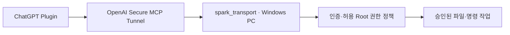

| 작업하는 곳 | 여기서 할 일 |
|---|---|
| **OpenAI Platform 웹사이트** | Tunnel 생성, Tunnel을 ChatGPT Workspace에 연결, Runtime API key 준비 |
| **Windows PowerShell** | SPARK 다운로드·초기화·설정·시작·상태 확인 |
| **ChatGPT Plugins 관리 화면** | MCP 서버를 Plugin으로 추가·인증하고 도구 10개를 확인 |

**용어 세 개만 기억하십시오.**

- **Tunnel ID** — OpenAI와 내 PC가 연결될 통로의 식별자입니다. `tunnel_...`로 시작합니다. 비밀번호가 아닙니다.
- **Runtime API key** — **내 PC의 Tunnel 프로그램**이 OpenAI에 접속할 때 쓰는 비밀키입니다. **MCP 연결 토큰으로 사용하지 않습니다.**
- **MCP Access Token** — ChatGPT가 **내 SPARK 서버**를 호출할 때 쓰는 별도 비밀번호입니다. `spk_...`로 시작하며 SPARK 초기화에서 생성됩니다.

### 1.1. 시작 전 준비

1. Windows 11에서 **PowerShell**을 엽니다. 시작 메뉴에서 `PowerShell`을 검색하면 됩니다.
2. **Git**과 **Node.js**가 설치되어 있는지 아래 명령으로 확인합니다. 명령을 찾을 수 없으면 [Git 공식 다운로드](https://git-scm.com/downloads/)와 [Node.js 공식 다운로드](https://nodejs.org/en/download)에서 Windows용 설치 프로그램을 준비합니다. **Node.js 24 LTS를 권장**하며, SPARK가 요구하는 최소 버전은 20입니다. 기존 Windows 시스템 구성요소를 변경하는 경우에는 적절한 복구 지점을 먼저 확보합니다.
3. ChatGPT Business/Enterprise/Edu Workspace의 **Custom MCP 서버 연결 권한**과 OpenAI Platform의 **Tunnel 권한**을 확인합니다.

```powershell
git --version
node --version
npm --version
```

**다음으로 진행할 조건:** 세 명령에서 버전이 표시되고, 현재 Workspace에서 Custom MCP 서버를 추가할 수 있어야 합니다. Business에서는 Workspace **관리자 또는 소유자**, Enterprise/Edu에서는 **관리자/소유자 또는 생성 권한이 부여된 사용자**가 필요합니다. 화면에 **Add custom MCP server**가 없으면 임의의 다른 연결을 만들지 말고 Workspace 권한을 확인합니다.

**이미 SPARK가 있는 PC라면:** 개인 설정과 인증정보는 Git에 들어 있지 않습니다. 설정·키·현재 실행 환경의 **검증된 복구 수단**을 마련하기 전에는 기존 설치에서 `init`·`start`·`restart`를 실행하거나 키를 새로 발급하지 않습니다. 아래는 **새 설치**를 기준으로 합니다.

## 2. OpenAI Platform에서 Tunnel 준비하기

**사용 장소:** Windows PowerShell이 아니라 **웹 브라우저**입니다.

### 2.1. Tunnel ID 만들기

1. 브라우저에서 [OpenAI Platform → Tunnels](https://platform.openai.com/settings/organization/tunnels)를 엽니다.
2. SPARK를 연결할 **Platform Organization**을 선택합니다.
3. Tunnel 생성 기능으로 새 Tunnel을 만듭니다. **생성 권한은 Tunnels Read + Manage**입니다.
4. 생성된 `tunnel_...` 값을 기록합니다. 나중에 SPARK 설정과 ChatGPT 양쪽에 **같은 ID**를 넣습니다.
5. Tunnel의 연결·접근 설정에서 **실제로 SPARK를 사용할 ChatGPT Workspace를 연결 대상으로 포함**합니다. Platform Organization만 연결하면 ChatGPT 쪽 목록에 나타나지 않을 수 있습니다.

**완료 확인:** Tunnel 목록에 방금 만든 ID가 보이고, 그 Tunnel이 사용할 ChatGPT Workspace와 연결돼 있어야 합니다.

### 2.2. Tunnel 실행용 Runtime API key 만들기

1. [OpenAI Platform → Runtime API keys](https://platform.openai.com/settings/organization/api-keys)를 엽니다.
2. **Restricted Runtime API key**를 만듭니다.
3. 그 키를 사용할 역할에 **Tunnels Read + Use** 권한이 있는지 확인합니다. 이 권한은 **Tunnel을 만드는 Read + Manage 권한과 다릅니다.**
4. 생성된 키를 외부 채팅·GitHub·스크린샷에 붙여 넣지 마십시오. 3.4에서 **내 PC의 키 파일**에만 저장합니다.

**완료 확인:** `tunnel_...` ID와 Runtime API key를 각각 확보했습니다. **MCP Access Token은 아직 만들지 않았어도 정상입니다.**

**공식 참고:** [OpenAI Secure MCP Tunnel](https://developers.openai.com/api/docs/guides/secure-mcp-tunnels). 이 방식은 **개인/Workspace용 비공개 MCP 연결**이며, 공개 Plugin 마켓플레이스 배포를 의미하지 않습니다.

## 3. Windows에 SPARK 설치하기

**사용 장소:** Windows PowerShell. 처음 설치할 때와 기존 설치에 다시 접속할 때의 시작 위치를 구분합니다.

| 상황 | 처음 해야 할 일 |
|---|---|
| 처음 설치 | 파일 탐색기에서 소스를 내려받을 **기존 빈 상위 폴더**를 열고 주소창에 `powershell`을 입력합니다. `3.1`의 `git clone`을 먼저 실행합니다. |
| 이미 Clone된 폴더 | SPARK 루트(`out`·`mod`가 보이는 폴더)에서 탐색기 주소창에 `powershell`을 입력합니다. |
| 새 PowerShell 창 | 항상 SPARK 루트로 이동한 뒤 `Test-Path .\out\SPARK.ps1`가 `True`인지 확인합니다. |

다음 명령은 저장소 루트인지 **읽기 전용**으로 검사합니다.

~~~powershell
Test-Path .\out\SPARK.ps1
~~~

`False`이면 SPARK 루트로 이동한 후 다시 검사해야 합니다.

### 3.1. 소스 내려받기

처음 설치할 때 파일 탐색기로 선택한 상위 디렉터리에서 다음을 실행합니다.

```powershell
git clone https://github.com/SPARK-SymbioticPersonalAIRoboticKeeper/SPARK.git
Set-Location .\SPARK
Test-Path .\out\SPARK.ps1
node -p "require('./out/package.json').version"
powershell.exe -NoProfile -ExecutionPolicy Bypass -File out\SPARK.ps1 --help
```

**완료 확인:** 버전 출력이 `0.0.3`이고 SPARK 사용법이 표시됩니다. 버전이 다르거나 명령이 실패하면 설치를 계속하지 않습니다. 여기서는 **`out/SPARK.ps1`을 인수 없이 실행하지 마십시오.** 무인수 실행은 실제 프로그램을 시작합니다.

### 3.2. 내 설정과 MCP Access Token 만들기

```powershell
powershell.exe -NoProfile -ExecutionPolicy Bypass -File out\SPARK.ps1 init
```

**완료 확인:** 출력에 설정 파일 생성과 Access Token 생성이 각각 `PASS`로 표시됩니다. 이미 파일이 존재하면 SPARK는 원본을 보존하도록 설계돼 있습니다. 누락·충돌 오류가 나면 키를 지우거나 덮어쓰지 마십시오.

### 3.3. SPARK가 접근할 폴더와 Tunnel ID 지정하기

먼저 방금 생성된 설정 파일을 엽니다.

```powershell
$configPath = (node --input-type=module -e "import { RUNTIME_CONFIG_PATH } from './mod/spark_transport/src/config.mjs'; console.log(RUNTIME_CONFIG_PATH)").Trim()
notepad.exe $configPath
```

메모장에서 **기존 JSON 전체를 지우지 말고**, 다음 **두 항목의 값만** 변경합니다.

| 찾을 항목 | 넣을 값 |
|---|---|
| `transport.allowedRoot` | SPARK가 읽거나 변경하도록 **내가 허용할 실제 Windows 폴더** |
| `tunnel.id` | 2.1에서 만든 **내 `tunnel_...` ID** |

먼저 **Windows 파일 탐색기 → 문서**에서 새 빈 폴더를 하나 만들고(예: `SPARK-Workspace`), 그 폴더를 연 뒤 탐색기 주소 표시줄을 클릭하여 **전체 폴더 경로를 복사**합니다. `Windows`나 `Program Files` 같은 시스템 폴더를 작업 폴더로 지정하지 마십시오.

첫 번째 값은 아래와 같은 **JSON 파일의 일부**입니다. `C:/SPARK/workspace` 대신 **방금 복사한 내 폴더 경로**를 넣으십시오(`\` 대신 `/`를 사용해도 됩니다). 나머지 JSON은 지우지 마십시오.

```json
"allowedRoot": [
  { "path": "C:/SPARK/workspace", "permissions": "RWX" }
]
```

**주의:** `C:/SPARK/workspace`는 설명용 예시입니다. **자신의 PC에 실제로 만든 폴더 주소**로 바꿉니다. 기본 설정에 작업 폴더가 여러 개 들어 있다면 **모든 폴더의 실제 존재 여부를 확인**하거나 사용하지 않을 항목을 `allowedRoot` 배열에서 정확하게 제거합니다. 쉼표와 `[]`가 깨지지 않도록 주의하십시오. `R`은 읽기, `W`는 쓰기, `X`는 명령 실행 권한입니다. 최소 권한만 부여하십시오. `tunnel.id`에는 2.1의 실제 ID를 넣습니다.

저장한 다음 JSON 문법과 작업 폴더 존재 여부를 검사합니다. 아래 명령은 키 값을 출력하지 않습니다.

```powershell
$cfg = Get-Content -LiteralPath $configPath -Raw | ConvertFrom-Json
foreach ($rootEntry in $cfg.transport.allowedRoot) {
  if (-not (Test-Path -LiteralPath $rootEntry.path -PathType Container)) { throw '설정된 작업 폴더가 없습니다.' }
}
$id = [string]$cfg.tunnel.id
if (-not $id.StartsWith('tunnel_') -or $id -match '^tunnel_x+$') { throw 'Tunnel ID가 기본 예시값이거나 유효하지 않습니다.' }
'CONFIG_OK'
```

**완료 확인:** `CONFIG_OK`가 표시되고, **설정한 Tunnel ID가 Platform에서 만든 실제 ID와 정확히 같은지 화면에서 직접 비교**합니다. 위 검사는 형식·작업 폴더 존재만 확인하며 OpenAI Tunnel 권한까지 입증하지 않습니다. 실패하면 해당 항목만 수정한 후 다시 검사합니다.

### 3.4. Runtime API key를 내 PC에 저장하기

아래 명령으로 SPARK가 사용하는 **Tunnel 키 파일**을 엽니다.

```powershell
$accessPath = (node --input-type=module -e "import { ACCESS_TOKEN_PATH } from './mod/spark_transport/src/config.mjs'; console.log(ACCESS_TOKEN_PATH)").Trim()
$runtimeKeyPath = Join-Path (Split-Path -Parent $accessPath) 'API_secret_key'
notepad.exe $runtimeKeyPath
```

1. 2.2에서 만든 **Runtime API key만 한 줄** 넣습니다.
2. 메모장에서 **저장**합니다. 기존 파일이 있었다면 **검증된 복구 수단을 확보한 뒤에만** 변경하십시오.
3. 다음 명령으로 파일 존재 여부만 확인합니다.

```powershell
if ((Test-Path -LiteralPath $runtimeKeyPath -PathType Leaf) -and ((Get-Item -LiteralPath $runtimeKeyPath).Length -gt 0)) { 'KEY_FILE_PRESENT' } else { 'KEY_FILE_MISSING' }
```

**완료 확인:** `KEY_FILE_PRESENT`가 나옵니다. 이것은 **파일이 있다는 뜻**일 뿐 OpenAI 인증 성공을 뜻하지 않습니다.

### 3.5. ChatGPT에 입력할 MCP Access Token 확인하기

`init`이 만든 **MCP Access Token**은 3.4의 Runtime API key와 **서로 다른 값**입니다.

```powershell
$accessPath = (node --input-type=module -e "import { ACCESS_TOKEN_PATH } from './mod/spark_transport/src/config.mjs'; console.log(ACCESS_TOKEN_PATH)").Trim()
if ((Test-Path -LiteralPath $accessPath -PathType Leaf) -and ((Get-Item -LiteralPath $accessPath).Length -gt 0)) { 'TOKEN_FILE_PRESENT' } else { 'TOKEN_FILE_MISSING' }
```

**완료 확인:** `TOKEN_FILE_PRESENT`가 표시됩니다. 지금은 **토큰을 복사할 필요가 없습니다.** ChatGPT가 입력을 요구할 때 5절에서 메모장으로 열겠습니다.

## 4. Windows에서 SPARK 시작하고 확인하기

### 4.1. 서버와 Tunnel 시작하기

**처음 설치하는 PC에서만**, 위 설정을 검증한 뒤 다음 명령을 실행합니다. 기존 서비스를 운영 중이라면 별도 복원 계획 없이 실행하지 않습니다.

```powershell
powershell.exe -NoProfile -ExecutionPolicy Bypass -File out\SPARK.ps1 start -SkipChatGPTUi
```

이 명령은 **spark_transport와 Tunnel을 시작**하고 필요한 Tunnel client를 준비합니다. `-SkipChatGPTUi`는 설치 중 ChatGPT Windows 앱과 사용자 화면에 영향을 최소화하기 위한 옵션입니다. 설치 과정에서 PC의 파일·프로세스 상태가 변경됩니다.

### 4.2. 연결 상태 확인하기

```powershell
powershell.exe -NoProfile -ExecutionPolicy Bypass -File out\SPARK.ps1 status
```

출력에서 **다음 두 줄을 확인**합니다. PID·Tunnel ID 같은 개인별 숫자는 다를 수 있습니다.

```text
[S2-STATUS-01] Transport service
running (..., healthy=True, auth=bearer)
[S2-STATUS-02] Tunnel readiness / identity
ready (identity=verified, ..., control-plane=ok)
```

| 보이는 결과 | 다음 행동 |
|---|---|
| spark_transport `healthy=True`, Tunnel `identity=verified` 및 `control-plane=ok` | **5절로 진행합니다.** |
| `not-running` 또는 `not-ready` | **7.5 Tunnel 문제**를 확인합니다. |
| `IDENTITY-MISMATCH` | **설정 ID와 실제 Tunnel이 다릅니다.** 임의로 재시작·강제 초기화하지 마십시오. |
| `auth=bearer`가 아님 | **연결 진행을 멈추고** MCP Access Token 설정을 확인합니다. |

**중요:** 이 결과가 정상이어도 아직 **ChatGPT에서 실제 도구가 동작한다는 뜻은 아닙니다.** 실제 확인은 6절입니다.

## 5. ChatGPT Plugins에 spark_transport 연결

**등록 장소:** 현재 공식 Custom MCP 연결 생성은 [ChatGPT Plugins](https://chatgpt.com/plugins)의 지원되는 웹 인터페이스에서 수행합니다. 이는 **Plugin 연결을 관리하는 단계**이며, SPARK의 주된 Windows ChatGPT 앱 통합 기능과는 구별합니다. 사용 중인 계정에서 해당 관리자 화면을 제공하지 않으면 권한부터 확인합니다.

### 5.1. 먼저 내 화면의 시작 메뉴를 확인하기

[ChatGPT Plugins](https://chatgpt.com/plugins)를 열고 **2.1에서 Tunnel과 연결한 ChatGPT Workspace**를 선택합니다.

| 화면에 보이는 버튼 | 따라 할 절차 |
|---|---|
| **`+ → Add custom MCP server`** | **5.2**의 현재 Plugins 절차로 갑니다. |
| **`Apps → Create`** 또는 **Drafts / Publish** | **5.3**의 화면 사진을 보며 진행합니다. |

**둘을 동시에 실행하지 마십시오.** 같은 SPARK에 중복 앱을 만들 필요가 없습니다. 버튼이 없으면 [7.1 권한 문제](#71-추가-버튼이-없습니다)부터 확인합니다.

### 5.2. Plugins에서 바로 추가하는 화면이라면

현재 공식 ChatGPT 연결 절차입니다. 아래에는 **실제 확보하지 않은 현재 UI 화면 이미지를 붙이지 않았습니다.**

1. **Plugins → `+` → Add custom MCP server**를 누릅니다.
2. **Name**에 `SPARK`를 입력하고 설명에는 `Windows local MCP tools`처럼 알아보기 쉬운 설명을 입력합니다.
3. **Connection**에서 **Tunnel**을 선택하고 2.1에서 생성한 **같은 Tunnel ID**를 선택하거나 입력합니다.
4. **Authentication**에서 SPARK 서버가 요구하는 **고정 Access token / API key + Bearer** 방식을 제공하는지 확인합니다. **해당 옵션이 실제로 제공되는 경우에만** 선택합니다. **OAuth만 있거나 No authentication만 있는 화면에서는 여기서 중단**합니다. SPARK가 제공하지 않는 OAuth 설정을 임의로 만들거나 `No authentication`을 선택해서 Bearer 보호를 해제하면 안 됩니다. 현재 Plugins 화면에서 고정 토큰 연결을 지원하는지 **실제 계정 검증은 아직 끝나지 않았습니다**.
5. **4번의 호환 가능한 인증 옵션이 확인됐을 때만**, 위험 안내를 읽고 **I understand and want to continue**를 체크한 뒤 **Create as a plugin**을 누릅니다.
6. 발견된 **Tools/Actions가 10개인지** 확인하고, 만들어진 Plugin 상세정보에서 **Install**을 눌러 설치·활성화합니다. Workspace 승인 대기 상태라면 권한 있는 관리자의 승인을 받습니다.
7. 생성·설치 또는 **Connect** 과정에서 **Access Token 입력란이 나타나면**, 아래 방법으로 **MCP Access Token만** 입력합니다. 인증을 묻지 않은 경우에도 실제 호출이 실패하면 7.3절을 확인합니다.
8. 새 채팅에서 `@SPARK`를 찾아 선택한 뒤 **6절의 실제 도구 시험**을 수행합니다. 연결 표시만으로 설치 완료로 판정하지 않습니다.

**토큰 입력이 필요한 경우:** Windows 파일 탐색기에서 SPARK 프로젝트 폴더를 열어 **3절의 방법으로 그 위치에서 PowerShell을 연 다음** 아래를 실행합니다. 다른 PowerShell을 닫았어도 이 방법이면 정상적으로 찾아갑니다.

```powershell
$accessPath = (node --input-type=module -e "import { ACCESS_TOKEN_PATH } from './mod/spark_transport/src/config.mjs'; console.log(ACCESS_TOKEN_PATH)").Trim()
notepad.exe $accessPath
```

파일에서 `spk_...` **한 줄만** Connect/Access Token 입력창에 붙여 넣습니다. `Bearer `라는 글자나 **Runtime API key**는 입력하지 않습니다.

**완료 확인:** 고정 Bearer 인증 방식이 제공되고 `SPARK` 연결에서 도구 10개가 실제 탐색되는 경우에만 다음으로 진행합니다. **인증 옵션 부재, 도구 0개, 권한 비활성, 401 오류는 실패 또는 BLOCKED**입니다. 완료라고 판단하지 말고 7절에서 원인을 확인합니다.

**계정·버튼별 공식 기준:** [OpenAI — Custom MCP server 연결](https://help.openai.com/en/articles/12584461-connecting-custom-mcp-servers-in-chatgpt) 및 [Plugin 인증 방식](https://developers.openai.com/plugins/build/plugins). **현행 화면의 고정 Bearer Token 입력 지원 여부는 공식 문서만으로 확인되지 않습니다.** 화면에 없는 기능을 가정하거나 별도 앱을 중복 등록하지 마십시오.

### 5.3. Apps / Drafts 화면이 보이는 경우 — 실제 사진 순서대로

**이 절은 `Apps → Create` 화면을 쓰는 계정 전용**입니다. 현재 화면이 `Add custom MCP server`라면 **5.2만** 따르십시오. 아래 사진들은 **각 단계를 실행하는 자리에서** 확인합니다. 사진을 클릭하면 원본 크기로 열립니다.

#### 5.3.1. Apps 화면에서 Create 누르기

1. Workspace의 **Apps** 화면을 엽니다.
2. 화면 오른쪽 위 **Create**를 누릅니다. 이때는 새 앱 입력창만 열립니다.

[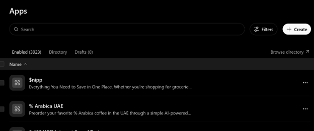](png/Picture1.png)

**정상:** `New App` 입력창이 나옵니다. **아직 Draft가 생성된 것은 아닙니다.**

#### 5.3.2. New App에 Tunnel과 인증 방식 입력하기

1. **Name**에 `SPARK` 또는 본인이 정한 알아보기 쉬운 이름을 입력합니다.
2. **Connection → Tunnel**을 선택합니다.
3. **Available tunnels**에서 2.1의 Tunnel을 고르거나 **Use tunnel ID instead**에서 같은 ID를 넣습니다.
4. **Authentication → Access token / API key**, **Header scheme → Bearer**를 선택합니다.
5. 보안 위험 경고를 읽고 **I understand and want to continue**를 체크합니다.
6. 입력값을 확인한 뒤 화면 하단 **Create**를 누릅니다.

[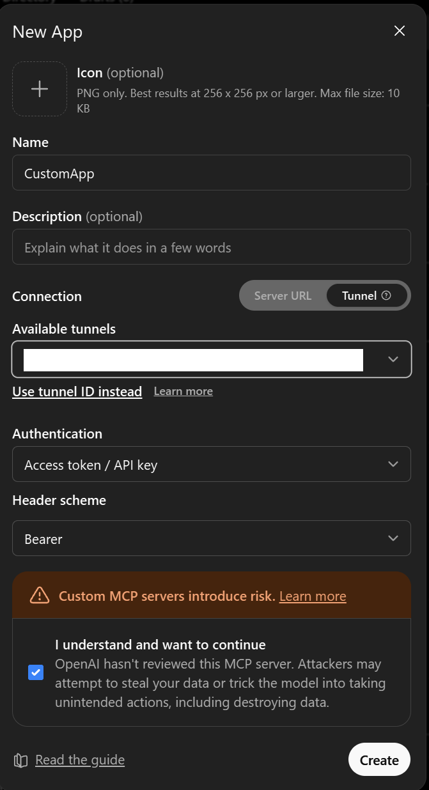](png/Picture2.png)

**정상:** 앱이 **Draft**로 생성됩니다. 이 화면에는 **Access Token 값 입력 칸이 없을 수 있습니다.** 이때 `spk_...` 값을 아무 필드에도 붙이지 마십시오. **5.3.11 Connect 화면에서 입력**합니다.

#### 5.3.3. Draft 목록에 내 앱이 생겼는지 확인하기

1. Apps 화면의 **Drafts**를 누릅니다.
2. 방금 정한 이름의 앱이 목록에 표시되는지 확인합니다.

[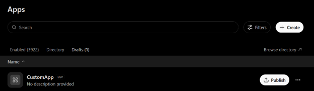](png/Picture3.png)

**정상:** 앱 이름 옆에 Draft/Dev 상태가 보입니다. 아직 다른 사용자에게 게시되거나 연결된 것은 아닙니다.

#### 5.3.4. Publish 위험 안내 검토하기

1. Draft 앱의 **Publish**를 누릅니다.
2. 권한과 데이터 접근 위험에 관한 **모든 검토 항목**을 엽니다.
3. 실제 위험을 확인하고 Workspace 정책에 따라 게시합니다. **관리자·소유자만 Publish할 수 있습니다.**

[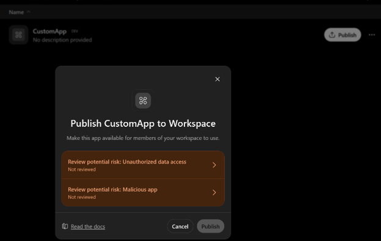](png/Picture4.png)

**정상:** 필요한 검토가 완료돼야 `Publish`가 활성화됩니다. 경고를 읽지 않고 승인하지 마십시오.

#### 5.3.5. 게시된 앱이 목록에 있는지 확인하기

1. 다시 Apps의 **Enabled** 또는 게시된 앱 목록을 엽니다.
2. 자신이 만든 앱을 찾습니다.

[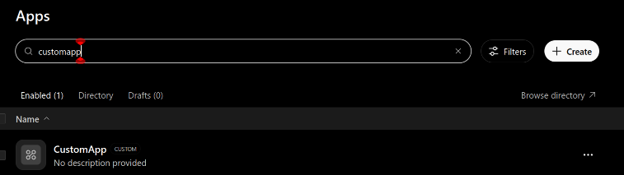](png/Picture5.png)

**정상:** Draft 목록에만 남아 있지 않고 Workspace에서 사용할 수 있어야 합니다. **목록 표시만으로 MCP 연결 성공은 아닙니다.**

#### 5.3.6. 앱 상세 메뉴 열기

1. 앱 오른쪽의 **•••**를 누릅니다.
2. **View details** 또는 **Manage app**을 선택합니다.

[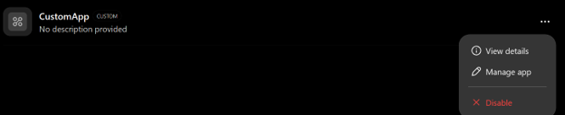](png/Picture6.png)

**정상:** 앱 상세정보와 **Actions** 항목을 확인할 수 있습니다.

#### 5.3.7. Actions가 비어 있으면 성공으로 넘기지 않기

상세 화면에서 **Actions**를 확인합니다.

[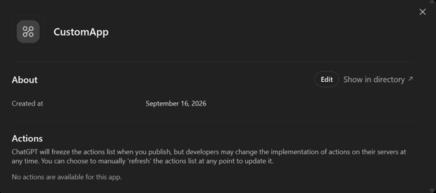](png/Picture7.png)

**이 사진의 상태는 실패 예시입니다.** `No actions are available`가 보이면 SPARK 도구가 발견되지 않은 것입니다. **4.2의 Tunnel 상태와 5.3.2의 연결 설정**을 먼저 다시 확인하고, 관리자의 **Refresh/도구 재검색** 기능이 있는 경우 실행합니다. **도구 10개를 확인하기 전에는 6절의 테스트를 성공 처리하지 않습니다.**

#### 5.3.8. Plugins 목록에서 내 앱 찾기

1. [Plugins](https://chatgpt.com/plugins)를 엽니다.
2. 검색창에 5.3.2에서 입력한 **앱 이름**을 입력합니다.

[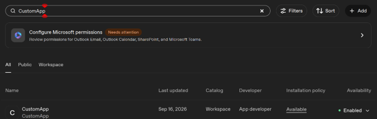](png/Picture8.png)

**정상:** 같은 이름의 앱이 검색됩니다. 이름이 같아도 다른 앱일 수 있으므로 상세정보까지 확인합니다.

#### 5.3.9. 앱 사용 권한과 Actions 확인하기

1. Plugin 설정에서 **Availability / Permissions / Actions**를 확인합니다.
2. **Actions = None enabled**라면 권한 관리 화면에서 필요한 도구를 활성화합니다.
3. Workspace 권한상 직접 활성화할 수 없다면 관리자에게 요청합니다.

[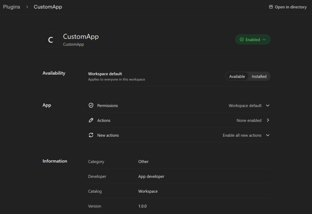](png/Picture9.png)

**이 사진의 `None enabled`도 완료 상태가 아닙니다.** 설치 후 사용할 MCP 도구 10개가 발견되고, 필요한 Actions가 실제 활성화됐는지 확인해야 합니다.

#### 5.3.10. Connect 버튼 누르기

1. Plugin 상세 페이지로 이동합니다.
2. 화면의 **Connect**를 누릅니다.

[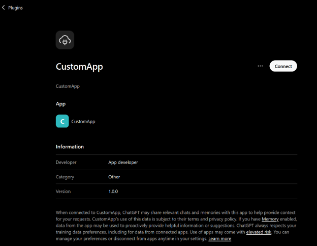](png/Picture10.png)

**정상:** MCP Access Token 입력 대화상자가 열립니다.

#### 5.3.11. MCP Access Token 붙여 넣고 연결하기

1. Windows **파일 탐색기**에서 SPARK 프로젝트 폴더(`out`과 `mod`가 있는 폴더)를 열고, 주소 표시줄에 `powershell`을 입력한 후 Enter를 누릅니다. 새 PowerShell에서 `Test-Path .\out\SPARK.ps1`이 `True`인지 확인한 뒤 다음 두 줄을 실행합니다. 이전 PowerShell을 닫았어도 같은 방법으로 다시 열 수 있습니다.

   ```powershell
   $accessPath = (node --input-type=module -e "import { ACCESS_TOKEN_PATH } from './mod/spark_transport/src/config.mjs'; console.log(ACCESS_TOKEN_PATH)").Trim()
   notepad.exe $accessPath
   ```

2. 파일에서 `spk_...`로 시작하는 **토큰 한 줄만** 복사합니다.
3. 브라우저의 **Connect** 창에 토큰만 붙여 넣습니다.
4. **Connect SPARK** 또는 **Connect <내 앱 이름>**을 누릅니다.

[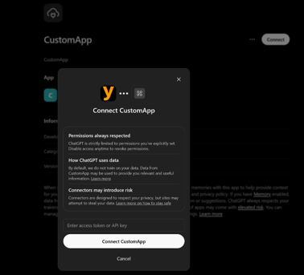](png/Picture11.png)

**정상:** Connect 창이 닫히고 연결 상태가 **Connected**로 바뀝니다. 비밀번호 입력란이 점으로 가려지는 것은 정상입니다. **`Bearer spk_...` 전체를 넣지 말고 `spk_...` 값만** 넣습니다.

**이제 6절로 진행합니다.** 다시 Create/Publish할 필요는 없습니다.

## 6. ChatGPT Plugin Smoke test

지금부터는 **연결 표시가 아닌 실제 동작**을 검사합니다.

### 6.1. 새 채팅에서 SPARK 선택하기

1. Plugin이 활성화된 지원되는 ChatGPT 대화에서 **새 대화**를 시작합니다.
2. 메시지 입력창에 `@`를 입력하고 **설치한 SPARK Plugin**을 선택합니다.
3. SPARK가 제공하는 **다음 이름의 도구 10개**를 확인합니다.

| 번호 | 도구 | 기능 |
|---|---|---|
| 1 | `list_directory` | 폴더 안 보기 |
| 2 | `read_file` | 파일 읽기 |
| 3 | `create_file` | 새 파일 만들기 |
| 4 | `write_file` | 파일 내용 바꾸기 |
| 5 | `modify_file` | 특정 문자열만 바꾸기 |
| 6 | `create_directory` | 새 폴더 만들기 |
| 7 | `copy_path` | 복사 |
| 8 | `move_path` | 이동 |
| 9 | `delete_path` | Windows 휴지통으로 이동 |
| 10 | `run_command` | 허용된 Windows 명령 실행 |

**정상:** 이름과 개수가 모두 일치하고 사용할 권한도 있어야 합니다. 앱이 검색되기만 하거나 Actions가 0개라면 실패입니다.

### 6.2. 파일 만들기 → 읽기 → 수정 → 다시 읽기

**3.3에서 허용한 테스트용 폴더**만 사용합니다. 그 폴더에 이미 같은 이름의 파일이 있으면 **새로운 고유 파일명**으로 바꾸십시오. 다른 사람의 파일을 덮어쓰지 마십시오.

ChatGPT에 한 번에 전부 맡기지 말고 **아래 요청을 하나씩 입력하고 결과를 확인**합니다.

1. `create_file` 사용 요청: **“SPARK가 허용한 작업 폴더에 spark_smoke_test.txt라는 새 파일을 만들고 내용은 SPARK_SMOKE_1로 저장하십시오. 같은 이름의 파일이 이미 있으면 덮어쓰지 마십시오.”**
   **정상:** 새 파일 생성 성공.
2. `read_file` 사용 요청: **“방금 만든 파일을 읽어 내용을 그대로 보여 주십시오.”**
   **정상:** 정확히 `SPARK_SMOKE_1`.
3. `modify_file` 사용 요청: **“그 파일에서 SPARK_SMOKE_1을 SPARK_SMOKE_2로 한 번만 바꾸십시오.”**
   **정상:** 수정 성공.
4. `read_file` 사용 요청: **“파일을 다시 읽어 내용을 확인하십시오.”**
   **정상:** 정확히 `SPARK_SMOKE_2`.

### 6.3. 명령 실행 확인하기

ChatGPT에 다음을 입력합니다.

> `run_command 도구로 cmd.exe를 실행하고 args=["/d","/c","echo SPARK_SMOKE_OK"]를 전달하십시오. cwd는 허용한 작업 폴더를 사용하십시오. 다른 명령은 실행하지 마십시오.`

**정상:** `exitCode=0`, 출력에 `SPARK_SMOKE_OK`가 있습니다. 실행 권한 `X`를 주지 않았다면 이 검사는 실패할 수 있습니다.

### 6.4. 테스트 파일 정리하고 결과 판정하기

앞에서 **내가 방금 만든 테스트 파일이라는 사실과 원복 가능성을 확인한 뒤에만** ChatGPT에 다음을 요청합니다.

> `방금 생성한 spark_smoke_test.txt를 delete_path로 Windows 휴지통에 이동하고, list_directory로 원래 작업 폴더에 더 이상 없는지 확인하십시오. 다른 파일은 삭제하지 마십시오.`

**정상:** 새로 만든 테스트 파일만 휴지통에 있고 원래 작업 폴더에 없습니다. 휴지통으로 옮겼다고 영구 삭제된 것은 아닙니다.

**설치 완료 판정:** spark_transport Health 정상, Tunnel Identity/Control Plane 정상, Plugin Connected/도구 10개, Create→Read→Modify→Read, 명령 실행, 휴지통 이동까지 **모두 성공**해야 합니다. **하나라도 실패하면 “설치 완료”로 표시하지 마십시오.**

## 7. 문제가 생겼을 때 (FAQ)

### 7.1. 추가 버튼이 없습니다

- **Plugins에서 Add custom MCP server가 보이지 않는 경우:** 올바른 ChatGPT Workspace를 선택했는지 확인합니다. Business는 관리자/소유자, Enterprise/Edu는 관리자 또는 생성 권한이 필요합니다.
- **Apps → Create만 보이는 경우:** 버튼을 임의로 찾지 말고 **5.3**의 실제 사진 절차를 사용합니다.
- **Tunnel이 목록에 없는 경우:** 2.1의 Tunnel이 **해당 ChatGPT Workspace에 연결됐는지**, 그리고 운영자에게 **Tunnels Read + Use**가 있는지 확인합니다.

### 7.2. Scan Tools 버튼이 안 보입니다

**현재 Plugins 화면**에서는 `Create as a plugin` 후 발견된 도구를 검토합니다. **Apps 화면**에 `Scan Tools` 버튼이 있다면 그 버튼을 이용하고, 없다면 해당 화면의 정상 생성 절차를 진행합니다. 버튼이 없는 것을 성공으로 간주해서는 안 되며 **결국 10개 도구를 확인**해야 합니다.

### 7.3. 401 Unauthorized가 나옵니다

**가장 먼저 두 비밀키를 구분**합니다.

| 어디에 쓰는 값인가 | 입력할 값 |
|---|---|
| PC의 Tunnel 프로그램 | **OpenAI Runtime API key** |
| ChatGPT의 MCP 인증/Connect 입력란 | **SPARK MCP Access Token (`spk_...`)** |

Windows 파일 탐색기로 SPARK 폴더를 열고 **3절의 방법으로 그 폴더에서 PowerShell을 시작**한 뒤 **5.3.11절의 두 줄짜리 경로 조회·메모장 실행 명령**으로 MCP Token을 확인합니다. **정의되지 않은 `$accessPath` 변수를 그대로 실행하지 마십시오.** **`Bearer `라는 글자와 다른 사용자의 토큰, Tunnel Runtime API key를 붙여 넣지 않습니다.** 키를 화면에 인쇄하거나 채팅으로 전송하지 마십시오.

### 7.4. Connect에서 Failed to add connector link가 나옵니다

1. 4.2의 `status`를 다시 확인합니다.
2. ChatGPT의 **Tunnel ID**가 PC 설정의 `tunnel.id`와 같은지 확인합니다.
3. **Authentication = Access token / API key**, **Header scheme = Bearer**인지 확인합니다.
4. 해당 Workspace가 Tunnel에 연결돼 있는지 확인합니다.
5. Connect 창이 있으면 **SPARK MCP Access Token만** 다시 넣고 결과를 확인합니다.

실패 메시지만으로 원인을 확정하지 않습니다. 같은 실패가 반복되면 무작정 키나 Tunnel을 지우지 말고 현재 오류를 기록하고 관리자에게 확인합니다.

### 7.5. Tunnel이 not-ready 또는 IDENTITY-MISMATCH입니다

- `not-ready`: 내 PC에 인터넷 연결이 있는지, Runtime API key에 **Tunnels Read + Use**가 있는지, 2.1의 Tunnel ID를 사용했는지 확인합니다.
- `IDENTITY-MISMATCH`: 현재 설정과 실제 실행 중인 Tunnel이 다른 상태입니다. **임의 강제 재시작이나 파일 삭제를 하지 마십시오.** 원래 설정과 실행 상태를 확인해 원복 계획을 확보합니다.
- spark_transport가 꺼져 있다면 4.1의 시작 절차를 **새 설치라는 조건에서만** 확인합니다. 기존 서비스에 대한 무단 재시작은 금지합니다.

### 7.6. 앱을 만들었지만 새 채팅에서 안 보입니다

1. 올바른 **ChatGPT Workspace**를 선택합니다.
2. Plugin이 **설치/활성화**됐는지 확인합니다.
3. **Apps 화면**을 쓰는 경우 **Draft만 생성한 것인지**, 권한 있는 관리자가 **Publish**까지 완료했는지 확인합니다.
4. 새 채팅을 열고 `@`로 정확한 앱 이름을 검색합니다.
5. 그래도 없으면 등록/권한/게시 상태를 확인할 때까지 성공이라고 판단하지 않습니다.

### 7.7. 앱 이름은 있지만 도구가 0개이거나 None enabled입니다

1. **4.2 서버·Tunnel 정상**부터 확인합니다.
2. 앱 상세의 **Actions/Tools**가 실제로 몇 개인지 확인합니다.
3. 관리자 기능에 **Refresh**가 있으면 SPARK 연결 상태가 정상인 상황에서 다시 탐색합니다.
4. 도구가 검색됐어도 **None enabled**라면 필요한 Actions를 활성화합니다.
5. 10개 중 누락이 있다면 “설치 완료”가 아니라 **도구 검색/권한 실패**입니다.

### 7.8. 삭제한 예전 Plugin 이름이 아직 검색됩니다

1. Workspace Plugins와 Apps/Drafts/Enabled, 개인 Plugin 연결 목록을 각각 확인합니다.
2. 다른 이름이나 똑같은 이름의 중복 등록이 있는지 확인합니다.
3. 브라우저 새로고침 후 새 채팅에서 다시 검색합니다.
4. 계속 남아 있으면 오래된 Workspace 목록일 수 있습니다. **실제 서버가 재등록했다고 단정하거나 새 App을 반복 생성하지 마십시오.** Workspace 관리자에게 확인합니다.

### 7.9. 현행 Plugins 화면에 고정 Access Token/Bearer 옵션이 없습니다

**현재 연결 방식의 인증 호환성 미검증(BLOCKED)** 상황입니다. SPARK는 고정 Bearer Token을 요구하며, 현행 ChatGPT Plugins의 계정별 UI에서 해당 인증 방식을 제공하는지는 공식 안내만으로 확정할 수 없습니다.

1. **OAuth** 또는 **No authentication**만 보이면 SPARK 설정을 변경하지 말고 설치를 중단합니다.
2. SPARK 서버의 인증을 끄거나, 임의의 OAuth 자격증명을 생성하거나, Runtime API key를 MCP 인증란에 넣지 않습니다.
3. Workspace 관리자와 함께 실제 연결 화면·권한·지원 인증 방식을 확인합니다. 별도 Apps 관리 화면이 제공되는 계정이라도 이미 생성한 Plugin과 중복 등록하지 말고 연결 상태부터 검사합니다.
4. 호환 가능한 인증 방식을 확인하기 전에는 **원격 도구 시험을 PASS로 기록하지 않습니다.**

## 8. 설치 후 선택 사항과 안전 원칙

### 8.1. ChatGPT Windows 앱과 함께 사용하기

Plugin 연결을 준비한 다음 Windows ChatGPT 앱에서 **spark_ui**, **spark_log**, **spark_cii**를 사용할 수 있습니다. 각 모듈은 독립 설정과 실행 절차가 있으므로 해당 매뉴얼을 따르십시오.

```powershell
powershell.exe -NoProfile -ExecutionPolicy Bypass -File out\SPARK.ps1 --help
powershell.exe -NoProfile -ExecutionPolicy Bypass -File out\SPARK.ps1 status
```

**무인수 `SPARK.ps1` 실행은 서비스·Tray를 시작합니다.** 사용법만 확인하려면 반드시 `--help`를 입력하십시오. Windows 자동 시작은 로그인 이후만 적용되며 변경 전 Windows 복원 지점과 Startup 항목 복원 수단을 확보해야 합니다.

### 8.2. 데이터와 권한을 안전하게 관리하기

- `transport.allowedRoot`에는 필요한 폴더만 넣고 `R/W/X` 권한을 최소화합니다.
- 인증정보는 Git·README·스크린샷에 넣지 않습니다.
- **`delete_path`는 휴지통 이동**이고 `run_command`는 OS 전체 샌드박스가 아닙니다.
- 기존 파일 변경·삭제·설정 변경은 **검증된 원복 수단이 없으면 진행하지 않습니다.**
- 정상 상태를 주장할 때는 **실제 도구 실행 결과**를 확인합니다. 서버가 켜졌다는 사실과 작업 성공을 구분합니다.

### 8.3. 고급 사용자용 로컬 전체 검사

**처음 설치하는 사람은 6절의 ChatGPT 실사용 시험만 따라 하면 됩니다.** 아래는 개발자나 관리자가 추가로 수행하는 **로컬 자동 검사**입니다. 별도 PowerShell 창을 열었다면 **3절 방법으로 SPARK 폴더에서 실행**하십시오.

새로 복제한 저장소의 임시 검사 디렉터리는 테스트 실행기가 필요할 때 생성합니다. **다른 곳에서 실행 중인 기존 SPARK의 세션·사용자 데이터는 건드리지 마십시오.**

```powershell
npm --prefix out test
npm --prefix out run chatgpt-ui:validate
```

이 두 명령의 성공은 **원격 ChatGPT 연결 성공이 아니라 자동 테스트 성공**입니다.

`SPARK.ps1 validate`는 단순 상태 확인이 **아닙니다.** 허용된 작업 폴더에 시험용 파일과 디렉터리를 만들고, 수정·명령 실행·휴지통 이동을 수행합니다. **해당 작업 폴더를 전용 테스트 공간으로 지정하고 복구 수단을 확인한 경우에만** 다음을 실행하십시오.

```powershell
powershell.exe -NoProfile -ExecutionPolicy Bypass -File out\SPARK.ps1 validate
```

### 8.4. Windows Tray와 자동 시작 (선택)

Windows 앱과 SPARK를 함께 사용할 때의 선택 기능입니다. 아래 명령은 **SPARK 설치 폴더에서 PowerShell을 열었을 때** 사용합니다.

- `out/SPARK.vbs`는 화면에 PowerShell 창을 오래 남기지 않고 SPARK를 시작하는 진입점입니다.
- Windows에서 `out/SPARK.ps1`을 **인수 없이 실행하면 실제 서비스 시작을 요청**합니다. 상태 확인용으로 사용하지 마십시오.
- Windows 로그인 후 자동 시작을 사용하려면 아래 `autostart` 옵션이 있습니다. **ON/OFF는 Windows 시작 프로그램 항목을 변경하므로**, 설정 변경 전 대상 항목 백업과 Windows 시스템 복원 지점을 확보하고 복구 가능 여부를 확인해야 합니다.

```powershell
powershell.exe -NoProfile -ExecutionPolicy Bypass -File out\SPARK.ps1 autostart status
powershell.exe -NoProfile -ExecutionPolicy Bypass -File out\SPARK.ps1 autostart on
powershell.exe -NoProfile -ExecutionPolicy Bypass -File out\SPARK.ps1 autostart off
```

`autostart status`는 상태 확인, `on`/`off`는 설정 변경입니다. AutoStart는 **Windows 사용자 로그인 이후**만 적용됩니다. 재부팅 전 로그인 화면이나 로그인 전 실행을 보장하지 않습니다.

**자세한 기술 자료:** [아키텍처](ARCH.md) · [QGate](ARCH_QGate.md) · [릴리스 기준](RELEASE.md) · [공식 MCP 연결 안내](https://help.openai.com/en/articles/12584461-connecting-custom-mcp-servers-in-chatgpt) · [공식 Secure MCP Tunnel](https://developers.openai.com/api/docs/guides/secure-mcp-tunnels)
